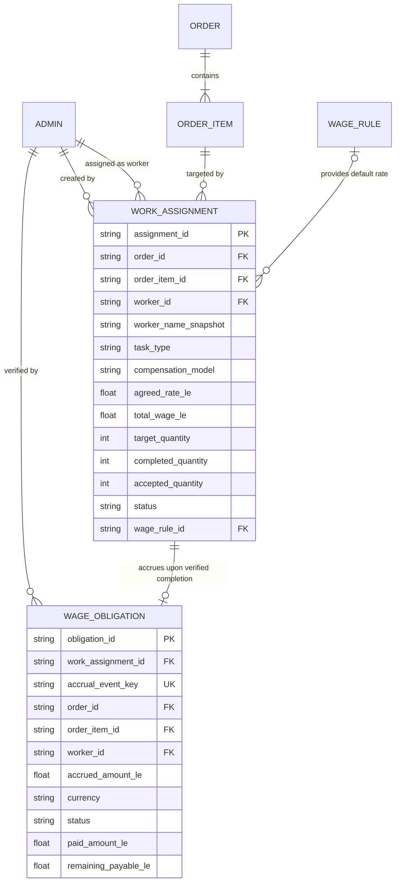
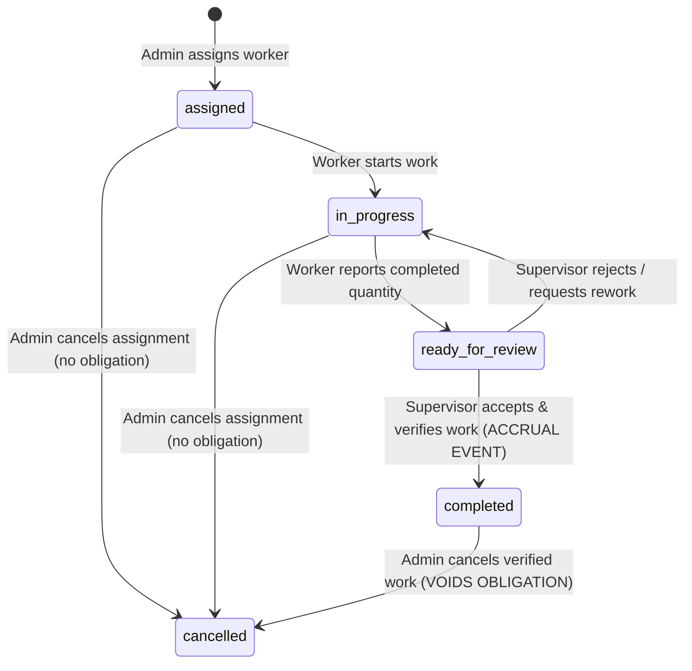
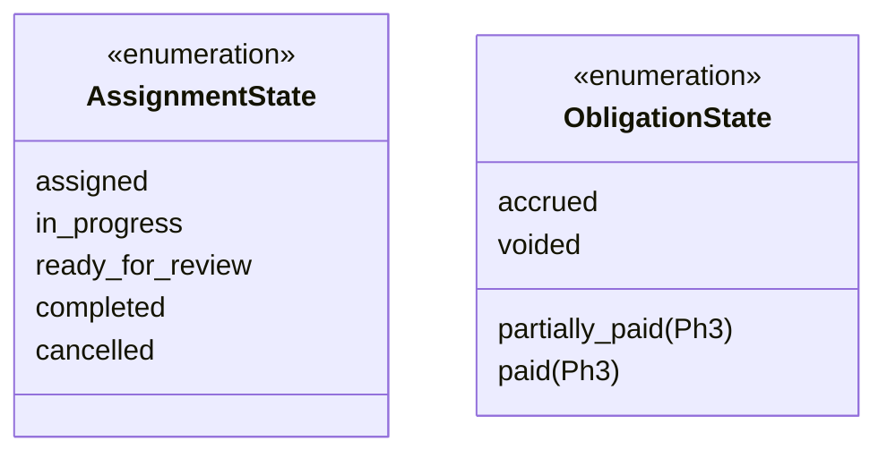

# SOGIL FURNITURE
# PHASE 2 ARCHITECTURE & SCOPE LOCK v1.1
## WORK ASSIGNMENTS & PRODUCTION PIECE-RATE

---

## 1. Executive Summary

This document establishes the authoritative architectural contract for **Phase 2 — Work Assignments & Production Piece-Rate** of the Sogil Furniture management platform. Building directly on the verified Phase 1 baseline (`65a8f14`, *Order-Payment Core*), Phase 2 governs the operational execution of manufacturing: assigning craftsmen/workers to order items, calculating piece-rate and task wages against configurable rules, recording verified completion, and accruing immutable wage obligations.

The primary objective of Revision v1.1 is to eliminate the architectural gaps identified in v1.0. Specifically, v1.1 defines:
1. **Accrual Event Identity & Idempotent Concurrency**: A durable, unique compound key mechanism that prevents double-accrual under concurrent completion requests, network retries, and partial write failures.
2. **Explicit Compensation Models**: Rigorous separation between per-accepted-unit piece rates (`piece_rate`), fixed-job borongan rates (`fixed_job`), and manual negotiated rates (`manual_fixed`), ensuring fixed amounts are never multiplied by quantity.
3. **Decoupled Payout Boundary**: Strict adherence to the financial conservation law:
   $$\text{Assignment} \to \text{Completion Report} \to \text{Supervisor Verification} \to \text{Wage Obligation Accrued} \not\to \text{Cash Movement}$$
   Actual wage disbursement (Cash-Out) remains entirely deferred to Phase 3, guaranteeing zero cash movements in Phase 2 and zero mutation of historical `db.employee_wages` records.
4. **Stable Order Item Identity**: A deterministic backward-compatible identifier schema (`item_id`) across checkout, invoices, and edits, eliminating shifting array index references.
5. **Supervisor Verification & Role Governance**: A clear operational workflow where employees report completion, but only authorized supervisors/admins verify acceptance and trigger wage accrual.
6. **HPP Costing Readiness**: Comprehensive preservation of historical labor cost facts (worker ID, rate snapshot, completed quantity, timestamp, order item link) without implementing premature cost valuation engines.

---

## 2. Revision History from v1.0

| Issue / Topic | v1.0 Flaw / Gap | v1.1 Resolution |
| :--- | :--- | :--- |
| **Concurrency & Double Accrual** | Simple query check (`find_one`) vulnerable to race conditions | Compound unique index on `(work_assignment_id, accrual_event_key)` + atomic conditional update (`find_one_and_update`) |
| **Compensation Models** | Formula naively multiplied `agreed_rate_le * target_quantity` for all types | Explicit `compensation_model` field (`piece_rate`, `fixed_job`, `manual_fixed`) with distinct calculation formulas |
| **Cancellation & Partial Work** | Binary cancellation that voided obligations without handling partial work | Fine-grained lifecycle: partial completions accrue only accepted pieces; cancellations preserve audit trail and prohibit silent voiding |
| **Order Item Identification** | Assumed item IDs existed; actual code used raw embedded array without keys | Additive `item_id` generation (`itm_<uuid12>`) in checkout & invoice conversion, with lazy hash fallback for legacy orders |
| **Supervisor Verification** | Left ambiguous whether workers self-approve | Explicit default: Worker reports `ready_for_review`, Supervisor verifies `accepted` $\to$ triggers accrual |
| **Assignment Granularity** | Optional free-text task string | Controlled task categories (`whole_item`, `assembly`, `finishing`, `cutting`, `custom`) supporting 0–3+ workers per item |
| **Future Payout Boundary** | Mentioned future payout without reconciliation safeguards | Strict data model isolation: Phase 2 writes zero finance transactions; payout engine and cash-out integration formally deferred to Phase 3 |

---

## 3. Verified Baseline and Git State

- **Repository Root**: `/Users/syahidmujahid/Sogil-Project/Sogil-Furniture`
- **Active Branch**: `main`
- **Verified HEAD Commit**: `65a8f14d002304a7f67d92f256487dd4b00ddc42`
- **Verified Remote `origin/main`**: `65a8f14d002304a7f67d92f256487dd4b00ddc42`
- **Commit Subject**: `feat(order): implement phase 1 order payment core`
- **Working Tree State**:
  ```text
  ?? backend/tests/test_migrate_legacy_inventory_units.py
  ?? scripts/migrate_legacy_inventory_units.py
  ```
  *(Pre-existing legacy migration files preserved untouched; 0 tracked modifications)*
- **Production Status**:
  - Railway Backend: Live on `65a8f14` (`https://sogil-furniture-production.up.railway.app`)
  - Cloudflare Pages Frontend: Live on `65a8f14` (`https://sogilfurniture.com`, `https://team.sogilfurniture.com`)
  - Production DB: MongoDB Atlas (READ-ONLY during this audit)

---

## 4. Evidence and Confidence Classification

Every architectural statement in this document is explicitly classified into one of five rigor categories:
1. **[VERIFIED FACT]**: Directly proven by repository inspection with file path and line numbers.
2. **[DESIGN PROPOSAL]**: Proposed Phase 2 architectural specification designed to meet requirements.
3. **[ASSUMPTION]**: Inferred from surrounding patterns; documented for validation.
4. **[USER DECISION REQUIRED]**: Business policy requiring explicit owner confirmation before build.
5. **[DEFERRED]**: Explicitly excluded from Phase 2 and reserved for subsequent phases.

---

## 5. Existing Architecture Findings

### A. Order and Order-Item Persistence [VERIFIED FACT]
- **Orders Collection**: `db.orders`.
- **Embedded Items Structure**: Items are persisted as an embedded array `items: List[dict]` and duplicated into a legacy singular `item: dict` mirror ([`server.py#L1623`](file:///Users/syahidmujahid/Sogil-Project/Sogil-Furniture/backend/server.py#L1623)).
- **Item Identification Deficit**:
  - In public checkout ([`server.py#L1566-L1572`](file:///Users/syahidmujahid/Sogil-Project/Sogil-Furniture/backend/server.py#L1566-L1572)), items contain `product_id`, `product_name_snapshot`, `configuration_snapshot`, `quantity`, `unit_price_le`, and `subtotal_le`, but **no persistent unique `item_id`**.
  - In invoice conversion ([`server.py#L1343-L1361`](file:///Users/syahidmujahid/Sogil-Project/Sogil-Furniture/backend/server.py#L1343-L1361)), invoice items are converted into order items without assigned IDs.
  - In admin order editing ([`server.py#L1901-L1904`](file:///Users/syahidmujahid/Sogil-Project/Sogil-Furniture/backend/server.py#L1901-L1904)), `update["items"] = data.items` replaces the entire array wholesale.
- *Architectural Consequence*: Work assignments cannot safely rely on array indexes (which shift upon reordering or editing). Persistent `item_id` values must be injected on order creation and preserved across updates.

### B. Team Accounts & Role Master [VERIFIED FACT]
- **Canonical Master**: `db.admins` ([`server.py#L120-L130`](file:///Users/syahidmujahid/Sogil-Project/Sogil-Furniture/backend/server.py#L120-L130)).
- **Account Types**: `ACCOUNT_TYPES = ["owner", "manager", "admin", "employee"]`.
- **Permissions**: `PERMISSION_KEYS = ["manage_orders", "modify_products", "manage_settings", "access_finance", "delete_data", "manage_admins"]`.
- *Finding*: Craftsmen/workers are already registered as accounts in `db.admins` (typically role `employee` or `admin`). No duplicate worker master will be created.

---

## 6. Existing `employee_wages` Compatibility [VERIFIED FACT]

- **Code Path Inspection**:
  - In [`server.py#L3862-L3874`](file:///Users/syahidmujahid/Sogil-Project/Sogil-Furniture/backend/server.py#L3862-L3874), a record is inserted into `db.employee_wages` *only* when an admin manually records a cash expense transaction in `db.finance_transactions` (`type == "expense"` and `_is_wage_category(category)`).
  - In [`server.py#L3930,L3958`](file:///Users/syahidmujahid/Sogil-Project/Sogil-Furniture/backend/server.py#L3930), updating or deleting that finance transaction modifies or removes the `employee_wages` record.
  - In [`server.py#L4189-L4200`](file:///Users/syahidmujahid/Sogil-Project/Sogil-Furniture/backend/server.py#L4189-L4200), `employee_wages_summary` queries `db.finance_transactions` as primary source of truth, treating `employee_wages` as a historical fallback.
- **Architectural Conclusion**:
  `db.employee_wages` represents **historical cash disbursement receipts (paid wages)**, NOT work assignments and NOT unpaid accrued liabilities.
- **Compatibility Mandate**: Phase 2 must **leave `db.employee_wages` completely untouched**. Work assignments and accrued liabilities will reside in new dedicated operational collections (`db.work_assignments` and `db.wage_obligations`).

---

## 7. Stable Order Item Identity [DESIGN PROPOSAL]

To ensure assignments remain durably linked to the exact intended furniture piece:
1. **New Orders (Checkout & Invoice)**:
   Every item inserted into `orders.items` will receive an auto-generated, persistent `item_id`:
   ```python
   "item_id": f"itm_{uuid.uuid4().hex[:12]}"
   ```
2. **Order Editing Protection**:
   In `admin_update_order`, if an existing item has an `item_id`, it must be preserved. New items without `item_id` receive a newly generated one. If an item with existing assignments is removed from the array, the API must reject the deletion with `HTTP 409 Conflict: Item memiliki penugasan kerja aktif`.
3. **Legacy Orders Fallback**:
   When reading historical orders lacking `item_id`, the system deterministically derives a virtual key:
   `itm_legacy_{order_id}_{index}` or injects `item_id` upon the first assignment creation.
4. **Zero Phase 1 Regression**:
   Payment recording and summary derivations in Phase 1 operate on `order.total_le` and `order_id`. Adding an optional `item_id` field inside embedded item dictionaries does not alter order totals, payment allocations, or finance transactions.

---

## 8. Domain Model and Relationships [DESIGN PROPOSAL]



---

## 9. Assignment Granularity [DESIGN PROPOSAL & USER DECISION REQUIRED]

### Supported Models:
1. **Multiple Workers per Order Item (0 to 3+)**:
   An order item with quantity 1 (or more) can have multiple workers assigned.
   - *Example*: Table 160x80 $\to$ Worker Ahmad (Assembly, 150 LE), Worker Budi (Finishing, 100 LE).
2. **Task Categorization**:
   To avoid ambiguous free text while retaining operational flexibility, assignments must use a controlled `task_type`:
   - `whole_item`: Borongan penuh / Complete production by one craftsman.
   - `assembly`: Perakitan kerangka / Assembly.
   - `finishing`: Pengecatan / Polishing / Finishing.
   - `cutting`: Pemotongan bahan / Cutting.
   - `custom`: Penugasan khusus dengan catatan spesifik.
3. **No Double Assignment of Identical Responsibility**:
   A uniqueness rule prohibits assigning the *same worker* to the *same task_type* on the *same order_item* twice in an active state (`assigned` or `in_progress`).

> [!IMPORTANT]
> **User Decision E1**: Confirm that the controlled task categories (`whole_item`, `assembly`, `finishing`, `cutting`, `custom`) match actual workshop terminology.

---

## 10. Completion Reporting and Verification Workflow [DESIGN PROPOSAL]

The assignment state machine enforces operational dual-custody:



### Transition Matrix & Permissions:
1. **`assigned` $\to$ `in_progress`**:
   - *Actor*: Assigned worker or Admin (`manage_orders`).
   - *Side effect*: Timestamps `started_at`. Zero financial effect.
2. **`in_progress` $\to$ `ready_for_review`**:
   - *Actor*: Assigned worker or Admin.
   - *Payload*: `reported_quantity: int`, `notes: str`.
   - *Side effect*: Timestamps `reported_at`. Zero financial effect.
3. **`ready_for_review` $\to$ `completed` (Acceptance & Accrual)**:
   - *Actor*: Supervisor or Admin with `manage_orders` (assigned worker CANNOT self-approve unless user explicitly authorizes single-operator mode).
   - *Payload*: `accepted_quantity: int`, `verification_notes: str`.
   - *Side effect*: **Atomically generates 1 `WageObligation` document**. Timestamps `verified_at`, records `verified_by_id`. Zero cash movement.
4. **`ready_for_review` $\to$ `in_progress` (Rework)**:
   - *Actor*: Supervisor / Admin.
   - *Payload*: `rejection_reason: str`. Zero financial effect.
5. **`completed` $\to$ `cancelled` (Void / Correction)**:
   - *Actor*: Owner or Admin with `access_finance`.
   - *Constraint*: Permitted ONLY if the linked `WageObligation` has `paid_amount_le == 0.0`.
   - *Side effect*: Marks assignment `cancelled` and linked obligation `voided`.

---

## 11. Wage Rules and Compensation Models [DESIGN PROPOSAL]

The system formally supports three distinct compensation models:

```json
"compensation_model": "piece_rate" | "fixed_job" | "manual_fixed"
```

### Model 1: `piece_rate` (Per Accepted Unit)
- **Use Case**: Standard repetitive items (e.g. 5 units of Rak 60x20 at 30 LE/unit).
- **Rule Source**: Default rate fetched from `db.wage_rules`.
- **Agreed Value**: Stored as `agreed_rate_le` (rate per piece).
- **Accrual Formula**:
  $$\text{accrued\_amount\_le} = \text{round}(\text{agreed\_rate\_le} \times \text{accepted\_quantity}, 2)$$
- **Quantity Invariant**: $\text{accepted\_quantity} \le \text{target\_quantity}$ (unless supervisor explicitly approves over-production).

### Model 2: `fixed_job` (Borongan per Task)
- **Use Case**: Fixed lump sum for the entire job, regardless of quantity (e.g. 200 LE to paint an entire customized set).
- **Rule Source**: Default lump sum from `db.wage_rules`.
- **Agreed Value**: Stored as `total_wage_le` (total job amount). `agreed_rate_le` set equal to `total_wage_le`.
- **Accrual Formula**:
  $$\text{accrued\_amount\_le} = \text{total\_wage\_le}$$
  *(Crucial Invariant: The lump sum is NEVER multiplied by target quantity).*

### Model 3: `manual_fixed` (Negotiated Custom Rate)
- **Use Case**: One-off bespoke furniture where no standard rule applies.
- **Rule Source**: Entered manually by manager/admin during assignment (`wage_rule_id = null`).
- **Authorization**: Requires `manage_orders`. Reason for override captured in `override_reason`.
- **Accrual Formula**: Evaluated based on whether manager specifies piece rate or lump sum.

---

## 12. Calculation Formulas and Worked Examples [DESIGN PROPOSAL]

### Example 1: `piece_rate` (Rak Dinding 80x20)
- **Order Item**: Quantity = 4 units.
- **Assignment**: Worker Ahmad assigned for `assembly`.
- **Wage Rule**: 35.00 LE per unit.
- **Model**: `piece_rate`.
- **Execution**: Ahmad reports 4 units completed; Supervisor accepts 4 units.
- **Calculation**: $35.00 \times 4 = 140.00\text{ LE}$.
- **Accrued Obligation**: Exactly `140.00 LE`.

### Example 2: `fixed_job` (Meja Belajar Custom — Finishing Borongan)
- **Order Item**: Quantity = 2 units (Custom desk with drawer).
- **Assignment**: Worker Budi assigned for `finishing`.
- **Wage Rule**: Borongan finishing meja custom = 250.00 LE flat.
- **Model**: `fixed_job`.
- **Execution**: Budi reports finishing completed; Supervisor accepts job.
- **Calculation**: Flat `250.00 LE` (NOT $250 \times 2 = 500$).
- **Accrued Obligation**: Exactly `250.00 LE`.

### Example 3: `manual_fixed` (Perbaikan Khusus / Custom Task)
- **Order Item**: Quantity = 1 unit.
- **Assignment**: Worker Candra assigned for `cutting` custom curve.
- **Wage Rule**: None. Admin enters negotiated rate of `85.00 LE`.
- **Model**: `manual_fixed`.
- **Execution**: Supervisor accepts.
- **Calculation**: Exactly `85.00 LE`.
- **Accrued Obligation**: `85.00 LE`.

---

## 13. Accrual Event Identity and Cardinality [DESIGN PROPOSAL]

To solve Concurrency Issue A in v1.0:
1. **Accrual Event Key**:
   Every completion/verification action constructs a deterministic event key:
   $$\text{accrual\_event\_key} = \text{f"acc\_\{assignment\_id\}\_\{batch\_index\}"}$$
   For Phase 2 (single completion per assignment), `batch_index = 1`.
2. **Database Constraint**:
   Collection `db.wage_obligations` enforces a unique index on `accrual_event_key`:
   ```python
   await db.wage_obligations.create_index(
       [("accrual_event_key", 1)],
       unique=True,
       name="uniq_obligation_accrual_event"
   )
   ```
3. **Result**: Even if two concurrent requests attempt to verify the same assignment simultaneously, exactly one insertion succeeds; the second collides on the unique index and is rejected with zero duplicate liability.

---

## 14. Idempotency and Concurrency Strategy [DESIGN PROPOSAL]

### Atomic Transition Pattern:
The backend executes status transition and obligation creation using an atomic conditional update:
```python
# 1. Atomically transition assignment only if currently ready_for_review
assignment = await db.work_assignments.find_one_and_update(
    {
        "_id": id_query(assignment_id),
        "status": "ready_for_review"
    },
    {
        "$set": {
            "status": "completed",
            "accepted_quantity": accepted_qty,
            "verified_by_id": admin["id"],
            "verified_by_name": admin["name"],
            "verified_at": now_iso
        }
    },
    return_document=ReturnDocument.AFTER
)
if not assignment:
    # Either already completed, cancelled, or invalid state
    existing = await db.work_assignments.find_one({"_id": id_query(assignment_id)})
    if existing and existing.get("status") == "completed":
        # Idempotent return: fetch existing obligation
        existing_wob = await db.wage_obligations.find_one({"work_assignment_id": str(existing["_id"])})
        return clean(existing_wob)
    raise HTTPException(status_code=400, detail="Penugasan tidak dalam status siap ditinjau")

# 2. Insert wage obligation with unique accrual_event_key
try:
    await db.wage_obligations.insert_one(obligation_doc)
except DuplicateKeyError:
    # Handled cleanly without duplicate liability
    pass
```

---

## 15. Transaction and Failure Recovery [DESIGN PROPOSAL]

1. **Production Environment (MongoDB Atlas)**:
   Wrapped in `async with await client.start_session() as session:` with multi-document transactions.
2. **Development / Test Environment (Standalone MongoDB)**:
   Catches `(ConfigurationError, InvalidOperation, Exception)` gracefully. If obligation insertion fails after assignment status update, a compensating update immediately rolls assignment status back to `ready_for_review` and surfaces `HTTP 500`.
3. **Reconciliation Query**:
   A scheduled or admin check verifies:
   $$\text{assignments}(\text{status} = \text{"completed"}) \setminus \text{obligations}(\text{status} \ne \text{"voided"})$$
   Any orphan completed assignment triggers an automated alert.

---

## 16. Cancellation and Correction Model [DESIGN PROPOSAL]

| State at Time of Correction | Permitted Action | Financial Consequence | Audit Trail |
| :--- | :--- | :--- | :--- |
| **`assigned`** | Cancel | Zero liability; zero cash movement | Logged in assignment history |
| **`in_progress`** | Cancel | Zero liability; zero cash movement | Logged with reason |
| **`ready_for_review`** | Reject to `in_progress` | Zero liability; worker reworks piece | Logged with supervisor notes |
| **`completed` (Unpaid)** | Cancel / Void | Marks assignment `cancelled`; marks obligation `voided` | Mandatory reason required; logged |
| **`completed` (Paid in Ph3)**| **PROHIBITED** | Cannot void paid obligation. Requires Phase 3 compensating adjustment. | Blocked with HTTP 400 |

---

## 17. Wage Obligation Model [DESIGN PROPOSAL]

### Collection: `db.wage_obligations`
```json
{
  "_id": "ObjectId",
  "obligation_number": "WOB-20261009-001",
  "accrual_event_key": "acc_607f1f77bcf86cd799439011_1",
  "work_assignment_id": "607f1f77bcf86cd799439011",
  "order_id": "507f1f77bcf86cd799439022",
  "order_number": "SGF-20261008-001",
  "order_item_id": "itm_e7f29a014b2d",
  "item_name_snapshot": "Rak 60x20",
  "worker_id": "407f1f77bcf86cd799439033",
  "worker_name_snapshot": "Ahmad",
  "task_type": "assembly",
  "compensation_model": "piece_rate",
  "agreed_rate_le": 35.0,
  "accepted_quantity": 4,
  "accrued_amount_le": 140.0,
  "currency": "EGP",
  "status": "accrued",
  "paid_amount_le": 0.0,
  "remaining_payable_le": 140.0,
  "accrued_at": "2026-10-09T03:00:00Z",
  "verified_by_id": "admin_01",
  "verified_by_name": "Supervisor Budi",
  "payout_allocations": []
}
```

---

## 18. Source-of-Truth Matrix

| Concept | Canonical Source of Truth | Cached / Denormalized Views | Reconciliation Invariant |
| :--- | :--- | :--- | :--- |
| **Worker Identity** | `db.admins` | `worker_name_snapshot` | Snapshot is immutable on assignment & obligation |
| **Order Item Identity**| `db.orders.items[].item_id` | `order_item_id` | Never altered once assigned |
| **Wage Defaults** | `db.wage_rules` | None | Future rule edits never affect existing assignments |
| **Agreed Wage Terms** | `db.work_assignments` | None | Frozen at assignment creation |
| **Accrued Liability** | `db.wage_obligations` | Worker pending wage summary | $\sum \text{remaining\_payable\_le}$ where `status="accrued"` |
| **Actual Cash Paid** | `db.finance_transactions` | None in Phase 2 | Phase 3 payout will dual-write with linked obligation |
| **HPP Labor Cost** | `db.wage_obligations` | Future production cost sheet | Filtered by `order_id` & `order_item_id` |

---

## 19. Future Payout Boundary (Phase 3 Integration Contract) [DEFERRED]

To ensure Phase 2 guarantees zero cash leaks:
1. **Zero Cash-Out in Phase 2**: Neither assignment, reporting, verification, nor accrual touches `db.finance_transactions`.
2. **Phase 3 Payout Blueprint**:
   - Payout execution will group multiple `WageObligation` records for a worker into one disbursement batch.
   - Exactly **1 Cash-Out transaction** (`type="expense"`, `category="Upah / Gaji"`) will be written to `db.finance_transactions`.
   - Each paid obligation will record the linked payout ID in `payout_allocations`, updating `paid_amount_le` and setting `remaining_payable_le = 0.0`.
   - Idempotency keys on payout batches will guarantee zero duplicate cash deductions.

---

## 20. Currency and Money Precision [DESIGN PROPOSAL]

1. **Currency Isolation**:
   - All production craftsman wages in Sogil Furniture operate in **EGP (Egyptian Pound)**.
   - All wage rules, assignments, and obligations explicitly enforce `"currency": "EGP"`.
   - IDR is disallowed for production wages in Phase 2, preventing accidental currency mixing.
2. **Numeric Precision**:
   - Stored as standard Python/MongoDB floats rounded strictly to 2 decimal places (`round(val, 2)`).
   - Multiplication formulas evaluate roundings immediately to avoid fractional LE compounding.

---

## 21. HPP Readiness Contract [DESIGN PROPOSAL]

Phase 2 provides 100% of the raw direct labor data points required by future cost accounting:
- **Order Association**: `order_id` and `order_number`.
- **Item Traceability**: `order_item_id` and `item_name_snapshot`.
- **Craftsman Accountability**: `worker_id` and `worker_name_snapshot`.
- **Operation Step**: `task_type` (`cutting`, `assembly`, `finishing`, etc.).
- **Physical Output**: `accepted_quantity`.
- **Unit Labor Cost**: `agreed_rate_le`.
- **Total Direct Labor Cost**: `accrued_amount_le`.
- **Verification Audit**: `verified_by_id` and `verified_at`.

*(Future Phase 4 HPP engine will simply sum `accrued_amount_le` over an order item to determine direct labor expense without re-evaluating payroll).*

---

## 22. API Contract [DESIGN PROPOSAL]

### A. Wage Rules (Master Data Upah)
- `GET /api/admin/wage-rules`: List active wage rules.
- `POST /api/admin/wage-rules`: Create wage rule (`manage_settings` or `access_finance`).
- `PUT /api/admin/wage-rules/{id}`: Update wage rule (`manage_settings` or `access_finance`).
- `DELETE /api/admin/wage-rules/{id}`: Soft-delete/deactivate rule.

### B. Work Assignments
- `GET /api/admin/orders/{order_id}/assignments`: List all assignments for an order.
- `POST /api/admin/orders/{order_id}/assignments`: Assign worker to order item (`manage_orders`).
- `PATCH /api/admin/assignments/{assignment_id}/progress`: Worker reports work started or ready for review (`manage_orders` or assigned worker).
- `POST /api/admin/assignments/{assignment_id}/verify`: Supervisor accepts work $\to$ triggers obligation accrual (`manage_orders`).
- `POST /api/admin/assignments/{assignment_id}/cancel`: Cancel assignment (`manage_orders` or `access_finance`).

### C. Pending Wage Reporting (Read-Only)
- `GET /api/admin/workers/{worker_id}/pending-wages`: Summarizes unpaid accrued wage obligations for a worker.
- `GET /api/admin/wages/pending-summary`: Summarizes total pending wage obligations across all workers.

---

## 23. Collection and Index Design [DESIGN PROPOSAL]

```python
# db.wage_rules
await db.wage_rules.create_index([("category", 1), ("task_type", 1)])
await db.wage_rules.create_index([("active", 1)])

# db.work_assignments
await db.work_assignments.create_index([("order_id", 1), ("order_item_id", 1)])
await db.work_assignments.create_index([("worker_id", 1), ("status", 1)])
await db.work_assignments.create_index(
    [("order_item_id", 1), ("worker_id", 1), ("task_type", 1)],
    unique=True,
    partialFilterExpression={"status": {"$in": ["assigned", "in_progress", "ready_for_review"]}},
    name="uniq_active_worker_task_assignment"
)

# db.wage_obligations
await db.wage_obligations.create_index([("accrual_event_key", 1)], unique=True, name="uniq_obligation_accrual_event")
await db.wage_obligations.create_index([("worker_id", 1), ("status", 1)])
await db.wage_obligations.create_index([("order_id", 1), ("order_item_id", 1)])
```

---

## 24. State Machines and Transition Permissions



- **Assignment Self-Approval Prohibition**: An employee assigned to a task cannot call `verify` on their own assignment. The endpoint checks `if current_user["id"] == assignment["worker_id"] and current_user["role"] != "owner": raise HTTPException(403, "Pekerja tidak dapat menyetujui penugasan sendiri")`.

---

## 25. Double-Counting and Financial Integrity Matrix

| Event / Action | WorkAssignment Mutation | WageObligation Mutation | Finance Transaction Mutation | Cash Balance Impact | Double-Counting Protection |
| :--- | :---: | :---: | :---: | :---: | :--- |
| **Assign Worker** | Insert (`assigned`) | None | None | **0.00** | Zero financial effect |
| **Start Work** | Update (`in_progress`) | None | None | **0.00** | Zero financial effect |
| **Report Ready** | Update (`ready_for_review`) | None | None | **0.00** | Zero financial effect |
| **Verify Work** | Update (`completed`) | **Insert (`accrued`)** | **None** | **0.00** | Accrual is liability, NOT cash-out |
| **Retry Verify** | Return existing clean | No-op | None | **0.00** | Unique `accrual_event_key` blocks duplicate |
| **Order Selesai**| None | None | None | **0.00** | Decoupled fulfillment |
| **Future Payout**| None | Update (`paid`) | **1 Cash-Out (`expense`)** | **-Amount** | Phase 3 cash disbursement |
| **Cust Payment** | None | None | **1 Cash-In (`order_revenue`)**| **+Amount** | Phase 1 customer payment untouched |

---

## 26. Security and Authorization [DESIGN PROPOSAL]

- **Role Capabilities**:
  - `owner`: Full privileges (rule config, manual overrides, verification, cancellations).
  - `manager` / `admin`: Create assignments, adjust agreed rates, verify work.
  - `employee`: View own assignments, mark `in_progress`, report `ready_for_review`. Blocked from self-verification.
- **Audit Logging**: Every assignment mutation and verification records `created_by_id`, `verified_by_id`, timestamps, and notes.

---

## 27. Migration and Backward Compatibility [DESIGN PROPOSAL]

1. **Zero Database Mutation for Existing Orders**:
   Historical orders retain their existing schema. No automated backfill script is executed.
2. **Additive Fields**:
   New orders include `item_id` on items. Work assignment collections are created empty on startup.
3. **No Retrospective Worker Accrual**:
   Completed historical orders do NOT receive retroactive work assignments or synthetic obligations.

---

## 28. Testing and Acceptance Contract (For Future Implementation)

The Phase 2 test suite must implement automated tests for:
1. `test_item_id_generation_and_preservation_across_edits`
2. `test_wage_rule_creation_and_rate_prefill`
3. `test_wage_rule_update_does_not_mutate_existing_assignments`
4. `test_multiple_workers_on_single_order_item_with_custom_rates`
5. `test_duplicate_assignment_rejection_for_same_worker_and_task`
6. `test_piece_rate_calculation_multiplies_by_accepted_quantity`
7. `test_fixed_job_calculation_ignores_quantity`
8. `test_worker_cannot_self_verify_work_completion`
9. `test_supervisor_verification_atomically_creates_wage_obligation`
10. `test_concurrent_or_repeated_verification_idempotency`
11. `test_cancellation_of_unpaid_completed_assignment_voids_obligation`
12. `test_phase1_customer_payment_and_finance_invariants_remain_untouched`

---

## 29. Phase 2 Scope Matrix

### IN SCOPE (Phase 2 Master Build)
- [x] Stable `item_id` generation on order items.
- [x] `db.wage_rules` collection, schema, and admin CRUD endpoints.
- [x] `db.work_assignments` collection supporting multiple workers per item with controlled task categories.
- [x] `db.wage_obligations` collection with compound unique event keys.
- [x] Dual-custody completion state machine (`ready_for_review` $\to$ `completed`).
- [x] Explicit compensation models (`piece_rate`, `fixed_job`, `manual_fixed`).
- [x] Order Detail UI widget: Worker assignment modal, rate prefill, status toggle.
- [x] Read-only pending wage summary endpoint.
- [x] Automated test suite verifying all 12 acceptance criteria.

### DEFERRED (Phase 3 & Beyond)
- [ ] Payout batch disbursement engine (`db.finance_transactions` cash-out write).
- [ ] Worker payout UI modal and printable payroll slips.
- [ ] Delivery logistics, driver assignments, delivery stops, and driver wages.
- [ ] Material consumption costing engine & stock deduction on order completion.
- [ ] HPP calculation engine & order gross margin reporting.
- [ ] Worker self-service mobile app portal.

---

## 30. Deferred Work

To maintain pristine scope boundaries and prevent financial bugs, **Cash-Out payout execution is deferred to Phase 3**. Phase 2 guarantees that every earned cent is recorded with absolute mathematical precision and auditability without risking cash deductions before money actually leaves the cash box.

---

## 31. Architecture Decision Register

| Decision ID | Topic | v1.0 Approach | v1.1 Locked Decision | Status |
| :--- | :--- | :--- | :--- | :---: |
| **ADR-01** | Accrual Cardinality | 1 obligation per assignment checked via query | Compound unique key `acc_{assignment_id}_1` enforced by DB index | **LOCKED** |
| **ADR-02** | Compensation Formulas| Multiplied rate $\times$ quantity universally | Strict formulas based on `compensation_model` | **LOCKED** |
| **ADR-03** | Cash-Out Timing | Deferred to future phase | Formally locked: Phase 2 writes ZERO cash-out transactions | **LOCKED** |
| **ADR-04** | Order Item Keying | Unspecified | Persistent `item_id` injected on order item creation | **LOCKED** |
| **ADR-05** | Worker Master | Reused `db.admins` | Confirmed: `db.admins` is canonical; zero worker duplication | **LOCKED** |
| **ADR-06** | Historical Wages | Unspecified | `db.employee_wages` preserved untouched as historical cash payout log | **LOCKED** |
| **ADR-07** | Currency Policy | Unspecified | Strictly **EGP** for all craftsman wages; IDR prohibited | **LOCKED** |
| **ADR-08** | Verification Custody | Unspecified | Dual-custody: Worker reports ready, Supervisor verifies | **PROPOSED** |
| **ADR-09** | Task Categories | Optional free text | Controlled categories (`whole_item`, `assembly`, `finishing`, etc.) | **PROPOSED** |

---

## 32. User Decisions Required

Prior to authoring the Master Build Prompt, user confirmation is requested on two operational preferences:

1. **User Decision E1 (Task Categories)**:
   Does the initial list of task categories (`whole_item`, `assembly`, `finishing`, `cutting`, `custom`) align with workshop practice, or should specific custom task names be permitted?
   - *Recommendation*: Lock these 5 controlled categories with an open `notes` field.
2. **User Decision E2 (Single-Operator Self-Approval Bypass)**:
   In small team scenarios where the shop owner is also assembling furniture, should the Owner role be permitted to bypass supervisor verification and mark assignments directly from `in_progress` to `completed`?
   - *Recommendation*: Yes, allow the `owner` role to bypass the dual-custody check, while enforcing it strictly on `employee` and `admin` accounts.

---

## 33. Risks and Mitigations

- **Risk: Reordering Order Items Corrupts Assignment Links**
  - *Mitigation*: Hard reference to immutable `order_item_id`.
- **Risk: Concurrent Verification Requests Double-Accrue Wages**
  - *Mitigation*: Atomic `find_one_and_update` on status + unique database index on `accrual_event_key`.
- **Risk: Borongan Lump Sum Multiplied by Piece Count**
  - *Mitigation*: Formula branched by `compensation_model`.
- **Risk: Early Cash-Out Bleeds Ledger**
  - *Mitigation*: Complete exclusion of finance write tools from Phase 2 endpoints.

---

## 34. Implementation Order for Future Authorized Build

When Phase 2 build authorization is granted, execution will proceed in strict sequence:
1. **Order Item Identity**: Update `create_order` and invoice conversion to inject `item_id`.
2. **Wage Rules Core**: Implement `db.wage_rules` schemas, indexes, and CRUD endpoints.
3. **Work Assignment Core**: Implement `db.work_assignments` schemas, indexes, and assignment endpoints.
4. **Verification & Accrual Engine**: Implement dual-custody status transition and `db.wage_obligations` creation.
5. **Pending Wage Queries**: Implement read-only pending wage aggregation endpoints.
6. **Admin UI Integration**: Build assignment modal and status management in `AdminOrderDetail.jsx`.
7. **Automated Test Suite**: Run all 12 acceptance tests and regression suite locally.

---

## 35. Final Readiness Verdict

### 🟡 **B. CONDITIONAL — USER DECISIONS REQUIRED**

**Reasoning**:  
All technical risks (concurrency, calculation formulas, stable item keying, cash ledger isolation, and idempotency) have been rigorously resolved with concrete database and architectural mechanisms. The technical design is 100% complete. Two minor operational policy options (**User Decisions E1 & E2**) are documented above for user alignment before implementation begins.
