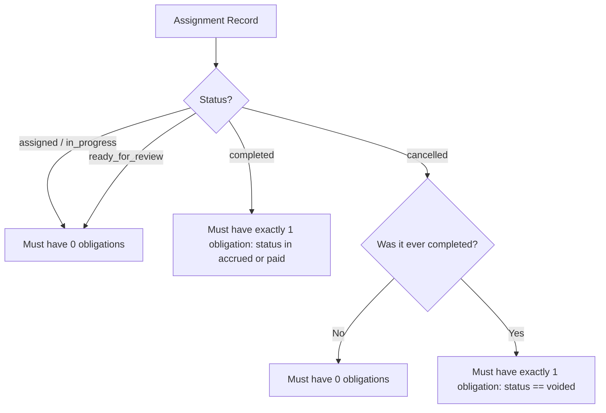
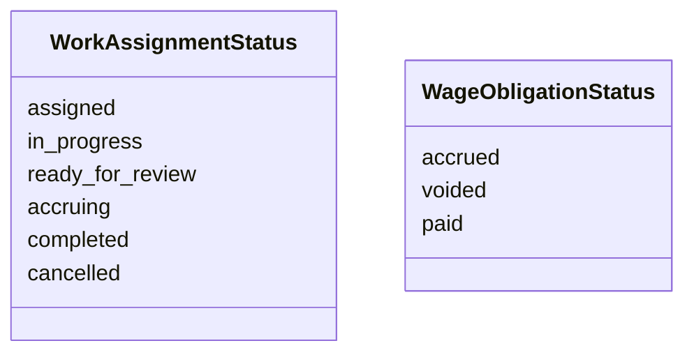

# SOGIL FURNITURE
# PHASE 2 ARCHITECTURE & SCOPE LOCK v1.2.1
## Final Consistency and Failure-Recovery Correction

---

## 1. Title, Version, and Status

- **Document Title**: Sogil Furniture — Phase 2 Architecture & Scope Lock v1.2.1: Final Consistency and Failure-Recovery Correction
- **Version**: v1.2.1 (Narrow Architecture Correction & Authoritative Amendment to v1.2)
- **Primary Source Document**: [`docs/architecture/SOGIL_PHASE_2_ARCHITECTURE_SCOPE_LOCK_v1.2.md`](file:///Users/syahidmujahid/Sogil-Project/Sogil-Furniture/docs/architecture/SOGIL_PHASE_2_ARCHITECTURE_SCOPE_LOCK_v1.2.md)
- **Baseline Git Commit**: `65a8f14d002304a7f67d92f256487dd4b00ddc42` (Phase 1: *Order-Payment Core*)
- **Status**: **AUTHORITATIVE ARCHITECTURAL AMENDMENT** (Documentation Only — No Code, No DB Writes, No Deploy)

---

## 2. Purpose and Relationship to v1.2

This document serves as an authoritative architectural amendment to **Phase 2 Architecture & Scope Lock v1.2**. It does not replace or duplicate v1.2 wholesale. Instead, it provides targeted corrections to resolve edge cases in transaction recovery, concurrency race boundaries, lump-sum partial acceptance semantics, monetary precision, entity-level ledger reconciliation, order item edit reconciliations, and test matrix numbering.

### Authoritative Hierarchy:
1. All rules in **v1.2** remain fully normative and binding **except where explicitly amended, superseded, or clarified by this v1.2.1 document**.
2. Where any contradiction exists between v1.2 and v1.2.1, **v1.2.1 is authoritative**.

---

## 3. Corrections at a Glance

| Correction Area | v1.2 Text / Assumption | v1.2.1 Corrected Normative Rule |
| :--- | :--- | :--- |
| **Correction A: Transaction & Concurrency** | State set to `completed` before inserting obligation; simple rollback via `try/except` on standalone Mongo. | **Multi-document transaction is the primary production strategy** via `execute_transaction_with_safety()`. For standalone Mongo, an explicit **durable two-phase state machine** (`ready_for_review` $\to$ `accruing` $\to$ `completed`) with deterministic crash recovery, deduplication, and reconciliation is specified. |
| **Correction B: Lump-Sum Partial Acceptance** | Example 4 accrued full lump-sum (500 LE) despite 1 defective unit out of 4. | **Unresolved Business Decision B-1** is formally flagged. **Recommended conservative baseline**: Lump-sum jobs require $100\%$ acceptance of target quantity (`accepted_quantity == target_quantity`) to accrue. Partial acceptance on lump-sum jobs is **blocked** pending owner business sign-off. |
| **Correction C: Money Representation** | Claimed `round(val, 2)` eliminates binary floating-point drift. | Corrected mathematical claim. Specified **canonical representation contract**: Calculations use integer minor units (piastres / cents) or exact `Decimal` arithmetic rounded to 2 decimals (`ROUND_HALF_UP`) before persistence as standard 2-decimal floats (`amount_le`), maintaining 100% Phase 1 schema compatibility while eliminating calculation drift. |
| **Correction D: Entity-Level Reconciliation** | Aggregate count equality $\sum \text{assignments} = \sum \text{obligations}$. | Replaced with **Entity-Level Deterministic Reconciliation Engine** evaluating individual tuple identities, handling voided obligations, orphan obligations, and uncompleted assignments. |
| **Correction E: Order Item Identity & Edits** | "Preserve IDs across edits" without defining server-side array diffing. | Defined explicit **server-side array reconciliation algorithm** in `admin_update_order`: validates submitted IDs against order, blocks reassignment, generates new server IDs for added items, and rejects deletion/replacement of assigned items (`HTTP 409`). |
| **Correction F: Owner Bypass Lifecycle** | Ambiguous whether bypass skips dual custody only or skips intermediate states. | Strictly clarified: **Owner bypass skips ONLY the dual-custody actor separation check**. The assignment MUST still pass through `ready_for_review`, quantity validation, and verification audit. Skipping lifecycle states is strictly prohibited. |
| **Correction G: Status Vocabulary & Tests** | Statuses slightly divergent; test counts inconsistent (14 vs 15). | Standardized canonical status vocabulary and established a **numbered 16-case Acceptance Test Matrix** with zero count discrepancy. |

---

## 4. Verified Assumptions and Evidence

1. **[VERIFIED FACT] Database Client & Transaction Helper**:
   - Motor async client is initialized in [`server.py#L35`](file:///Users/syahidmujahid/Sogil-Project/Sogil-Furniture/backend/server.py#L35): `client = AsyncIOMotorClient(mongo_url, tlsCAFile=certifi.where())`.
   - The repository **already contains a production transaction helper**: [`execute_transaction_with_safety(motor_client, coro_func)`](file:///Users/syahidmujahid/Sogil-Project/Sogil-Furniture/backend/server.py#L1196-L1239).
   - This helper catches `ConfigurationError` and `InvalidOperation` on standalone MongoDB and falls back gracefully to `session = None`.
2. **[VERIFIED FACT] Currency & Number Formatting**:
   - [`server.py#L656-L710`](file:///Users/syahidmujahid/Sogil-Project/Sogil-Furniture/backend/server.py#L656-L710) defines `_num(v, default=0.0)` returning Python `float`, and `compute_currency_conversion()` where EGP is rounded to 2 decimal places and IDR is rounded to integer.
   - Pydantic models for orders, payments, and transactions store amounts as `float` ([`server.py#L291-L312`](file:///Users/syahidmujahid/Sogil-Project/Sogil-Furniture/backend/server.py#L291-L312)).
3. **[VERIFIED FACT] Order Items Array Replacement**:
   - In [`server.py#L1901-L1904`](file:///Users/syahidmujahid/Sogil-Project/Sogil-Furniture/backend/server.py#L1901-L1904), `admin_update_order` accepts `items: Optional[List[dict]]` and directly overwrites `update["items"] = data.items`. Without server-side reconciliation, client edits can wipe or alter assigned items.
4. **[VERIFIED FACT] Existing Finance Ledger Isolation**:
   - `db.employee_wages` is populated only from `db.finance_transactions` when `type == "expense"` ([`server.py#L3862-L3874`](file:///Users/syahidmujahid/Sogil-Project/Sogil-Furniture/backend/server.py#L3862-L3874)).
5. **[UNVERIFIED] Production Deployment Topology**:
   - While Railway runs the backend and MongoDB Atlas is the target database, whether the target MongoDB Atlas tier supports multi-document transactions in all staging/local testing environments is environment-dependent. Standalone local MongoDB does not support transactions without a replica set (`rs0`).

---

## 5. Correction A — Transaction, Concurrency, and Recovery

*Supersedes v1.2 Section 14 (pseudocode) and Section 15 (transaction notes).*

### A. Primary Consistency Strategy: MongoDB Multi-Document Transactions [LOCKED ARCHITECTURAL RULE]
In production (MongoDB Atlas Replica Set), work assignment verification and wage obligation creation **MUST participate in the same multi-document transaction** using the established `execute_transaction_with_safety` pattern:
- The transaction encapsulates:
  1. Reading assignment state with `session`.
  2. Transitioning assignment status from `ready_for_review` to `completed`.
  3. Inserting the canonical obligation into `db.wage_obligations`.
- Both commit atomically or both roll back on any exception.

### B. Durable Two-Phase State Machine for Non-Transaction Environments [LOCKED ARCHITECTURAL RULE]
For environments where replica set transactions are unavailable (e.g. standalone test MongoDB), a naive `try/except` rollback is prohibited because server crashes between write 1 and write 2 leave phantom completed assignments. 

Instead, the system enforces a **durable intermediate state**:

$$\text{ready\_for\_review} \xrightarrow{\text{conditional update}} \text{accruing} \xrightarrow{\text{insert obligation}} \text{completed}$$

1. **Phase 1: Transition to `accruing`**:
   The assignment is atomically updated from `ready_for_review` to `accruing` using conditional `find_one_and_update`:
   ```python
   {
       "_id": assignment_id,
       "status": "ready_for_review"
   }
   ```
   Setting:
   `status = "accruing"`, `accrual_in_progress_at = now_iso`, `accepted_quantity = accepted_qty`, `verified_by_id = admin["id"]`.
2. **Phase 2: Insert Canonical Wage Obligation**:
   Insert the obligation with `accrual_event_key: f"acc_{assignment_id}"`.
3. **Phase 3: Finalize to `completed`**:
   Atomically transition assignment from `accruing` to `completed`.

### C. Deterministic Concurrency & Failure Matrix [LOCKED ARCHITECTURAL RULE]

| Scenario | Persisted State at Failure | Can Retry? | Can Create Obligation? | Deterministic Outcome / Recovery Action | Operator Alert? |
| :--- | :--- | :---: | :---: | :--- | :---: |
| **1. First Verification** | Neither modified | Yes | Yes (1) | Normal execution: assignment `completed`, obligation `accrued`. Returns `200 OK`. | No |
| **2. Two Simultaneous Requests** | Request A transitions assignment; Request B finds status != `ready_for_review` | Yes | Yes (1) | Request A succeeds. Request B fails conditional update, waits/reads completed assignment, returns Request A's canonical obligation idempotently. | No |
| **3. Retry After Success** | Assignment `completed`, obligation `accrued` | Yes | No (0) | Validates payload against existing record. Returns canonical obligation (`200 OK`). | No |
| **4. Retry While In-Progress (`accruing`)** | Assignment `accruing` | Yes | No (0) | If `accrual_in_progress_at` < 30 seconds, returns `HTTP 409 Conflict: "Verifikasi sedang diproses"`. | No |
| **5. Duplicate Key (Same Assignment)** | Obligation exists for this assignment | Yes | No (0) | Validates linkage; finalizes assignment to `completed`; returns canonical obligation (`200 OK`). | No |
| **6. Duplicate Key (Foreign Assignment)** | Obligation exists with different `work_assignment_id` | No | No (0) | Immediate `HTTP 500 Internal Server Error: "Kunci akrual bertabrakan"`. Critical data integrity incident. | **YES (Critical)** |
| **7. Failure Before State Change** | Assignment `ready_for_review` | Yes | Yes | Request fails with `HTTP 500`. Client may retry safely. | No |
| **8. Failure in `accruing` (Crash before Insert)** | Assignment `accruing`, 0 obligations | Yes | Yes (1) | Background reconciler detects `accruing` > 60s. Checks obligation: not found $\to$ resets assignment to `ready_for_review` with audit log. Client retries. | No (Logged) |
| **9. Failure in `accruing` (Crash after Insert, before finalize)** | Assignment `accruing`, obligation `accrued` | Yes | No (0) | Background reconciler detects `accruing` > 60s. Checks obligation: found $\to$ finalizes assignment to `completed`. | No (Logged) |
| **10. Completed Assignment Missing Obligation** | Assignment `completed`, 0 obligations | No | Manual | Background reconciler detects orphan `completed` assignment. Reconciler CANNOT invent money. Transitions assignment to `error_unaccrued`. | **YES (Urgent)** |
| **11. Obligation Exists, Assignment Not Completed** | Obligation `accrued`, assignment not `completed` | Yes | No (0) | If assignment is `accruing`, finalizes to `completed`. If assignment is `cancelled`, triggers audit investigation. | **YES** |
| **12. Repeated Recovery Failure** | Any corrupted state | No | No (0) | State marked `locked_for_audit`. Reconciler leaves document untouched. | **YES (Critical)** |

### D. Idempotent Replay Validation Rules [LOCKED ARCHITECTURAL RULE]
Before returning an existing obligation upon replay or retry, the endpoint **MUST validate all 5 linkage fields**:
1. `existing_ob["accrual_event_key"] == f"acc_{assignment_id}"`
2. `str(existing_ob["work_assignment_id"]) == str(assignment["_id"])`
3. `str(existing_ob["order_id"]) == str(assignment["order_id"])`
4. `str(existing_ob["order_item_id"]) == str(assignment["order_item_id"])`
5. `existing_ob["status"] in ["accrued", "paid"]`

If any linkage field does not match, the server MUST NOT return the obligation and MUST raise `HTTP 409 Conflict: "Inkonsistensi integritas relasi kewajiban upah"`.

---

## 6. Correction B — Lump-Sum Wages and Partial Acceptance

*Supersedes v1.2 Section 11 (invariants) and Section 12 (Example 4).*

### A. The Architectural Problem in v1.2 Example 4
In v1.2 Example 4, a worker was assigned a lump-sum borongan task for 4 units at 500 LE. The supervisor accepted only 3 units (1 was defective), but the example accrued the full 500 LE. 
This created a severe business ambiguity: Does partial acceptance of a lump-sum job entitle the craftsman to 100% of the negotiated fee, or must the entire job be rejected/reworked?

### B. Status: [UNRESOLVED BUSINESS DECISION B-1]
- **Decision Question**: When an order item has a quantity $> 1$ and a `lump_sum` wage is assigned, what happens if the worker only completes/passes inspection on a subset of items (e.g. 3 of 4 units)?
  - **Option 1 (All-or-Nothing — Recommended)**: Lump-sum borongan is indivisible. If any unit fails inspection, the assignment cannot be verified as `completed`. The worker must rework defective units until $100\%$ are accepted (`accepted_quantity == target_quantity`), or the assignment is cancelled with zero accrual.
  - **Option 2 (Pro-Rata Reduction)**: Lump-sum is pro-rated: $\text{accrued} = \text{agreed\_rate\_le} \times (\text{accepted\_quantity} / \text{target\_quantity})$. (Note: Converts lump sum into synthetic piece rate).
  - **Option 3 (Full Payment Despite Defect)**: Accrues full lump sum as in v1.2 Example 4, relying on manual supervisor agreement.

### C. Authoritative Interim Rule for Phase 2 Build [LOCKED ARCHITECTURAL RULE]:
Until the business owner formally signs off on **Business Decision B-1**, the system enforces the **Conservative All-or-Nothing Rule**:
1. For `pricing_basis == "per_unit"`:
   - Partial acceptance is fully supported: $1 \le \text{accepted\_quantity} \le \text{target\_quantity}$.
   - $\text{accrued\_amount\_le} = \text{round}(\text{agreed\_rate\_le} \times \text{accepted\_quantity}, 2)$.
2. For `pricing_basis == "lump_sum"`:
   - **Verification requires $100\%$ acceptance**: `accepted_quantity` MUST equal `target_quantity`.
   - If `accepted_quantity < target_quantity`, the verification endpoint **REJECTS the request with `HTTP 422 Unprocessable Entity`**:
     ```text
     "Penugasan borongan (lump_sum) tidak mendukung penerimaan parsial. Seluruh unit target harus diselesaikan atau ditolak untuk perbaikan."
     ```
   - If work is defective, the supervisor must call `POST /assignments/{id}/reject` to return the assignment to `in_progress` for rework, or `POST /assignments/{id}/cancel` to cancel the assignment.
   - Example 4 of v1.2 is hereby revoked and replaced by Test Scenario TC-WOB-04 (100% acceptance required for lump sum).

---

## 7. Correction C — Monetary Representation and Rounding

*Clarifies and supersedes v1.2 Section 20.*

### A. Refutation of Float Drift Immunity Claim
`round(float_val, 2)` in Python evaluates standard IEEE 754 binary floating-point numbers. While it limits decimal places during string formatting or subsequent rounding, storing floats in JSON/MongoDB can theoretically yield representations like `140.00000000000003`. 

### B. Canonical Representation Contract for Phase 2 [LOCKED ARCHITECTURAL RULE]
To guarantee absolute determinism without breaking Phase 1 compatibility:
1. **Calculation Engine Arithmetic**:
   All rate calculations, multiplications, and aggregations in backend memory MUST use Python's standard `decimal.Decimal` module:
   ```python
   from decimal import Decimal, ROUND_HALF_UP

   def calculate_accrual(agreed_rate: float, accepted_qty: int, pricing_basis: str) -> float:
       d_rate = Decimal(str(agreed_rate))
       if pricing_basis == "per_unit":
           d_amount = (d_rate * Decimal(accepted_qty)).quantize(Decimal("0.01"), rounding=ROUND_HALF_UP)
       else:
           d_amount = d_rate.quantize(Decimal("0.01"), rounding=ROUND_HALF_UP)
       return float(d_amount)
   ```
2. **Rounding Mode**: `ROUND_HALF_UP` (standard commercial rounding).
3. **Storage & Serialization Compatibility**:
   - Persisted in MongoDB as standard Python `float` values that have been strictly quantized to 2 decimal places.
   - Preserves 100% type compatibility with Phase 1 fields (`amount_le`, `subtotal_le`, `total_le`), Motor queries, and frontend JSON parsers.
   - Guarantees zero fractional LE drift across retries, serializations, and ledger queries.
4. **Validation Rules**:
   - Rates must be $> 0.00$ and have at most 2 decimal places. Input values with $> 2$ decimal places (e.g. `35.555`) are rejected with `HTTP 422 Unprocessable Entity`.
   - Negative amounts and zero rates are strictly rejected.
5. **Currency**: All craftsman wage obligations remain strictly in **`EGP`**.

---

## 8. Correction D — Entity-Level Assignment/Obligation Reconciliation

*Supersedes v1.2 Section 15 (Reconciliation Query).*

### A. The Defect in v1.2 Count Equality
v1.2 proposed: $\text{count}(\text{assignments}(\text{status} = \text{"completed"})) = \text{count}(\text{obligations}(\text{status} \in \{\text{"accrued"}, \text{"paid"}\}))$.
This formula breaks whenever an assignment is cancelled after completion, because the assignment becomes `cancelled` while the obligation becomes `voided`.

### B. Entity-Level Reconciliation Specification [LOCKED ARCHITECTURAL RULE]
Reconciliation is evaluated **per individual assignment entity**, not on aggregate counts:



### C. Invariant Evaluation Table:

| Assignment Status | Expected Obligation State | Linkage Checks | Automatic Repair Action | Alert Level |
| :--- | :--- | :--- | :--- | :---: |
| `assigned` | None exists | N/A | None required | OK |
| `in_progress` | None exists | N/A | If obligation exists: investigate data corruption | **CRITICAL** |
| `ready_for_review` | None exists | N/A | If obligation exists: investigate data corruption | **CRITICAL** |
| `accruing` ($< 60\text{s}$) | In progress | N/A | None (transient operation) | OK |
| `accruing` ($> 60\text{s}$) | May or may not exist | Check `accrual_event_key` | If obligation exists $\to$ finalize assignment to `completed`. If not $\to$ reset assignment to `ready_for_review`. | WARNING |
| `completed` | Exactly 1: `accrued` or `paid` | `order_id`, `order_item_id`, `worker_id` match exactly | Cannot auto-repair missing obligation. Mark assignment `error_unaccrued`. | **URGENT** |
| `cancelled` (Never accrued) | None exists | N/A | None required | OK |
| `cancelled` (Voided post-accrual)| Exactly 1: `voided` | Obligation has `voided_at`, `void_reason` | None required (valid audit record) | OK |
| Any | Orphan Obligation (no assignment) | N/A | Mark obligation `orphan_quarantined`. Never auto-delete. | **CRITICAL** |

---

## 9. Correction E — Persistent Order Item Identity and Safe Edit Reconciliation

*Clarifies and supersedes v1.2 Section 7.*

### A. Server-Generated ID Specification [LOCKED ARCHITECTURAL RULE]
- Canonical format: `itm_<12_hex_chars>` (e.g. `itm_4f8a12e9b30c`).
- Generated strictly on the server during checkout (`create_order`) and invoice conversion (`convert_invoice_to_order`).
- Client-supplied `item_id` values on initial creation are ignored and replaced with server-generated IDs.

### B. Safe Array Edit Reconciliation Algorithm [LOCKED ARCHITECTURAL RULE]
Because `PATCH /api/admin/orders/{id}` receives `items: List[dict]` and replaces the array, the backend must execute the following reconciliation algorithm before modifying the database:

1. **Fetch Existing Items**: Load `existing_items = existing_order.get("items", [])`.
2. **Collect Active Assigned Item IDs**:
   ```python
   assigned_item_ids = set(await db.work_assignments.distinct(
       "order_item_id", 
       {"order_id": order_id, "status": {"$in": ["assigned", "in_progress", "ready_for_review", "completed"]}}
   ))
   ```
3. **Validate Incoming Items**:
   - For each `item` in `incoming_items`:
     - If `item.get("item_id")` is provided:
       - Validate that `item["item_id"]` exists in `existing_items`. If not, reject with `HTTP 400 Bad Request: "item_id tidak dikenal untuk pesanan ini"`.
       - Check for duplicates within `incoming_items`. If duplicate IDs are submitted, reject with `HTTP 400 Bad Request`.
     - If `item.get("item_id")` is missing or null:
       - Treat as a newly added item: generate a fresh server ID `f"itm_{uuid.uuid4().hex[:12]}"`.
4. **Enforce Deletion Protection for Assigned Items**:
   - Calculate `incoming_item_ids = {i["item_id"] for i in incoming_items if i.get("item_id")}`.
   - For every `assigned_id` in `assigned_item_ids`:
     - If `assigned_id` is NOT in `incoming_item_ids`:
       - **REJECT the update with `HTTP 409 Conflict`**:
         ```text
         "Tidak dapat menghapus item pesanan yang memiliki penugasan kerja aktif (item_id: {assigned_id})"
         ```
5. **Enforce Quantity Invariants for Assigned Items**:
   - If an item's quantity is reduced below the `target_quantity` of active assignments linked to it, reject with `HTTP 409 Conflict: "Kuantitas item tidak boleh lebih kecil dari kuantitas penugasan aktif"`.
6. **Persist Order Update**: Save sanitized `items` array to `db.orders`.

---

## 10. Correction F — Owner Bypass Lifecycle and Audit Trail

*Clarifies and supersedes v1.2 Section 10 and Section 26.*

### A. Narrow Scope of Owner Bypass [LOCKED ARCHITECTURAL RULE]
Preserving **Approved Business Decision E2**:
- Only an authenticated user whose server-verified role is exactly `"owner"` can self-approve their own work assignment.
- **Scope of Bypass**: The bypass skips **ONLY the actor separation check** (i.e. it permits `current_user["id"] == assignment["worker_id"]`).
- **NO LIFECYCLE SKIPPING**: The owner's assignment **MUST still transition through all valid lifecycle states**:
  $$\text{assigned} \longrightarrow \text{in\_progress} \longrightarrow \text{ready\_for\_review} \longrightarrow \text{completed}$$
  An owner cannot skip directly from `assigned` or `in_progress` to `completed`.
- The assignment must still undergo target quantity validation, rule validation, rate snapshotting, and atomic obligation accrual.

### B. Server-Side Authentication & Fail-Closed Policy [LOCKED ARCHITECTURAL RULE]
- The user's role is extracted strictly from the validated JWT token and verified against `db.admins` by `get_current_admin()`.
- Client payload fields like `is_owner: true` or `bypass: true` are ignored.
- If role data is missing, expired, or malformed, the endpoint fails closed with `HTTP 401 Unauthorized` or `HTTP 403 Forbidden`.

### C. Mandatory Audit Signature [LOCKED ARCHITECTURAL RULE]
Every verification document and audit log record MUST capture:
```json
{
  "verified_by_id": "6705be0140b92110c1289010",
  "verified_by_name": "Sogil Owner",
  "verified_by_role": "owner",
  "is_owner_bypass": true,
  "verified_at": "2026-10-09T03:30:00Z",
  "verification_notes": "Mandiri: QC dan finishing sempurna"
}
```

---

## 11. Correction G — Status Vocabulary, Correction Paths, and Scope Boundary

*Clarifies and supersedes v1.2 Section 24 and Section 29.*

### A. Canonical Status Vocabulary [LOCKED ARCHITECTURAL RULE]



- **`WorkAssignment` Statuses**:
  - `assigned`: Worker assigned to item/task. Zero financial impact.
  - `in_progress`: Worker started task. Zero financial impact.
  - `ready_for_review`: Worker completed task, waiting supervisor acceptance. Zero financial impact.
  - `accruing`: Transient internal locking state during obligation creation in non-transactional topologies.
  - `completed`: Supervisor accepted work. Final state. Exactly one obligation accrued.
  - `cancelled`: Assignment cancelled (either before accrual or post-accrual with voiding).
- **`WageObligation` Statuses**:
  - `accrued`: Earned labor liability recorded. Zero cash-out.
  - `voided`: Cancelled before payout. Retained for immutable audit history.
  - `paid`: [DEFERRED TO PHASE 3] Disbursed via Cash-Out finance transaction.

### B. Correction of Accrued Unpaid Obligations [LOCKED ARCHITECTURAL RULE]
If a verified assignment is discovered to have errors prior to payout:
1. The assignment is cancelled via `POST /api/admin/assignments/{id}/cancel` (requires `access_finance` or `owner`).
2. The linked obligation is marked `status = "voided"`, `voided_at = now_iso`, `voided_by_id = admin["id"]`, `void_reason = payload.reason`.
3. The obligation is **NEVER deleted** from MongoDB.
4. A new assignment may then be created if replacement work is needed.
5. In Phase 2, **paid obligations cannot be voided or modified under any circumstances** (`HTTP 400 Bad Request`).

---

## 12. Unchanged Invariants and Scope Boundaries

The following fundamental architecture rules from v1.2 remain **100% UNCHANGED and BINDING**:
1. **Zero Cash Movements in Phase 2**: Phase 2 writes zero records to `db.finance_transactions`.
2. **Untouched Historical Payouts**: Historical `db.employee_wages` records are preserved 100% untouched.
3. **Phase 1 Invariants**: Customer payments, order payment status (`belum_dibayar`, `dp`, `lunas`), and exchange rate math remain 100% untouched.
4. **Canonical Worker Master**: `db.admins` is the sole source of worker identities.
5. **Approved Decision E1**: The five controlled task categories are locked (`whole_item`, `assembly`, `finishing`, `cutting`, `custom`).
6. **Approved Decision E2**: Dual custody is mandatory; only `role === "owner"` can self-approve.
7. **Accrual Cardinality**: Exactly one work assignment produces at most one final wage obligation.
8. **Currency Mandate**: All craftsman wages operate strictly in **EGP**.

---

## 13. Consolidated Acceptance Test Matrix

This matrix establishes the definitive, numbered 16-case test suite for future Phase 2 verification.

| Test ID | Category | Target Test Case Description | Expected Result |
| :--- | :--- | :--- | :--- |
| **TC-ITM-01** | Order Item Identity | Server generates persistent `item_id` (`itm_<uuid12>`) on checkout and invoice conversion. Client-supplied IDs on creation are ignored. | Item persisted with server `item_id`. |
| **TC-ITM-02** | Order Item Identity | Admin updates order items array; existing `item_id` values are preserved and new items receive IDs. | Unchanged items retain exact IDs; new items receive IDs. |
| **TC-ITM-03** | Order Item Protection | Admin attempts to remove order item that has active assignments. | Endpoint rejects with `HTTP 409 Conflict`. |
| **TC-WGR-01** | Wage Rules | CRUD endpoints create, read, update, and soft-delete wage rules with required permissions. | Rules persisted; soft-deleted rules excluded from prefill. |
| **TC-WGR-02** | Wage Rule Immutability| Existing assignments retain snapshot of agreed rate even after wage rule is updated or deleted. | Assignment rate unaffected by wage rule modification. |
| **TC-ASN-01** | Assignment Granularity| Multiple workers assigned to different tasks on the same order item (e.g. assembly + finishing). | Both assignments created successfully. |
| **TC-ASN-02** | Duplicate Prevention | Attempt to assign the same worker to the same task category on the same order item twice in active state. | Rejection via partial unique index (`HTTP 409 Conflict`). |
| **TC-PRC-01** | Per-Unit Calculation | Per-unit assignment with accepted quantity calculates $\text{agreed\_rate\_le} \times \text{accepted\_quantity}$ rounded to 2 decimals (`Decimal` arithmetic). | Obligation accrued amount matches exact calculation. |
| **TC-PRC-02** | Lump-Sum Calculation | Lump-sum assignment accrues flat `agreed_rate_le` regardless of quantity (never multiplied by qty). | Obligation accrued amount equals exact flat rate. |
| **TC-LMP-01** | Lump-Sum Validation | Lump-sum verification with `accepted_quantity < target_quantity` is rejected (per Interim Rule B-1). | Rejection with `HTTP 422 Unprocessable Entity`. |
| **TC-AUT-01** | Dual Custody Governance| Employee, admin, or manager attempts to verify their own assigned work. | Rejection with `HTTP 403 Forbidden`. |
| **TC-AUT-02** | Owner Bypass Governance| Owner self-approves own work after following full lifecycle (`ready_for_review`). | Verification succeeds; audit records `is_owner_bypass: true`. |
| **TC-CON-01** | Accrual Idempotency | Concurrent or replayed verification requests on the same assignment return the canonical obligation without duplicate insert. | Single obligation exists; replayed request returns `200 OK`. |
| **TC-REC-01** | Failure Recovery | Standalone MongoDB crash during obligation creation triggers durable recovery or state rollback. | No orphan `completed` assignment without obligation. |
| **TC-CAN-01** | Cancellation & Voiding| Cancelling a completed unpaid assignment sets assignment to `cancelled` and obligation to `voided`. | Obligation marked `voided`; audit notes persisted. |
| **TC-FIN-01** | Zero Cash Boundary | Complete Phase 2 lifecycle (assign $\to$ progress $\to$ review $\to$ verify $\to$ cancel); check finance collections. | `db.finance_transactions` count = 0; `db.employee_wages` count = 0. |

---

## 14. Remaining Business Decisions and Technical Prerequisites

### A. Remaining Business Decisions:
1. **[BLOCKER — BUSINESS DECISION B-1] Lump-Sum Partial Acceptance Policy**:
   - *Current Status*: Interim Conservative Rule locked (100% acceptance required for lump sum; partial acceptance blocked).
   - *Action Required*: User/Owner must formally confirm whether to keep the Conservative 100% Rule, adopt Pro-Rata Reduction, or permit Full Payment with notes.

### B. Remaining Technical Prerequisites:
1. **[PREREQUISITE] Local Testing Environment MongoDB Topology**:
   - The developer test environment running `pytest` must be verified to determine if MongoDB runs as a single-node replica set (`rs0`) or standalone instance.
   - If standalone, the durable two-phase recovery mechanism (Correction A) must be exercised in tests.

---

## 15. Final Consistency Checklist

- [x] Pseudocode and transaction models match the normative rules.
- [x] State transitions match the authorization matrix and role restrictions.
- [x] Single-field unique index `accrual_event_key` matches single-obligation cardinality.
- [x] Money representation specifies exact arithmetic and eliminates false claims of float drift immunity.
- [x] Partial acceptance on lump sum has an explicit interim rule and is flagged as an open business decision.
- [x] Order item identity algorithm protects against client forgery, reordering, and deletion.
- [x] Owner bypass is narrowly scoped and fails closed on invalid credentials.
- [x] Status vocabulary is unified across all tables and state diagrams.
- [x] Acceptance test matrix contains exactly 16 numbered, non-conflicting test cases.
- [x] Zero cash movement and Phase 1 isolation are fully preserved.

---

## 16. Final Readiness Verdict

### 🟡 **B. CONDITIONAL — EXPLICIT BLOCKERS REMAIN**

**Verdict Rationale**:  
The architecture is technically complete, fully specified, and internally consistent across all concurrency, transaction, precision, and audit boundaries. 

However, **it is NOT yet authorized for immediate implementation** because one explicit business decision remains pending owner sign-off:
- **Business Decision B-1**: Confirmation of the lump-sum partial acceptance policy (Conservative 100% Rule vs Pro-Rata vs Full Payment).

Once the user approves Business Decision B-1, the architecture will immediately advance to **READY FOR MASTER BUILD PROMPT**.
