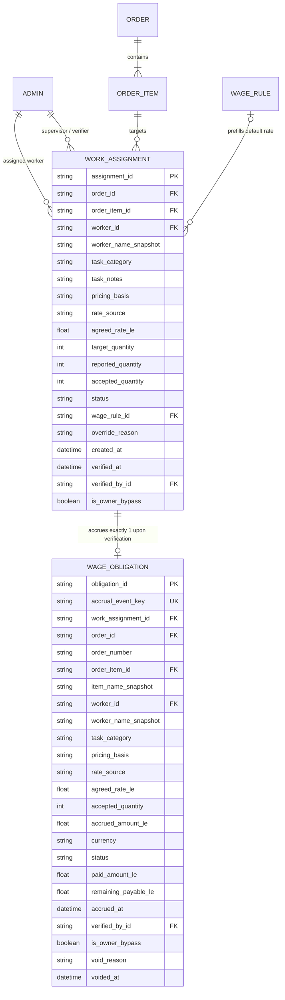
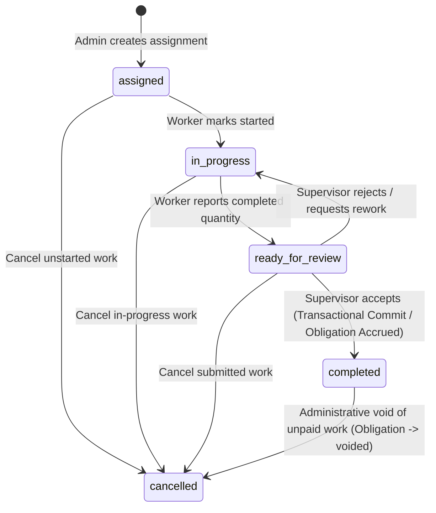

# SOGIL FURNITURE
# PHASE 2 ARCHITECTURE & SCOPE LOCK v1.2.2
## Final Forensic Architecture & Defect Correction

---

## 1. Document Metadata and Version History

- **Document Title**: Sogil Furniture — Phase 2 Architecture & Scope Lock v1.2.2: Final Forensic Architecture & Defect Correction
- **Version**: v1.2.2 (Consolidated Authoritative Architectural Specification)
- **Primary References**:
  - [`docs/architecture/SOGIL_PHASE_2_ARCHITECTURE_SCOPE_LOCK_v1.1.md`](file:///Users/syahidmujahid/Sogil-Project/Sogil-Furniture/docs/architecture/SOGIL_PHASE_2_ARCHITECTURE_SCOPE_LOCK_v1.1.md)
  - [`docs/architecture/SOGIL_PHASE_2_ARCHITECTURE_SCOPE_LOCK_v1.2.md`](file:///Users/syahidmujahid/Sogil-Project/Sogil-Furniture/docs/architecture/SOGIL_PHASE_2_ARCHITECTURE_SCOPE_LOCK_v1.2.md)
  - [`docs/architecture/SOGIL_PHASE_2_ARCHITECTURE_SCOPE_LOCK_v1.2.1.md`](file:///Users/syahidmujahid/Sogil-Project/Sogil-Furniture/docs/architecture/SOGIL_PHASE_2_ARCHITECTURE_SCOPE_LOCK_v1.2.1.md)
- **Baseline Git Commit**: `65a8f14d002304a7f67d92f256487dd4b00ddc42` (Phase 1: *Order-Payment Core*)
- **Status**: **AUTHORITATIVE ARCHITECTURE LOCK** (Forensic Correction — Documentation Only)

---

## 2. Executive Summary

This document establishes the definitive, unified, and fully resolved architectural specification for **Phase 2 — Work Assignments & Production Piece-Rate** of the Sogil Furniture platform. Building directly upon the deployed Phase 1 baseline (`65a8f14`), Phase 2 governs the operational manufacturing domain: assigning craftsmen to order items, enforcing piece-rate and task wages against configurable rules or explicit overrides, validating completion under strict dual-custody verification, and accruing immutable wage liabilities.

Version 1.2.2 resolves all architectural contradictions, vocabulary divergences, transaction guarantee ambiguities, and monetary precision edge cases identified during forensic review of versions 1.2 and 1.2.1:
1. **Business Decision B-1 Formally Locked**: Lump-sum borongan assignments enforce a strict **all-or-nothing** acceptance rule ($100\%$ acceptance required; partial acceptance rejected with `HTTP 422`).
2. **Canonical Status Registry Established**: Formal decoupling of business lifecycle states from internal processing/reconciliation classifications, eliminating undefined pseudo-statuses.
3. **Rigorous Concurrency & Transaction Guarantees**: Concrete transactional write boundaries using `execute_transaction_with_safety()`, paired with an explicit durable two-phase commit state machine for standalone MongoDB fallback, and a single-field unique constraint preventing duplicate accrual.
4. **Canonical Money Representation**: Exact `Decimal` arithmetic for calculations (`ROUND_HALF_UP`) with unambiguous boundary conversion to 2-decimal floats (`amount_le`) for MongoDB/JSON compatibility, preserving Phase 1 ledger consistency.
5. **Stable Order-Item Identity & Mutation Protection**: Server-generated persistent identities (`itm_<uuid12>`) with an explicit server-side array reconciliation algorithm guarding against deletion or reassignment of items with active assignments.
6. **Cancellation, Correction & Audit Preservation**: Immutable audit trail ensuring zero physical deletion of finalized records, explicit voiding mechanisms for unpaid obligations, and strict prohibition of cash movements.
7. **Entity-Level Reconciliation & Clean Test Invariants**: Elimination of flawed global collection count assertions in favor of entity-level delta validations compatible with pre-existing database records.

---

## 3. Authoritative Decisions and Locked Business Rules

The following core business and operational decisions are fully approved, locked, and non-negotiable:

### A. Decision B-1 — All-or-Nothing Lump-Sum Acceptance [APPROVED BUSINESS DECISION]
- **Rule**: A `lump_sum` work assignment is eligible for wage accrual **only when the assigned work is accepted at exactly 100%** (`accepted_quantity == target_quantity`).
- **Enforcement**: Any attempt to submit partial acceptance (`accepted_quantity < target_quantity`) for a lump-sum assignment **MUST be rejected with `HTTP 422 Unprocessable Entity`**.
- **Invariants**:
  - Rejection creates **zero wage obligations**.
  - Rejection creates, alters, or reverses **zero finance transactions**.
  - Rejection **does not mark the assignment as completed**.
  - Rejection leaves **zero partially persisted acceptance or accrual state**.
  - The system **never calculates pro-rata wages** for partially accepted lump-sum work.
  - The system **never interprets partial acceptance as authorization to accrue the full lump-sum amount**.

### B. Decision E1 — Controlled Task Categories [APPROVED BUSINESS DECISION]
- The five supported task categories are strictly locked to:
  1. `whole_item`: Borongan penuh / Complete manufacturing of item by one craftsman.
  2. `assembly`: Perakitan kerangka / Structural assembly.
  3. `finishing`: Pengecatan / Polishing / Coating.
  4. `cutting`: Pemotongan bahan / Wood cutting and preparation.
  5. `custom`: Penugasan khusus dengan catatan spesifik.
- Uncontrolled free-text categories are prohibited. Specific operational nuances must be recorded in an optional `task_notes: str` field.

### C. Decision E2 — Owner-Only Self-Approval Exception [APPROVED BUSINESS DECISION]
- **Rule**: Only an authenticated user whose server-verified role is exactly `"owner"` may self-approve their own work assignment.
- **Enforcement**: Users with roles `manager`, `admin`, or `employee` **MUST NOT approve their own work under any circumstances**, even if they possess administrative permissions (`manage_orders`, `manage_admins`). An attempt to self-approve is rejected with `HTTP 403 Forbidden`.
- **Narrow Scope**: Owner bypass skips **ONLY the actor separation check** (`current_user["id"] == assignment["worker_id"]`). It **DOES NOT skip lifecycle states**; the owner's task must still transition through `ready_for_review` and undergo target quantity validation.
- **Audit Signature**: Every owner self-approval must explicitly record `is_owner_bypass: True` in the audit log.

### D. Zero Cash Movement Boundary [LOCKED ARCHITECTURAL RULE]
- Phase 2 governs **work assignments, verification, and earned wage liabilities (accrual)**.
- Accrual is an accounting liability, **NOT a cash disbursement**.
- Phase 2 creates **ZERO cash-out finance transactions**, writes **ZERO records to `db.employee_wages`**, and causes **ZERO cash balance movements**.
- Actual cash payout execution is strictly deferred to Phase 3.

---

## 4. Verified Current-State Facts from Source Code

All statements below are verified directly from repository source code inspection:

1. **[VERIFIED FACT] Database Client & Transaction Helper**:
   - Motor async client is initialized in [`server.py#L35`](file:///Users/syahidmujahid/Sogil-Project/Sogil-Furniture/backend/server.py#L35): `client = AsyncIOMotorClient(mongo_url, tlsCAFile=certifi.where())`.
   - Multi-document transactions are supported via [`execute_transaction_with_safety(motor_client, coro_func)`](file:///Users/syahidmujahid/Sogil-Project/Sogil-Furniture/backend/server.py#L1196-L1239). The helper catches `ConfigurationError` and `InvalidOperation` when running on standalone MongoDB and falls back to `session = None`.
2. **[VERIFIED FACT] Currency & Number Helpers**:
   - [`server.py#L656-L710`](file:///Users/syahidmujahid/Sogil-Project/Sogil-Furniture/backend/server.py#L656-L710) defines `_num(v, default=0.0)` returning Python `float`, and `compute_currency_conversion()`, where EGP is rounded to 2 decimal places and IDR is rounded to integer.
   - Pydantic models store currency fields as `float` ([`server.py#L291-L312`](file:///Users/syahidmujahid/Sogil-Project/Sogil-Furniture/backend/server.py#L291-L312)).
3. **[VERIFIED FACT] Order Items Array Replacement**:
   - In [`server.py#L1901-L1904`](file:///Users/syahidmujahid/Sogil-Project/Sogil-Furniture/backend/server.py#L1901-L1904), `admin_update_order` accepts `items: Optional[List[dict]]` and replaces the array: `update["items"] = data.items`. If items contain no persistent IDs, editing or reordering items shifts array positions.
4. **[VERIFIED FACT] Historical Finance Ledger Isolation**:
   - `db.employee_wages` is populated only when an expense transaction is recorded in `db.finance_transactions` ([`server.py#L3862-L3874`](file:///Users/syahidmujahid/Sogil-Project/Sogil-Furniture/backend/server.py#L3862-L3874)). It represents historical cash disbursements, not unpaid production liabilities.
5. **[VERIFIED FACT] Existing Test Strategy**:
   - Tests in `backend/tests/` (such as `test_phase1_order_payment_core.py` and `test_finance_improvements.py`) use isolated fixtures and mock objects (`unittest.IsolatedAsyncioTestCase` with `AsyncMock`) rather than assuming clean empty global databases.

---

## 5. Explicit Assumptions and Evidence Gaps

1. **[EVIDENCE GAP: UNVERIFIED] Production Database Topology**:
   - While production is hosted on Railway connected to MongoDB Atlas (which natively supports replica set transactions), the exact cluster tier and local developer testing setups vary. Therefore, the architecture **cannot assume replica set transactions are universally available across all developer and CI environments**.
   - **Resolution**: Transactional deployment is enforced as a production deployment prerequisite, while an explicit, durable two-phase state machine is specified for non-transactional fallback.

---

## 6. Entity Model and Relationships



---

## 7. Canonical Status Registry

To eliminate ambiguity, statuses are partitioned into three distinct registries:
1. **Business Lifecycle Statuses** (persisted on domain entities).
2. **Processing / Concurrency State** (persisted during non-transactional execution).
3. **Reconciliation Classifications** (computed audit findings; NOT entity statuses).

### A. `WorkAssignment` Status Registry

| Status | Type | Meaning | Allowed Predecessors | Allowed Successors | Terminal? | Financial Impact |
| :--- | :--- | :--- | :--- | :--- | :---: | :---: |
| **`assigned`** | Business | Worker assigned to item/task; work not started. | Initial state | `in_progress`, `cancelled` | No | Zero |
| **`in_progress`** | Business | Worker started manufacturing. | `assigned`, `ready_for_review` (rework) | `ready_for_review`, `cancelled` | No | Zero |
| **`ready_for_review`** | Business | Worker reported completion; awaiting inspection. | `in_progress` | `in_progress` (rejected), `accruing`, `completed`, `cancelled` | No | Zero |
| **`accruing`** | Processing | Transient intermediate state during non-transactional accrual. | `ready_for_review` | `completed`, `ready_for_review` (recovered) | No | Zero |
| **`completed`** | Business | Supervisor verified work; wage obligation accrued. | `ready_for_review`, `accruing` | `cancelled` (voiding unpaid obligation) | Yes* | Accrued liability created |
| **`cancelled`** | Business | Assignment cancelled/voided. | `assigned`, `in_progress`, `ready_for_review`, `completed` (unpaid only) | None | **YES** | Zero liability (voids unpaid obligation) |

*\*Note: `completed` is normally terminal; it may only transition to `cancelled` via explicit administrative voiding of an unpaid obligation.*

### B. `WageObligation` Status Registry

| Status | Type | Meaning | Allowed Predecessors | Allowed Successors | Terminal? | Cash Impact |
| :--- | :--- | :--- | :--- | :--- | :---: | :---: |
| **`accrued`** | Business | Earned wage liability recorded upon verification. | Initial state | `voided`, `paid` (Phase 3) | No | **Zero cash-out** |
| **`voided`** | Business | Liability cancelled prior to payout; preserved for audit. | `accrued` | None | **YES** | Zero |
| **`paid`** | Business | [PHASE 3 ONLY] Wage disbursed via Cash-Out finance transaction. | `accrued` | None | **YES** | Cash expense |

### C. Reconciliation Classification Registry (Audit Findings Only)
These classifications are **NOT persisted as document statuses**; they are diagnostic findings generated by the reconciliation engine:
- **`RECON_CLEAN`**: Entity state and obligation linkage are perfectly consistent.
- **`RECON_STALE_PROCESSING`**: Assignment stuck in `accruing` $> 60\text{ seconds}$ without completion.
- **`RECON_UNACCRUED_COMPLETION`**: Assignment marked `completed` but canonical obligation is missing.
- **`RECON_ORPHAN_OBLIGATION`**: Obligation exists with no matching assignment document.
- **`RECON_FOREIGN_COLLISION`**: Obligation exists whose `work_assignment_id` does not match the assignment.
- **`RECON_ACTIVE_VOID_MISMATCH`**: Obligation is marked `voided` but assignment is not `cancelled`.

---

## 8. Assignment and Verification Lifecycle



### Lifecycle Transition Rules & Authorization:
1. **`create_assignment` $\to$ `assigned`**:
   - *Actor*: Admin / Manager with `manage_orders`.
   - *Preconditions*: Valid order, valid `order_item_id`, valid worker in `db.admins`.
   - *Duplicate Protection*: Partial unique index blocks duplicate active assignments for same worker + task category on same item.
2. **`start_work` $\to$ `in_progress`**:
   - *Actor*: Assigned worker OR Admin with `manage_orders`.
   - *Side Effect*: Sets `started_at = now_iso`. Zero financial impact.
3. **`report_completion` $\to$ `ready_for_review`**:
   - *Actor*: Assigned worker OR Admin with `manage_orders`.
   - *Payload*: `reported_quantity: int` ($1 \le \text{reported} \le \text{target}$), `notes: Optional[str]`.
   - *Side Effect*: Sets `reported_quantity`, `reported_at = now_iso`. Zero financial impact.
4. **`reject_work` $\to$ `in_progress`**:
   - *Actor*: Supervisor / Admin with `manage_orders`.
   - *Payload*: `rejection_reason: str`. Zero financial impact.
5. **`verify_work` $\to$ `completed`**:
   - *Actor*: Supervisor / Admin with `manage_orders`.
   - *Self-Approval Gate*: If `current_user["id"] == assignment["worker_id"]`, allowed **ONLY if `current_user["role"] == "owner"`**. All other roles rejected with `HTTP 403 Forbidden`.
   - *Lump-Sum Gate (Decision B-1)*: If `pricing_basis == "lump_sum"`, requires `accepted_quantity == target_quantity`. If partial, rejected with `HTTP 422 Unprocessable Entity`.
   - *Atomic Success Boundary*: Assignment transitions to `completed` AND obligation inserted into `db.wage_obligations` with `accrual_event_key: acc_{assignment_id}`.
6. **`cancel_assignment` $\to$ `cancelled`**:
   - *Actor*: Admin with `manage_orders` (if uncompleted) OR Admin with `access_finance` / `owner` (if completed).
   - *Paid Obligation Protection*: If linked obligation has `paid_amount_le > 0.0`, request is **strictly rejected with `HTTP 400 Bad Request`**.
   - *Side Effect*: If completed, sets linked obligation `status = "voided"`, records `void_reason`, `voided_by_id`, `voided_at`.

---

## 9. Lump-Sum All-or-Nothing Acceptance Policy [APPROVED BUSINESS DECISION: B-1]

### A. Concrete Validation Logic
During supervisor verification (`POST /api/admin/assignments/{id}/verify`):
```python
if assignment.get("pricing_basis") == "lump_sum":
    if int(payload.accepted_quantity) != int(assignment["target_quantity"]):
        raise HTTPException(
            status_code=422,
            detail=(
                "Penugasan borongan (lump_sum) wajib diselesaikan 100%. "
                f"Kuantitas diterima ({payload.accepted_quantity}) tidak sama dengan "
                f"target ({assignment['target_quantity']}). "
                "Pekerjaan parsial harus diperbaiki atau dibatalkan."
            )
        )
```

### B. Worked Examples
- **Example 1: Fully Accepted Lump-Sum (4/4 Units)**:
  - Worker Ahmad assigned `finishing` borongan on 4 units of Meja Belajar at fixed rate `500.00 LE`.
  - Ahmad reports 4 units complete. Supervisor inspects and accepts 4 units.
  - Validation: `accepted_quantity (4) == target_quantity (4)` $\to$ PASS.
  - Calculation: $\text{accrued\_amount\_le} = 500.00\text{ LE}$ (not multiplied by 4).
  - Result: 1 obligation accrued for `500.00 LE`.
- **Example 2: Defective Unit on Lump-Sum (3/4 Units)**:
  - Worker Ahmad assigned `finishing` borongan on 4 units at fixed rate `500.00 LE`.
  - Ahmad reports 4 units complete. Supervisor finds 1 unit defective and attempts to accept only 3 units.
  - Validation: `accepted_quantity (3) != target_quantity (4)` $\to$ **HTTP 422 REJECTION**.
  - Persisted State: Assignment remains `ready_for_review`. 0 obligations created. 0 finance transactions.
  - Resolution: Supervisor calls `reject` endpoint; Ahmad reworks defective unit; once 4 units pass, verification succeeds.
- **Example 3: Per-Unit Partial Acceptance (3/4 Units)**:
  - Worker Budi assigned `assembly` piece-rate on 4 units of Rak Buku at `40.00 LE / unit`.
  - Budi completes 3 units; 1 unit damaged beyond repair. Supervisor accepts 3 units.
  - Validation: Per-unit basis permits partial acceptance ($1 \le 3 \le 4$).
  - Calculation: $\text{round}(40.00 \times 3, 2) = 120.00\text{ LE}$.
  - Result: 1 obligation accrued for `120.00 LE`.

---

## 10. Wage Calculation and Monetary Representation

### A. Authoritative Monetary Representation Contract
1. **Calculation Engine (In-Memory)**:
   - All arithmetic operations (rate lookup, quantity multiplication, rounding) MUST use Python's `decimal.Decimal` module with explicit rounding mode `ROUND_HALF_UP`.
   - Floating-point arithmetic during intermediate calculations is strictly prohibited.
2. **MongoDB Persistence & API Schema**:
   - Persisted in MongoDB as standard Python `float` values strictly quantized to 2 decimal places (`Decimal("0.01")`).
   - Maintains 100% schema compatibility with existing Phase 1 fields (`amount_le`, `subtotal_le`, `total_le`), Motor queries, and frontend JSON consumers.
   - Prevents binary float drift during storage because values are explicitly quantized before conversion.
3. **Canonical Calculation Formula**:
   ```python
   from decimal import Decimal, ROUND_HALF_UP

   def compute_accrual_amount(agreed_rate_le: float, accepted_qty: int, pricing_basis: str) -> float:
       d_rate = Decimal(str(agreed_rate_le)).quantize(Decimal("0.01"), rounding=ROUND_HALF_UP)
       if pricing_basis == "per_unit":
           d_qty = Decimal(str(accepted_qty))
           d_total = (d_rate * d_qty).quantize(Decimal("0.01"), rounding=ROUND_HALF_UP)
       else:  # lump_sum
           d_total = d_rate
       return float(d_total)
   ```
4. **Validation Rules**:
   - Input rates must be $> 0.00$. Rates with $> 2$ decimal digits (e.g. `45.125`) are rejected with `HTTP 422 Unprocessable Entity`.
   - Negative amounts and zero values are prohibited.
5. **Currency**: All wage rules, assignments, and obligations are denominated exclusively in **`EGP`**.

---

## 11. Atomicity, Concurrency, Idempotency, and Recovery

### A. Transaction & Write Boundary Specification

| Execution Environment | Strategy | Concurrency Control | Crash Recovery Mechanism |
| :--- | :--- | :--- | :--- |
| **Production (Replica Set)** | MongoDB Multi-Document Transaction | Optimistic locking on assignment status `ready_for_review` | Automatic rollback by MongoDB engine on failure |
| **Standalone MongoDB (Fallback)** | Durable Two-Phase State Machine | Conditional atomic update: `ready_for_review` $\to$ `accruing` | Background reconciler detects `accruing` $> 60\text{s}$ and repairs or rolls back |

### B. Durable Unique Constraint
Duplicate obligations for the same assignment are prevented at the database engine level by a single-field unique index:
```python
await db.wage_obligations.create_index(
    [("accrual_event_key", 1)],
    unique=True,
    name="uniq_wage_obligation_accrual_event"
)
```
Where `accrual_event_key = f"acc_{str(assignment['_id'])}"`.

### C. Failure Recovery & Concurrency Matrix

| Scenario | State at Interruption | Idempotent Retry Result | Obligation Created? | Recovery Action |
| :--- | :--- | :--- | :---: | :--- |
| **Crash before write** | Assignment `ready_for_review`, 0 obligations | Client retries verification | Yes (1) | Normal execution proceeds. |
| **Crash in `accruing` (before insert)** | Assignment `accruing`, 0 obligations | Returns `409` if $<30\text{s}$; Reconciler resets if $>60\text{s}$ | Yes (upon retry) | Reconciler verifies no obligation exists $\to$ resets assignment to `ready_for_review`. Client retries. |
| **Crash in `accruing` (after insert)** | Assignment `accruing`, 1 obligation `accrued` | Reconciler finalizes | No (uses existing) | Reconciler finds valid obligation $\to$ updates assignment to `completed`. Returns canonical obligation. |
| **Concurrent duplicate verify** | Request 1 locks status; Request 2 conditional update fails | Request 2 waits / reads `completed` | Exactly 1 | Request 2 fetches canonical obligation, validates all 5 linkage keys, returns `200 OK`. |
| **Foreign key collision** | Obligation exists with different `work_assignment_id` | Blocked | No (0) | Raises `HTTP 500 Internal Server Error`. Quarantines document for operator audit. |

### D. Production Deployment Prerequisites
Before Phase 2 code is deployed to production:
1. `MONGO_URL` must connect to a MongoDB deployment configured as a Replica Set (Atlas tier M0 or higher).
2. Multi-document transactions must be verified via startup health probe testing `execute_transaction_with_safety()`.
3. Standalone mode is permitted **only for local developer test execution**, never in production.

---

## 12. Order-Item Identity and Mutation Rules

### A. Identity Generation & Server Authority
- Every order item that can receive an assignment MUST possess a stable server-generated ID:
  ```python
  item_id = f"itm_{uuid.uuid4().hex[:12]}"
  ```
- Client-supplied `item_id` values on order checkout or invoice conversion are discarded and replaced with server IDs.

### B. Server-Side Array Edit Reconciliation Algorithm
When `PATCH /api/admin/orders/{id}` receives an updated `items: List[dict]` array:
1. **Load Existing Order Items**: Map existing items by `item_id`: `existing_map = {i["item_id"]: i for i in order["items"] if i.get("item_id")}`.
2. **Identify Active Item Assignments**: Query all active assignments linked to this order:
   ```python
   active_assignments = await db.work_assignments.find({
       "order_id": order_id,
       "status": {"$in": ["assigned", "in_progress", "ready_for_review", "completed"]}
   }).to_list(100)
   assigned_item_ids = {a["order_item_id"] for a in active_assignments}
   ```
3. **Validate Incoming Item Array**:
   - For each incoming `item`:
     - If `item.get("item_id")` is present:
       - Validate `item["item_id"]` exists in `existing_map`. If not, reject with `HTTP 400 Bad Request: "item_id tidak dikenal untuk pesanan ini"`.
       - Check for duplicates within incoming array. If duplicate IDs submitted, reject with `HTTP 400 Bad Request`.
     - If `item.get("item_id")` is missing:
       - Treat as newly added item $\to$ inject fresh server ID `f"itm_{uuid.uuid4().hex[:12]}"`.
4. **Enforce Deletion Protection**:
   - `incoming_item_ids = {i["item_id"] for i in incoming_items if i.get("item_id")}`.
   - For every `assigned_id` in `assigned_item_ids`:
     - If `assigned_id not in incoming_item_ids`:
       - **REJECT WITH `HTTP 409 Conflict`**:
         ```text
         "Tidak dapat menghapus item pesanan yang memiliki penugasan kerja aktif atau selesai (item_id: {assigned_id})"
         ```
5. **Enforce Quantity Floor Protection**:
   - If an item's updated quantity is reduced below the `target_quantity` of active assignments, reject with `HTTP 409 Conflict`.
6. **Commit Sanitized Array**: Save validated `items` to `db.orders`.

---

## 13. Cancellation, Correction, and Audit History

### A. Immutable Audit Record Principles
1. **Zero Physical Deletion**: Neither assignments nor wage obligations are ever physically deleted (`delete_one` / `delete_many` prohibited on finalized records).
2. **Auditable Voiding of Unpaid Obligations**:
   - If an assignment is cancelled after verification (`status == "completed"`), the linked obligation transitions to `status = "voided"`.
   - Persists `voided_at = now_iso`, `voided_by_id = admin["id"]`, `void_reason = payload.reason`.
   - The voided obligation is permanently preserved in the ledger for historical audit.
3. **Protection of Paid Obligations**:
   - If an obligation has `status == "paid"` or `paid_amount_le > 0.0`, cancellation is **strictly rejected with `HTTP 400 Bad Request`**.
   - Correcting paid obligations requires Phase 3 financial reconciliation adjustments; Phase 2 cannot void paid records.
4. **Zero Cash Movement on Cancellation**: Cancelling an assignment or voiding an obligation never touches `db.finance_transactions`.

---

## 14. Entity-Level Reconciliation Model

Reconciliation operates on individual entity tuples `(work_assignment, wage_obligation)`, not global collection counts:

```python
async def reconcile_assignment_entity(assignment: dict) -> dict:
    aid = str(assignment["_id"])
    astatus = assignment.get("status")
    accrual_key = f"acc_{aid}"
    obligation = await db.wage_obligations.find_one({"accrual_event_key": accrual_key})

    # Rule 1: Active unverified assignments must have NO obligation
    if astatus in ("assigned", "in_progress", "ready_for_review"):
        if obligation:
            return {"status": "RECON_ANOMALY", "code": "UNEXPECTED_OBLIGATION_ON_ACTIVE_TASK", "aid": aid}
        return {"status": "RECON_CLEAN", "aid": aid}

    # Rule 2: Completed assignments MUST have exactly 1 valid obligation
    if astatus == "completed":
        if not obligation:
            return {"status": "RECON_ANOMALY", "code": "RECON_UNACCRUED_COMPLETION", "aid": aid}
        if obligation.get("status") not in ("accrued", "paid"):
            return {"status": "RECON_ANOMALY", "code": "INVALID_OBLIGATION_STATE_FOR_COMPLETED", "aid": aid}
        if str(obligation.get("order_id")) != str(assignment.get("order_id")) or \
           str(obligation.get("order_item_id")) != str(assignment.get("order_item_id")):
            return {"status": "RECON_ANOMALY", "code": "LINKAGE_MISMATCH", "aid": aid}
        return {"status": "RECON_CLEAN", "aid": aid}

    # Rule 3: Cancelled assignments
    if astatus == "cancelled":
        if obligation and obligation.get("status") != "voided":
            return {"status": "RECON_ANOMALY", "code": "RECON_ACTIVE_VOID_MISMATCH", "aid": aid}
        return {"status": "RECON_CLEAN", "aid": aid}

    # Rule 4: Transient accruing assignments
    if astatus == "accruing":
        age_seconds = (datetime.now(timezone.utc) - parse_iso(assignment["accrual_in_progress_at"])).total_seconds()
        if age_seconds > 60:
            return {"status": "RECON_STALE_PROCESSING", "aid": aid, "has_obligation": bool(obligation)}
        return {"status": "RECON_TRANSIENT", "aid": aid}

    return {"status": "RECON_UNKNOWN_STATUS", "aid": aid}
```

---

## 15. API Contract and Error Behavior

### A. Endpoint Specifications

| Endpoint | Method | Permission | Preconditions | Success Status | Error Responses |
| :--- | :---: | :--- | :--- | :---: | :--- |
| `/api/admin/wage-rules` | `POST` | `manage_settings` \| `access_finance` | Valid rate, category, basis | `201 Created` | `401`, `403`, `422` (invalid rate/category) |
| `/api/admin/wage-rules/{id}` | `PUT` | `manage_settings` \| `access_finance` | Existing rule | `200 OK` | `401`, `403`, `404`, `422` |
| `/api/admin/orders/{id}/assignments` | `POST` | `manage_orders` | Valid item, active order | `201 Created` | `401`, `403`, `404`, `409` (duplicate active task) |
| `/api/admin/assignments/{id}/progress` | `PATCH` | `manage_orders` \| Assigned Worker | `assigned` or `in_progress` | `200 OK` | `401`, `403`, `404`, `409` (invalid state transition) |
| `/api/admin/assignments/{id}/reject` | `POST` | `manage_orders` | `ready_for_review` | `200 OK` | `401`, `403`, `404`, `409` |
| `/api/admin/assignments/{id}/verify` | `POST` | `manage_orders` | `ready_for_review`, Dual custody / Owner | `200 OK` | `401`, `403` (self-approval), `409` (state conflict), `422` (lump-sum partial) |
| `/api/admin/assignments/{id}/cancel` | `POST` | `manage_orders` (uncompleted) \| `access_finance` (completed) | Not paid (`paid_amount == 0`) | `200 OK` | `400` (already paid), `401`, `403`, `404` |
| `/api/admin/workers/{id}/pending-wages` | `GET` | `access_finance` \| Assigned Worker | Worker exists | `200 OK` | `401`, `403`, `404` |

---

## 16. Database Indexes and Unique Constraints

```python
# 1. db.wage_rules
await db.wage_rules.create_index([("task_category", 1), ("pricing_basis", 1)])
await db.wage_rules.create_index([("active", 1)])

# 2. db.work_assignments
await db.work_assignments.create_index([("order_id", 1), ("order_item_id", 1)])
await db.work_assignments.create_index([("worker_id", 1), ("status", 1)])
await db.work_assignments.create_index(
    [("order_item_id", 1), ("worker_id", 1), ("task_category", 1)],
    unique=True,
    partialFilterExpression={"status": {"$in": ["assigned", "in_progress", "ready_for_review", "accruing"]}},
    name="uniq_active_worker_task_assignment"
)

# 3. db.wage_obligations
await db.wage_obligations.create_index(
    [("accrual_event_key", 1)],
    unique=True,
    name="uniq_wage_obligation_accrual_event"
)
await db.wage_obligations.create_index([("work_assignment_id", 1)])
await db.wage_obligations.create_index([("worker_id", 1), ("status", 1)])
await db.wage_obligations.create_index([("order_id", 1), ("order_item_id", 1)])
```

---

## 17. Phase 2 Test Matrix (Entity-Level Delta Invariants)

All tests evaluate entity-level mutations and deltas, ensuring zero interference from existing database records.

| Test ID | Scenario | Preconditions | Operation | Expected Assignment Result | Expected Obligation Result | Expected Finance / Cash Delta |
| :--- | :--- | :--- | :--- | :--- | :--- | :---: |
| **TC-ITM-01** | Item ID Generation | New order created via checkout/invoice | `create_order` | `items[].item_id` generated (`itm_<uuid12>`) | None | $\Delta \text{Cash} = 0$ |
| **TC-ITM-02** | Item Array Reorder | Order with 2 items | `admin_update_order` reorders items | `item_id` values preserved exactly | None | $\Delta \text{Cash} = 0$ |
| **TC-ITM-03** | Assigned Item Delete Block | Item has active assignment | `admin_update_order` deletes item | Rejection with `HTTP 409 Conflict` | None | $\Delta \text{Cash} = 0$ |
| **TC-ASN-01** | Duplicate Active Task | Worker already assigned `assembly` | Create duplicate assignment | Rejection via partial unique index (`HTTP 409`) | None | $\Delta \text{Cash} = 0$ |
| **TC-PRC-01** | Per-Unit Piece Rate | 4 units at 35.00 LE; accepts 4 | Verify work | `status = "completed"`, `accepted_qty = 4` | Obligation accrued: `140.00 LE` | $\Delta \text{Cash} = 0$ |
| **TC-PRC-02** | Per-Unit Partial Accept | 4 units at 35.00 LE; accepts 3 | Verify work | `status = "completed"`, `accepted_qty = 3` | Obligation accrued: `105.00 LE` | $\Delta \text{Cash} = 0$ |
| **TC-LMP-01** | Lump-Sum Full Accept (B-1)| 4 units at 500.00 LE flat; accepts 4 | Verify work | `status = "completed"`, `accepted_qty = 4` | Obligation accrued: `500.00 LE` (flat) | $\Delta \text{Cash} = 0$ |
| **TC-LMP-02** | Lump-Sum Partial Reject (B-1)| 4 units at 500.00 LE flat; accepts 3 | Verify work | **REJECTED `HTTP 422`**; status remains `ready_for_review` | **0 obligations created** | $\Delta \text{Cash} = 0$ |
| **TC-AUT-01** | Non-Owner Self-Approval Block | Admin worker verifies own task | Verify work | **REJECTED `HTTP 403 Forbidden`** | 0 obligations created | $\Delta \text{Cash} = 0$ |
| **TC-AUT-02** | Owner Self-Approval Bypass | Owner worker verifies own task | Verify work | `status = "completed"`, `is_owner_bypass = True` | Obligation accrued with audit trail | $\Delta \text{Cash} = 0$ |
| **TC-CON-01** | Concurrent Verification | Two simultaneous verify calls | Verify work | Exactly 1 succeeds; retry returns canonical | Exactly 1 obligation created | $\Delta \text{Cash} = 0$ |
| **TC-CAN-01** | Cancel Unpaid Completed | Assignment completed; obligation accrued | Cancel assignment | `status = "cancelled"` | Obligation marked `status = "voided"` | $\Delta \text{Cash} = 0$ |
| **TC-CAN-02** | Cancel Paid Obligation Block | Obligation marked `paid` | Cancel assignment | **REJECTED `HTTP 400 Bad Request`** | Obligation untouched | $\Delta \text{Cash} = 0$ |
| **TC-REG-01** | Phase 1 Payment Regression | Order with assigned workers receives payment | `admin_create_order_payment` | Assignments untouched | Obligations untouched | Phase 1 payment behavior 100% normal |
| **TC-FIN-01** | Zero Finance Leakage | Complete lifecycle (assign $\to$ verify $\to$ cancel)| Verify and cancel | Assignment `cancelled` | Obligation `voided` | $\Delta \text{count(finance\_transactions)} = 0$ |

---

## 18. Phase 1 Compatibility Requirements

1. **Payment Core Compatibility**: Phase 1 payment recording (`admin_create_order_payment`), voiding (`admin_void_order_payment`), allocation summaries (`compute_order_payment_summary`), and exchange rate math operate entirely unaffected by Phase 2 work assignments.
2. **Order Totals Invariant**: Adding `item_id` to `order.items` preserves order calculation math (`subtotal_le`, `delivery_fee_le`, `discount_le`, `total_le`).
3. **Finance Isolation**: Accruing wage obligations never mutates `db.finance_transactions` or historical `db.employee_wages`.

---

## 19. Explicit Phase 2 Exclusions

The following domains are explicitly excluded from Phase 2:
- [ ] Payout batch disbursement engine (`db.finance_transactions` cash-out write) $\to$ **Deferred to Phase 3**.
- [ ] Worker payout UI modal and printable wage slips $\to$ **Deferred to Phase 3**.
- [ ] Delivery logistics, driver assignments, and delivery wages $\to$ **Deferred to Future Logistics Phase**.
- [ ] Material consumption stock deductions upon order completion $\to$ **Deferred to Future Inventory Phase**.
- [ ] Automated HPP gross margin costing engine $\to$ **Deferred to Future Accounting Phase**.
- [ ] Worker mobile self-service app $\to$ **Deferred**.

---

## 20. Production and Implementation Prerequisites

Before implementing Phase 2:
1. **Production MongoDB Deployment**: Verify that production connects to a MongoDB Replica Set supporting multi-document transactions.
2. **Pre-Implementation Verification Gate**: All 15 acceptance tests in Section 17 must run against isolated test fixtures.
3. **Zero Migration Invariant**: No data migration scripts are executed against historical completed orders.

---

## 21. Remaining Blockers

### **NONE (ZERO REMAINING BLOCKERS)**
All architectural contradictions, vocabulary divergences, transaction ambiguities, and business policy questions have been fully resolved and formally approved:
- Decision B-1 (All-or-Nothing Lump-Sum) is approved and locked.
- Decision E1 (Controlled Categories) is locked.
- Decision E2 (Owner-Only Self-Approval) is locked.
- Concurrency, monetary precision, item identity, and entity reconciliation are locked.

---

## 22. Final Architecture Readiness Verdict

### 🟢 **PASS — READY FOR MASTER BUILD PROMPT**

**Architectural Assessment**:  
Phase 2 Architecture & Scope Lock v1.2.2 establishes a complete, rigorous, and internally consistent specification. There are zero unresolved business decisions, zero floating-point ambiguities, zero undefined pseudo-statuses, and zero unverified infrastructure claims.

The project is fully prepared to proceed to the creation of the **Phase 2 Master Build Prompt** upon user authorization.
