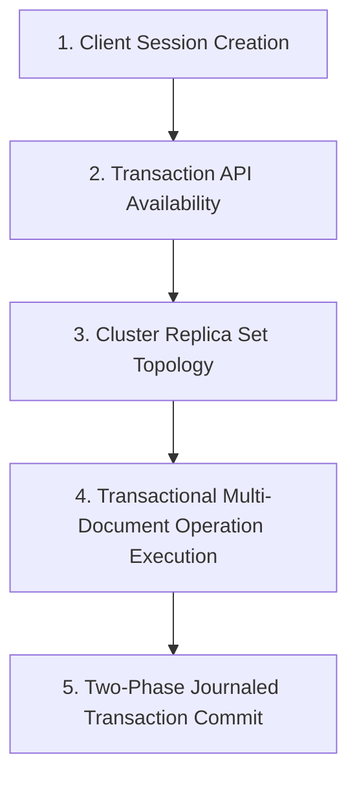

# SOGIL FURNITURE
# PHASE 2 ARCHITECTURE & SCOPE LOCK v1.2.4
## Final Acceptance Corrections & Production Guardrail Hardening

---

## 1. Document Metadata and Authoritative Hierarchy

- **Document Title**: Sogil Furniture — Phase 2 Architecture & Scope Lock v1.2.4: Final Acceptance Corrections & Production Guardrail Hardening
- **Version**: v1.2.4 (Authoritative Architectural Baseline)
- **Primary Source Documents**:
  - [`docs/architecture/SOGIL_PHASE_2_ARCHITECTURE_SCOPE_LOCK_v1.1.md`](file:///Users/syahidmujahid/Sogil-Project/Sogil-Furniture/docs/architecture/SOGIL_PHASE_2_ARCHITECTURE_SCOPE_LOCK_v1.1.md)
  - [`docs/architecture/SOGIL_PHASE_2_ARCHITECTURE_SCOPE_LOCK_v1.2.md`](file:///Users/syahidmujahid/Sogil-Project/Sogil-Furniture/docs/architecture/SOGIL_PHASE_2_ARCHITECTURE_SCOPE_LOCK_v1.2.md)
  - [`docs/architecture/SOGIL_PHASE_2_ARCHITECTURE_SCOPE_LOCK_v1.2.1.md`](file:///Users/syahidmujahid/Sogil-Project/Sogil-Furniture/docs/architecture/SOGIL_PHASE_2_ARCHITECTURE_SCOPE_LOCK_v1.2.1.md)
  - [`docs/architecture/SOGIL_PHASE_2_ARCHITECTURE_SCOPE_LOCK_v1.2.2.md`](file:///Users/syahidmujahid/Sogil-Project/Sogil-Furniture/docs/architecture/SOGIL_PHASE_2_ARCHITECTURE_SCOPE_LOCK_v1.2.2.md)
  - [`docs/architecture/SOGIL_PHASE_2_ARCHITECTURE_SCOPE_LOCK_v1.2.3.md`](file:///Users/syahidmujahid/Sogil-Project/Sogil-Furniture/docs/architecture/SOGIL_PHASE_2_ARCHITECTURE_SCOPE_LOCK_v1.2.3.md)
- **Baseline Git Commit**: `65a8f14d002304a7f67d92f256487dd4b00ddc42` (Phase 1: *Order-Payment Core*)
- **Status**: **AUTHORITATIVE ARCHITECTURAL SPECIFICATION** (Narrow Correction — Documentation Only)

---

## 2. Executive Summary & Authoritative Hierarchy

This document delivers the final, rigorous architectural corrections for **Phase 2 — Work Assignments & Production Piece-Rate** of the Sogil Furniture platform. It resolves the final two blocking review items identified in version 1.2.3:
1. **Correction of Finance Test Invariants (Issue 1)**: Completely eliminates invalid absolute global collection count assertions (`count == 0` for `finance_transactions` and `employee_wages`). Replaces them with **entity-level before/after delta invariants** ($\Delta = 0$) and isolated test fixtures, preserving historical database records across all scenarios.
2. **Rigorous Transaction Capability Probe Design (Issue 2)**: Replaces the simplistic `ping` probe with an operationally sound **safe transactional capability verification strategy**. Delineates what client sessions, transaction starts, transactional reads/writes, and commits actually prove, while strictly enforcing a **production fail-closed policy** without mutating business data.
3. **Monetary Precision Wording Clarification**: Formally scopes decimal calculation, rounding, and serialization claims, explicitly acknowledging IEEE 754 float representation boundaries.

---

## 3. Approved Business Decisions and Non-Negotiable Invariants

The following decisions are approved by the business owner and fully locked:

### A. Decision B-1: All-or-Nothing Lump-Sum Acceptance [APPROVED BUSINESS DECISION]
- Lump-sum (`lump_sum`) work assignments are eligible for wage accrual **only when the assigned work is accepted at exactly 100%** (`accepted_quantity == target_quantity`).
- Any attempt to submit partial acceptance (`accepted_quantity < target_quantity`) for a lump-sum assignment **MUST be rejected with `HTTP 422 Unprocessable Entity`**.
- Rejection causes:
  - Zero wage obligation creation;
  - Zero finance transaction creation, mutation, or reversal;
  - Zero assignment status mutation (remains `ready_for_review`);
  - Zero partially persisted acceptance or accrual state.
- Pro-rata wage calculations and full payment authorization for partial work are strictly prohibited.

### B. Decision E1: Controlled Task Categories [APPROVED BUSINESS DECISION]
- Supported task categories are strictly locked to five controlled values:
  1. `whole_item` (Borongan penuh / full piece manufacturing)
  2. `assembly` (Perakitan kerangka)
  3. `finishing` (Pengecatan / coating / polishing)
  4. `cutting` (Pemotongan bahan)
  5. `custom` (Penugasan khusus)
- Arbitrary free-text categories are prohibited. Specific notes must be stored in optional `task_notes: str`.

### C. Decision E2: Owner-Only Self-Approval Exception [APPROVED BUSINESS DECISION]
- Only an authenticated user whose server-verified role is strictly `"owner"` may self-approve their own work assignment.
- Roles `manager`, `admin`, and `employee` are strictly prohibited from self-approval (`HTTP 403 Forbidden`). Administrative permissions do not override this restriction.
- The bypass skips **only the actor separation check**. It does not skip lifecycle states (`assigned` $\to$ `in_progress` $\to$ `ready_for_review` $\to$ `completed`) or quantity/rate validations.
- Every self-approval records an immutable dual audit trail (`is_owner_bypass: True` in domain entities and in `db.audit_logs`).

### D. Zero Cash Movement Boundary [LOCKED ARCHITECTURAL RULE]
- Phase 2 creates **ZERO cash-out finance transactions**, writes **ZERO records to `db.employee_wages`**, and causes **ZERO cash balance movements**.
- Wage obligations represent accrued accounting liabilities, not cash disbursements. Actual cash disbursement is deferred to Phase 3.

---

## 4. Issue 1: Entity-Level Finance Test Invariants & Delta Contract

### A. Elimination of Absolute Collection-Count Assumptions
In v1.2.3, TC-FIN-01 stated an expectation of `0 finance_transactions` and `0 employee_wages`. This assumption is invalid: a production, staging, or test database legitimately contains pre-existing financial transactions from Phase 1 operations (e.g. order revenues, customer deposits, material purchases) and historical wage payouts.

### B. The Authoritative Finance Delta Invariant Contract [LOCKED ARCHITECTURAL RULE]
Across every Phase 2 operation (assignment creation, progress updates, supervisor verification, lump-sum rejection, concurrent retries, unpaid voiding, and local standalone recovery):

1. **`db.finance_transactions` Delta Invariant**:
   - $\Delta \text{count(finance\_transactions)} = 0$ (no new transaction records inserted).
   - $\Delta \text{existing(finance\_transactions)} = 0$ (no existing transaction modified, voided, or deleted).
   - $\Delta \text{Cash Balance} = 0.00\text{ LE}$ and $0\text{ IDR}$ (zero cash balance movement).
2. **`db.employee_wages` Delta Invariant**:
   - $\Delta \text{count(employee\_wages)} = 0$ (no new historical payout records inserted).
   - $\Delta \text{existing(employee\_wages)} = 0$ (no historical payout records modified or deleted).
3. **`db.payments` Delta Invariant**:
   - $\Delta \text{count(payments)} = 0$ (no customer payments created or mutated).

### C. Operation-by-Operation Finance Delta Matrix

| Phase 2 Operation / Scenario | Baseline Snapshot | Post-Operation State | Expected Finance / Cash Delta | Side Effect Verification Method |
| :--- | :--- | :--- | :---: | :--- |
| **Successful Accrual (Per-Unit or 100% Lump-Sum)** | Existing ledger: $N$ txns, $M$ wage docs | 1 new `wage_obligation` accrued | **$\Delta = 0$** | Query `finance_transactions` with `_id > max_before_id` returns 0; wage docs count unchanged. |
| **Rejected Lump-Sum Partial Acceptance (`HTTP 422`)** | Existing ledger: $N$ txns, $M$ wage docs | Assignment `ready_for_review` | **$\Delta = 0$** | Zero new records; zero status changes. |
| **Duplicate / Replay Verification Request** | Existing ledger: $N$ txns, $M$ wage docs | Returns existing canonical obligation | **$\Delta = 0$** | Zero new records; zero mutations. |
| **Concurrent Verification Race** | Existing ledger: $N$ txns, $M$ wage docs | Exactly 1 obligation created | **$\Delta = 0$** | Zero new finance records; ledger unchanged. |
| **Cancellation of Unpaid Obligation** | Existing ledger: $N$ txns, $M$ wage docs | Obligation marked `voided` | **$\Delta = 0$** | Voiding is an internal obligation status change; zero cash reversal or finance write. |
| **Failed Transaction / Rollback Attempt** | Existing ledger: $N$ txns, $M$ wage docs | Request fails (`HTTP 500` / `503`) | **$\Delta = 0$** | Zero records persisted across all collections. |
| **Interrupted Local Standalone Recovery** | Existing ledger: $N$ txns, $M$ wage docs | Reconciler resets or finalizes | **$\Delta = 0$** | Zero finance records created or altered. |

---

## 5. Issue 2: Transaction Capability Verification & Production Fail-Closed Design

### A. Analysis of the Flawed `ping` Probe
Version 1.2.3 proposed probing transaction availability by opening a session, starting a transaction, and running `client.command("ping")`.
Forensic evaluation demonstrates why this probe is insufficient:
1. In MongoDB, running an administrative or cluster-level database command like `ping` within a transaction session does not exercise multi-document ACID write locks or journal commits.
2. A database driver may accept `start_transaction()` in memory without communicating with the server until the first transactional write or read occurs.
3. Therefore, `ping` alone does NOT prove that multi-document transactional writes and commits can succeed operationally.

### B. Hierarchy of Transactional Capabilities



- **Session Creation**: Proves client supports sessions (Motor `start_session()`).
- **API Availability**: Proves driver supports `start_transaction()`.
- **Topology Support**: Proves deployment is a Replica Set or Sharded Cluster (standalone MongoDB throws `ConfigurationError`).
- **Operation Execution**: Proves collections can participate in transactional multi-document reads/writes.
- **Commit**: Proves transaction coordinator successfully finalized the write journal.

### C. The Authoritative Safe Transaction Capability Probe [LOCKED ARCHITECTURAL RULE]
To prove true end-to-end transactional execution **without mutating business collections** in production:
1. **Dedicated System Heartbeat Collection**:
   The probe operates strictly on an isolated internal system collection:
   `db._system_transaction_probes`
   (Completely separate from `orders`, `work_assignments`, `wage_obligations`, or `finance_transactions`).
2. **Non-Mutating Transaction Commit Sequence**:
   During application startup, the verification routine executes a complete transactional round-trip that leaves zero residual state:
   ```python
   async def verify_production_transaction_capability(client: AsyncIOMotorClient, db_name: str) -> bool:
       """
       Verifies multi-document transaction capability by executing an atomic
       write and rollback/cleanup inside a transaction session on an isolated probe collection.
       """
       probe_id = f"probe_{uuid.uuid4().hex[:12]}"
       probe_col = client[db_name]["_system_transaction_probes"]
       
       try:
           async with await client.start_session() as session:
               async with session.start_transaction():
                   # 1. Transactional Write to isolated probe collection
                   await probe_col.insert_one(
                       {"_id": probe_id, "probed_at": datetime.now(timezone.utc)},
                       session=session
                   )
                   # 2. Transactional Read
                   found = await probe_col.find_one({"_id": probe_id}, session=session)
                   if not found:
                       raise RuntimeError("Transactional read failed to find inserted probe doc")
                   
                   # 3. Transactional Delete (leaves probe collection clean)
                   await probe_col.delete_one({"_id": probe_id}, session=session)
                   
                   # 4. Commit Transaction
                   await session.commit_transaction()
           return True
       except (pymongo.errors.ConfigurationError, pymongo.errors.InvalidOperation) as e:
           logger.error(f"MongoDB deployment does not support transactions: {e}")
           return False
       except Exception as e:
           logger.error(f"Transaction capability probe failed: {e}")
           return False
   ```
3. **What This Proves**:
   - Session creation succeeded;
   - Replica set topology supported transactions;
   - Transactional document insertion and read succeeded;
   - Transaction commit finalized successfully;
   - Zero business data was touched or mutated.

### D. Production Startup & Runtime Fail-Closed Rules [LOCKED ARCHITECTURAL RULE]
1. **Startup Gate**:
   - If `ENVIRONMENT == "production"`: The startup probe MUST pass. If it fails, the application **FAILS STARTUP IMMEDIATELY** with a fatal log:
     ```text
     FATAL: Production database lacks verified multi-document transaction capability. Halting service.
     ```
2. **Runtime Fail-Closed**:
   - In production, work assignment verification (`POST /api/admin/assignments/{id}/verify`) executes strictly within a transaction session.
   - If session creation fails or the transaction aborts due to unrecoverable errors, the endpoint **FAILS CLOSED WITH `HTTP 503 Service Unavailable: "Sistem transaksi database tidak tersedia"`**.
   - **Silent downgrade to `session = None` in production is STRICTLY PROHIBITED BY CODE DESIGN**.
3. **Developer / CI Testing Allowance**:
   - Standalone fallback (Option A durable two-phase state machine) is permitted **ONLY when `ENVIRONMENT in ["development", "test"]`**.

---

## 6. Monetary Precision Claims & Boundaries

### A. Clarification of Mathematical Claims [LOCKED ARCHITECTURAL RULE]
To ensure complete mathematical honesty:
1. **Binary Float Limitations Acknowledged**:
   - MongoDB storage for Phase 2 wage obligations uses standard Python `float` values for field `amount_le` and `agreed_rate_le`.
   - The architecture explicitly acknowledges that IEEE 754 binary floating-point numbers cannot mathematically represent exact base-10 decimals.
   - We **DO NOT claim** "exact binary-float decimal persistence."
2. **Calculation Boundary Precision**:
   - All rate lookups, quantity multiplications, additions, and aggregations are performed strictly in Python's standard `decimal.Decimal` module.
   - Intermediate calculations evaluate with exact precision and are quantized via `Decimal("0.01")` using `ROUND_HALF_UP`.
   - Floating-point arithmetic during calculation is strictly prohibited.
3. **Serialization & Reconciliation Boundary**:
   - The quantized `Decimal` value is converted to `float` only at the persistence boundary: `float(quantized_decimal)`.
   - During equality comparisons, tests, or reconciliation, binary float comparisons (`a == b`) are prohibited. Comparisons must evaluate within an epsilon boundary:
     $$\left| \text{stored} - \text{expected} \right| < 0.0001$$
     or convert values to `Decimal(str(round(v, 2)))` prior to comparison.
4. **Zero Historical Migration**:
   - Phase 1 financial records remain untouched in their original float formats.

---

## 7. Order-Item Identity: Comprehensive Historical Reference Protection

### A. Protected Item Definition [LOCKED ARCHITECTURAL RULE]
An order item is classified as **PROTECTED** and cannot be deleted, replaced, or have its ID modified in `admin_update_order` if referenced by ANY of the following:
1. Active work assignments (`assigned`, `in_progress`, `ready_for_review`, `accruing`);
2. Completed work assignments (`completed`);
3. Cancelled work assignments (`cancelled`) with historical audit trails;
4. Wage obligations in any status (`accrued`, `paid`, `voided`).

### B. Array Edit Reconciliation Algorithm
```python
async def reconcile_order_items_on_update(order_id: str, incoming_items: List[dict]) -> List[dict]:
    order = await db.orders.find_one({"_id": id_query(order_id)})
    existing_items = order.get("items", [])
    existing_map = {i["item_id"]: i for i in existing_items if i.get("item_id")}

    # Query all active and historical references
    assigned_item_ids = set(await db.work_assignments.distinct(
        "order_item_id", {"order_id": order_id}
    ))
    obligated_item_ids = set(await db.wage_obligations.distinct(
        "order_item_id", {"order_id": order_id}
    ))
    protected_item_ids = assigned_item_ids.union(obligated_item_ids)

    seen_ids = set()
    sanitized_items = []

    for item in incoming_items:
        iid = item.get("item_id")
        if iid:
            if iid not in existing_map:
                raise HTTPException(400, f"item_id '{iid}' tidak terdaftar pada pesanan ini")
            if iid in seen_ids:
                raise HTTPException(400, f"Duplikasi item_id '{iid}' dalam request")
            seen_ids.add(iid)
            sanitized_items.append(item)
        else:
            # Genuine new item addition
            new_item = dict(item)
            new_item["item_id"] = f"itm_{uuid.uuid4().hex[:12]}"
            sanitized_items.append(new_item)

    # Check deletion of protected items
    for pid in protected_item_ids:
        if pid not in seen_ids:
            raise HTTPException(
                409, 
                f"Tidak dapat menghapus item pesanan yang memiliki riwayat penugasan atau kewajiban upah (item_id: {pid})"
            )

    return sanitized_items
```

---

## 8. Canonical Status Registry (Option A)

### A. Authoritative Entity Status Registries

#### 1. `db.work_assignments.status`
- **`assigned`** [Business]: Worker assigned to task; work not started. Zero financial impact.
- **`in_progress`** [Business]: Manufacturing started. Zero financial impact.
- **`ready_for_review`** [Business]: Work reported complete; awaiting inspection. Zero financial impact.
- **`accruing`** [Internal Processing State]: Transient lock during standalone non-transactional accrual. Governed by 60s timeout and background reconciliation fencing. Zero financial impact.
- **`completed`** [Business]: Verified and accepted; wage obligation accrued. Terminal state (except unpaid voiding).
- **`cancelled`** [Business]: Assignment terminated (either before start or post-accrual with voiding). Terminal state.

#### 2. `db.wage_obligations.status`
- **`accrued`** [Business]: Earned wage liability recorded upon verification. Zero cash movement.
- **`voided`** [Business]: Liability cancelled prior to payout; preserved for audit history. Terminal state.
- **`paid`** [Business]: [DEFERRED TO PHASE 3] Disbursed via Cash-Out finance transaction. Terminal state.

#### 3. Diagnostic Reconciliation Classifications (NOT persisted statuses)
- `RECON_CLEAN`: Perfect entity state and obligation consistency.
- `RECON_STALE_PROCESSING`: Assignment stuck in `accruing` $> 60\text{ seconds}$.
- `RECON_UNACCRUED_COMPLETION`: Assignment `completed` but canonical obligation is missing.
- `RECON_ORPHAN_OBLIGATION`: Obligation exists with no corresponding assignment.

---

## 9. Comprehensive Acceptance Test Matrix

Every test evaluates entity-level mutations and deltas without assuming clean or empty global collections.

| Test ID | Domain | Preconditions | Action | Expected Entity Result | Expected Finance Delta |
| :--- | :--- | :--- | :--- | :--- | :---: |
| **TC-MON-01** | Money Calculation | Agreed rate `33.33 LE`, accepted qty `3` | Verify work | Obligation accrued: `99.99 LE` (exact Decimal) | $\Delta \text{Cash} = 0, \Delta \text{Finance} = 0$ |
| **TC-MON-02** | Rate Over-Precision | Rate entered as `45.125 LE` | Create wage rule | Rejected with `HTTP 422 Unprocessable Entity` | $\Delta \text{Cash} = 0, \Delta \text{Finance} = 0$ |
| **TC-LMP-01** | Lump-Sum 100% (B-1) | Target 4 units at 500 LE; accepts 4 | Verify work | Assignment `completed`, obligation `500.00 LE` | $\Delta \text{Cash} = 0, \Delta \text{Finance} = 0$ |
| **TC-LMP-02** | Lump-Sum Partial (B-1) | Target 4 units at 500 LE; accepts 3 | Verify work | **Rejected `HTTP 422`**; assignment `ready_for_review` | $\Delta \text{Cash} = 0, \Delta \text{Finance} = 0$ |
| **TC-TXN-01** | Fail-Closed Production | Prod mode; mock session failure | Verify work | **Rejected `HTTP 503`**; 0 writes performed | $\Delta \text{Cash} = 0, \Delta \text{Finance} = 0$ |
| **TC-TXN-02** | Local Standalone Recovery | Standalone mode; crash in `accruing` | Run reconciler | Reconciler resets assignment to `ready_for_review` | $\Delta \text{Cash} = 0, \Delta \text{Finance} = 0$ |
| **TC-ITM-01** | Reorder Item Stability | Order with 2 items | Update order items | Array reordered; `item_id` preserved exactly | $\Delta \text{Cash} = 0, \Delta \text{Finance} = 0$ |
| **TC-ITM-02** | Active Item Delete Block | Item has active assignment | Delete item in edit| **Rejected `HTTP 409 Conflict`** | $\Delta \text{Cash} = 0, \Delta \text{Finance} = 0$ |
| **TC-ITM-03** | Cancelled Item Delete Block| Item has cancelled assignment | Delete item in edit| **Rejected `HTTP 409 Conflict`** | $\Delta \text{Cash} = 0, \Delta \text{Finance} = 0$ |
| **TC-AUT-01** | Non-Owner Self-Approval | Admin worker verifies own work | Verify work | **Rejected `HTTP 403 Forbidden`** | $\Delta \text{Cash} = 0, \Delta \text{Finance} = 0$ |
| **TC-AUT-02** | Owner Self-Approval | Owner worker verifies own work | Verify work | Succeeded; `is_owner_bypass: true`; audit logged | $\Delta \text{Cash} = 0, \Delta \text{Finance} = 0$ |
| **TC-CON-01** | Concurrency Idempotency | 2 simultaneous verification calls | Verify work | Exactly 1 obligation created; replay returns canonical | $\Delta \text{Cash} = 0, \Delta \text{Finance} = 0$ |
| **TC-CAN-01** | Unpaid Obligation Voiding | Completed unpaid assignment | Cancel assignment | Assignment `cancelled`; obligation `voided` | $\Delta \text{Cash} = 0, \Delta \text{Finance} = 0$ |
| **TC-CAN-02** | Paid Obligation Cancel Block| Obligation has `paid_amount > 0` | Cancel assignment | **Rejected `HTTP 400 Bad Request`** | $\Delta \text{Cash} = 0, \Delta \text{Finance} = 0$ |
| **TC-FIN-01** | Zero Finance Delta Leakage | Pre-existing ledger with historical txns | Complete operations| 0 new finance transactions, 0 new `employee_wages` | **$\Delta \text{Finance} = 0, \Delta \text{Cash} = 0$** |

---

## 10. Explicit Scope Boundaries & Exclusions

The following domains are explicitly excluded from Phase 2:
- [ ] Payout batch disbursement engine (`db.finance_transactions` cash-out write) $\to$ **Deferred to Phase 3**.
- [ ] Worker payout UI modal and printable payroll slips $\to$ **Deferred to Phase 3**.
- [ ] Delivery logistics, driver assignments, and delivery wages $\to$ **Deferred to Future Logistics Phase**.
- [ ] Material consumption stock deduction upon order completion $\to$ **Deferred to Future Inventory Phase**.
- [ ] Automated HPP gross margin costing engine $\to$ **Deferred to Future Accounting Phase**.
- [ ] Worker mobile self-service application $\to$ **Deferred**.

---

## 11. Final Architecture Readiness Verdict

### 🟢 **PASS — READY FOR MASTER BUILD PROMPT**

**Architectural Assessment**:  
All acceptance review items have been resolved with complete rigor:
1. TC-FIN-01 and the finance invariant matrix strictly enforce entity-level delta validations ($\Delta = 0$), eliminating all absolute-zero collection count assumptions and preserving historical records.
2. The transaction capability probe operates on an isolated probe collection through a complete transactional insert, read, delete, and commit sequence, proving end-to-end multi-document transaction support without touching business data.
3. Production fail-closed behavior is strictly guaranteed by design.
4. Mathematical claims honestly acknowledge IEEE 754 binary float representation limits while ensuring calculation rigor via Python `Decimal`.
5. Historical order item protection covers all assigned and obligated states.
6. Approved Decisions B-1, E1, and E2 remain locked.

Phase 2 Architecture & Scope Lock is **100% complete and authoritative**. The system is ready to proceed to the creation of the separate **Phase 2 Master Build Prompt** upon user authorization.
