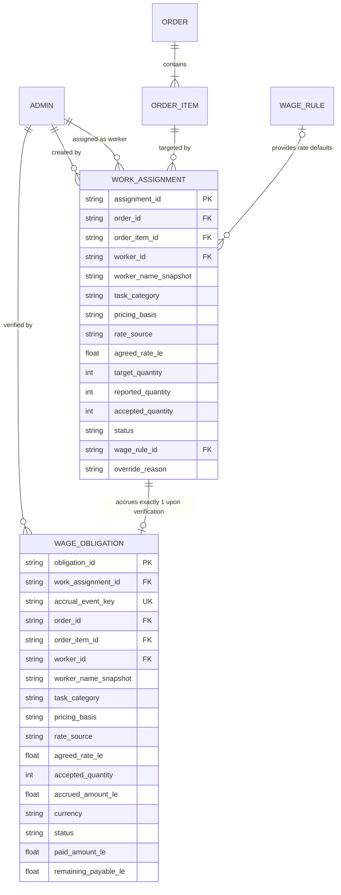
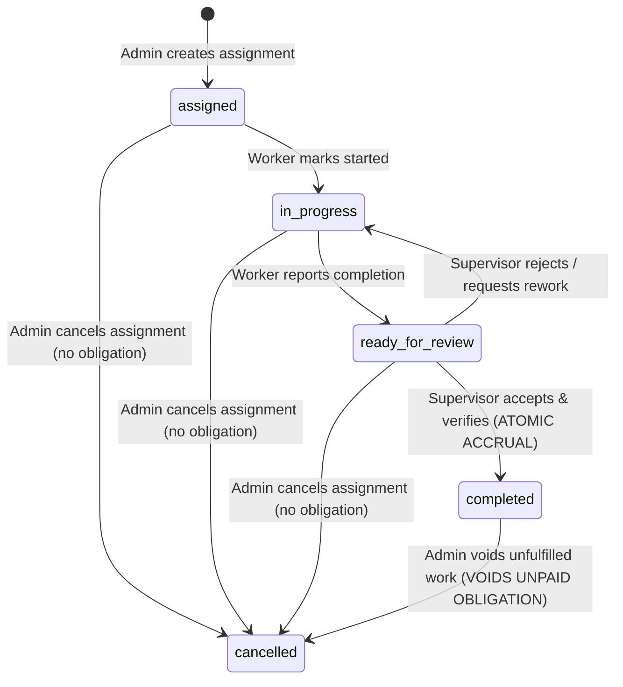

# SOGIL FURNITURE
# PHASE 2 ARCHITECTURE & SCOPE LOCK v1.2
## Final Technical Correction: Work Assignments & Production Piece-Rate

---

## 1. Executive Summary

This document establishes the definitive, corrected architectural contract for **Phase 2 — Work Assignments & Production Piece-Rate** of the Sogil Furniture management platform. Building directly on the verified Phase 1 baseline (`65a8f14d002304a7f67d92f256487dd4b00ddc42`, *Order-Payment Core*), Phase 2 governs the operational execution of manufacturing: assigning craftsmen/workers to order items, calculating piece-rate and task wages against configurable rules or explicit overrides, recording verified completion under dual-custody verification, and accruing immutable wage obligations.

Revision v1.2 incorporates final technical corrections to eliminate concurrency edge cases, decouple pricing basis from rate sources, formalize single final accrual semantics, guarantee persistent order item identity, and establish exact monetary precision.

### Key Architectural Invariants:
1. **Accrual Event Identity & Concurrency Safety**: A single-field unique index on `db.wage_obligations.accrual_event_key` (`acc_{work_assignment_id}`) paired with an atomic conditional state transition (`find_one_and_update` on `status: "ready_for_review"`) guarantees that duplicate concurrent requests cannot double-accrue wage liabilities. On duplicate key or replay, the endpoint idempotently fetches and validates the canonical obligation. In environments lacking multi-document transactions (e.g. standalone test MongoDB), explicit compensating rollbacks revert uncommitted state changes.
2. **Cardinality Contract**: Exactly **one work assignment produces at most one final wage obligation**. Incremental batch accruals are eliminated. Partial completion is represented solely by recording a final `accepted_quantity` ($\le \text{target_quantity}$) upon verification.
3. **Orthogonal Pricing Architecture**: Pricing basis (`per_unit` vs `lump_sum`) is strictly decoupled from rate source (`standard_rule` vs `manual_override`). Lump-sum jobs are never multiplied by quantity under any configuration.
4. **Stable Order Item Identity**: Every order item receives a permanent, server-generated `item_id` (`itm_<uuid12>`) upon order creation or invoice conversion. Existing item IDs are preserved during edits. Deleting order items with active assignments is rejected with `HTTP 409 Conflict`.
5. **Role Governance & Dual Custody**: Verification requires dual custody. Self-approval is strictly rejected with `HTTP 403 Forbidden` for `admin`, `manager`, and `employee` roles. Only a verified user with role `"owner"` may approve their own assignment, with full audit trail attribution (`is_owner_bypass: true`).
6. **Strict Financial Decoupling**: Phase 2 creates zero cash movements, writes zero finance transactions, and leaves historical `db.employee_wages` untouched. Wage obligations represent earned accrued liabilities, not cash disbursements. Payout execution is completely deferred to Phase 3.

---

## 2. Revision History from v1.1 to v1.2

| Topic / Area | v1.1 Architectural Gap / Weakness | v1.2 Corrected Architecture & Resolution |
| :--- | :--- | :--- |
| **Concurrency & Accrual Race** (Correction A & G) | Assignment marked `completed` before inserting obligation. On `DuplicateKeyError`, silently swallowed (`pass`) without validating assignment link or handling standalone Mongo rollback. | Status transition conditional on `ready_for_review`. Accrual key is strictly `acc_{work_assignment_id}`. On duplicate key collision, fetches canonical obligation, validates `work_assignment_id`, returns it idempotently. If standalone Mongo fails obligation insert, explicit compensating rollback restores assignment to `ready_for_review` and returns `HTTP 500`. |
| **Accrual Cardinality** (Correction B) | Ambiguous references to `batch_index = 1` suggested multi-batch accruals might occur per assignment. | Explicitly locked: **One assignment = at most one final wage obligation**. No incremental batches. Partial completion accepted at verification with `accepted_quantity <= target_quantity`. `batch_index` references removed. |
| **Compensation Model & Rates** (Correction C) | Conflated pricing basis and rate source in `manual_fixed`. | Completely separated into orthogonal fields: `pricing_basis` (`per_unit` \| `lump_sum`) and `rate_source` (`standard_rule` \| `manual_override`). Lump sum is never multiplied by quantity. |
| **Order Item Identity** (Correction D) | Allowed loose virtual keys (`itm_legacy_{order_id}_{index}`) which shift upon item reordering. | Server persists immutable `item_id` (`itm_<uuid12>`). Injected at creation and invoice conversion. Preserved during updates. Removing assigned items rejected (`HTTP 409`). For historical items, persisted lazily on first assignment. |
| **Verification Governance** (Correction E) | Self-approval bypass was ambiguous. | **Approved Decision E2 locked**: Only `role === "owner"` can self-approve. `admin`, `manager`, and `employee` are strictly blocked (`HTTP 403`). Audit trail records `is_owner_bypass: bool`. |
| **Money Representation & Precision** (Correction F) | Generic reference to float rounding without calculation specification. | Calculation uses exact numeric rounding `round(val, 2)` evaluated immediately on multiplication. Stored as 2-decimal floats compatible with Phase 1 `amount_le` float schema while eliminating floating point drift. |
| **Task Categories** | Proposed categories subject to decision. | **Approved Decision E1 locked**: Controlled task categories: `whole_item`, `assembly`, `finishing`, `cutting`, `custom`, with optional notes for specifics. |
| **Failure & Voiding Paths** (Correction H) | Unpaid vs paid obligation voiding semantics lacked formal failure matrix. | Uncompleted: cancel assignment. Completed unpaid: cancel assignment + void obligation with audit reason. Completed paid: cancellation strictly forbidden (`HTTP 400`). |

---

## 3. Verified Baseline and Git State

- **Repository Root**: `/Users/syahidmujahid/Sogil-Project/Sogil-Furniture`
- **Active Branch**: `main`
- **Verified HEAD Commit**: `65a8f14d002304a7f67d92f256487dd4b00ddc42`
- **Verified Remote `origin/main`**: `65a8f14d002304a7f67d92f256487dd4b00ddc42`
- **Commit Subject**: `feat(order): implement phase 1 order payment core`
- **Working Tree State**:
  ```text
  ?? backend/tests/test_migrate_legacy_inventory_units.py
  ?? docs/architecture/SOGIL_PHASE_2_ARCHITECTURE_SCOPE_LOCK_v1.1.md
  ?? docs/architecture/SOGIL_PHASE_2_ARCHITECTURE_SCOPE_LOCK_v1.2.md
  ?? scripts/migrate_legacy_inventory_units.py
  ```
  *(Untracked migration files preserved untouched; zero tracked file modifications)*
- **Production Status**:
  - Railway Backend: Live on `65a8f14` (`https://sogil-furniture-production.up.railway.app`)
  - Cloudflare Pages Frontend: Live on `65a8f14` (`https://sogilfurniture.com`, `https://team.sogilfurniture.com`)
  - Production DB: MongoDB Atlas (READ-ONLY during this audit)

---

## 4. Evidence and Confidence Classification

Every architectural specification in this document is classified as follows:
1. **[VERIFIED FACT]**: Directly proven by repository inspection with file path and line numbers.
2. **[LOCKED ARCHITECTURAL SPECIFICATION]**: Corrected, authoritative specification governing Phase 2 implementation.
3. **[DECISION LOCKED]**: Confirmed business and operational rule locked by user decision.
4. **[DEFERRED]**: Explicitly excluded from Phase 2 and reserved for Phase 3 or later.

---

## 5. Existing Architecture Findings

### A. Order and Order-Item Persistence [VERIFIED FACT]
- **Orders Collection**: `db.orders`.
- **Embedded Items Structure**: Items are persisted as an embedded array `items: List[dict]` and mirrored into a legacy singular `item: dict` field ([`server.py#L1623`](file:///Users/syahidmujahid/Sogil-Project/Sogil-Furniture/backend/server.py#L1623)).
- **Item Identification Deficit**:
  - In public checkout ([`server.py#L1566-L1572`](file:///Users/syahidmujahid/Sogil-Project/Sogil-Furniture/backend/server.py#L1566-L1572)), items contain `product_id`, `product_name_snapshot`, `configuration_snapshot`, `quantity`, `unit_price_le`, and `subtotal_le`, but no persistent unique `item_id`.
  - In invoice conversion ([`server.py#L1343-L1361`](file:///Users/syahidmujahid/Sogil-Project/Sogil-Furniture/backend/server.py#L1343-L1361)), invoice items are converted into order items without assigned IDs.
  - In admin order editing ([`server.py#L1901-L1904`](file:///Users/syahidmujahid/Sogil-Project/Sogil-Furniture/backend/server.py#L1901-L1904)), `update["items"] = data.items` replaces the array wholesale.
- *Resolution*: Persistent `item_id` must be injected on order creation/invoice conversion and preserved across order updates.

### B. Team Accounts & Role Master [VERIFIED FACT]
- **Canonical Master**: `db.admins` ([`server.py#L120-L130`](file:///Users/syahidmujahid/Sogil-Project/Sogil-Furniture/backend/server.py#L120-L130)).
- **Account Types**: `ACCOUNT_TYPES = ["owner", "manager", "admin", "employee"]`.
- **Permissions**: `PERMISSION_KEYS = ["manage_orders", "modify_products", "manage_settings", "access_finance", "delete_data", "manage_admins"]`.
- *Finding*: Craftsmen/workers are registered directly in `db.admins`. No redundant worker master collection will be created.

---

## 6. Existing `employee_wages` Compatibility [VERIFIED FACT]

- **Code Path Inspection**:
  - In [`server.py#L3862-L3874`](file:///Users/syahidmujahid/Sogil-Project/Sogil-Furniture/backend/server.py#L3862-L3874), a record is inserted into `db.employee_wages` *only* when an admin records a cash expense transaction in `db.finance_transactions` (`type == "expense"` and `_is_wage_category(category)`).
  - In [`server.py#L3930,L3958`](file:///Users/syahidmujahid/Sogil-Project/Sogil-Furniture/backend/server.py#L3930), updating or deleting that finance transaction modifies or removes the `employee_wages` record.
  - In [`server.py#L4189-L4200`](file:///Users/syahidmujahid/Sogil-Project/Sogil-Furniture/backend/server.py#L4189-L4200), `employee_wages_summary` queries `db.finance_transactions` as primary source of truth, treating `employee_wages` as a historical fallback.
- **Architectural Mandate**:
  `db.employee_wages` represents **historical cash disbursement receipts (paid wages)**, NOT work assignments and NOT accrued wage liabilities.
  Phase 2 must **leave `db.employee_wages` completely untouched**. Work assignments and accrued liabilities reside in new dedicated operational collections (`db.work_assignments` and `db.wage_obligations`).

---

## 7. Stable Order Item Identity [LOCKED ARCHITECTURAL SPECIFICATION]

To ensure assignments remain durably linked to the exact intended furniture item:
1. **Creation Generation**:
   Every item inserted into `orders.items` during checkout (`create_order`) or invoice conversion (`convert_invoice_to_order`) receives a permanent unique `item_id`:
   ```python
   "item_id": f"itm_{uuid.uuid4().hex[:12]}"
   ```
2. **Order Editing Preservation**:
   In `admin_update_order`, existing items retain their `item_id`. New items added receive a newly generated `item_id`.
3. **Deletion Protection**:
   If an admin attempts to remove an item from `order.items` that has existing work assignments (`db.work_assignments.count_documents({"order_id": order_id, "order_item_id": item_id}) > 0`), the update is rejected with:
   ```text
   HTTP 409 Conflict: "Tidak dapat menghapus item pesanan yang memiliki penugasan kerja aktif"
   ```
4. **Historical Orders Backward Compatibility**:
   For historical orders created prior to Phase 2 that lack `item_id`, when an assignment is created for an item, the backend assigns an `item_id` to that item in `db.orders.items` and persists it, ensuring immutable identity going forward.
5. **Phase 1 Invariant**:
   Adding `item_id` to embedded item dictionaries has zero impact on Phase 1 payment processing, order totals, or finance ledger calculations.

---

## 8. Domain Model and Relationships [LOCKED ARCHITECTURAL SPECIFICATION]



---

## 9. Assignment Granularity & Task Categories [DECISION LOCKED]

### A. Granularity Rules:
1. **Multiple Workers per Order Item (0 to 3+)**:
   An order item can have multiple workers assigned across different production steps.
   - *Example*: Order Item: Meja Kerja 160x80 (Qty 2) $\to$ Worker Ahmad (assembly), Worker Budi (finishing).
2. **Uniqueness Constraint**:
   The same worker cannot be assigned to the same task category on the same order item more than once in an active state (`assigned`, `in_progress`, `ready_for_review`). This is enforced by a partial unique index.

### B. Controlled Task Categories [DECISION LOCKED: E1]:
Assignments must use one of the five approved task categories:
- `whole_item`: Borongan penuh / Complete manufacturing of item by one craftsman.
- `assembly`: Perakitan kerangka / Structural assembly.
- `finishing`: Pengecatan / Polishing / Coating.
- `cutting`: Pemotongan bahan / Wood cutting and preparation.
- `custom`: Penugasan khusus dengan catatan spesifik.

An optional `task_notes: str` field allows specifying operational nuances without breaking category indexing.

---

## 10. Completion Reporting and Verification Workflow [LOCKED ARCHITECTURAL SPECIFICATION]

The assignment state machine enforces strict operational dual-custody:



### Transition Matrix & Permissions:
1. **`assigned` $\to$ `in_progress`**:
   - *Actor*: Assigned worker OR admin/manager with `manage_orders`.
   - *Payload*: None.
   - *Mutation*: Sets `status = "in_progress"`, `started_at = now_iso`. Zero financial impact.
2. **`in_progress` $\to$ `ready_for_review`**:
   - *Actor*: Assigned worker OR admin/manager with `manage_orders`.
   - *Payload*: `reported_quantity: int` ($1 \le \text{reported} \le \text{target}$), `notes: Optional[str]`.
   - *Mutation*: Sets `status = "ready_for_review"`, `reported_quantity`, `reported_at = now_iso`. Zero financial impact.
3. **`ready_for_review` $\to$ `in_progress` (Rework / Rejection)**:
   - *Actor*: Supervisor / Admin with `manage_orders`.
   - *Payload*: `rejection_reason: str`.
   - *Mutation*: Sets `status = "in_progress"`, logs rejection reason in audit trail. Zero financial impact.
4. **`ready_for_review` $\to$ `completed` (Acceptance & Wage Accrual)**:
   - *Actor*: Supervisor / Admin with `manage_orders`.
   - *Authorization Rule [DECISION LOCKED: E2]*: If `current_user["id"] == assignment["worker_id"]`, the action is REJECTED with `HTTP 403 Forbidden: "Pekerja tidak dapat menyetujui penugasan sendiri"`, **UNLESS `current_user["role"] == "owner"`**. Non-owners (`admin`, `manager`, `employee`) can NEVER self-approve.
   - *Payload*: `accepted_quantity: int` ($1 \le \text{accepted} \le \text{target}$), `verification_notes: Optional[str]`.
   - *Mutation*: Atomically transitions assignment to `completed` and creates exactly one `WageObligation`. Sets `is_owner_bypass: True` if owner self-approved.
5. **`completed` $\to$ `cancelled` (Voiding)**:
   - *Actor*: Owner OR Admin with `access_finance`.
   - *Prerequisite*: Allowed ONLY if linked `WageObligation` has `paid_amount_le == 0.0`. If `paid_amount_le > 0.0`, request is REJECTED with `HTTP 400 Bad Request: "Tidak dapat membatalkan penugasan dengan kewajiban upah yang sudah terbayar"`.
   - *Mutation*: Sets assignment `status = "cancelled"`, sets linked obligation `status = "voided"`.

---

## 11. Wage Rules and Compensation Models [LOCKED ARCHITECTURAL SPECIFICATION]

### A. Orthogonal Compensation Structure
To eliminate ambiguity, pricing basis is decoupled from rate source:

1. **`pricing_basis`** (`str`, enum):
   - `"per_unit"`: Wage is earned per accepted unit of finished furniture.
   - `"lump_sum"`: Wage is a fixed total amount for the job, regardless of quantity.
2. **`rate_source`** (`str`, enum):
   - `"standard_rule"`: Rate prefilled from active rule in `db.wage_rules`. Requires `wage_rule_id`.
   - `"manual_override"`: Rate negotiated manually by admin. Requires `override_reason`. `wage_rule_id` is null.

### B. Valid Combinations and Invariants:

| `pricing_basis` | `rate_source` | Calculation Formula | Target / Accepted Qty Meaning |
| :--- | :--- | :--- | :--- |
| **`per_unit`** | `standard_rule` | $\text{round}(\text{agreed\_rate\_le} \times \text{accepted\_quantity}, 2)$ | Worker gets rate per accepted piece. |
| **`per_unit`** | `manual_override` | $\text{round}(\text{agreed\_rate\_le} \times \text{accepted\_quantity}, 2)$ | Worker gets negotiated rate per accepted piece. |
| **`lump_sum`** | `standard_rule` | $\text{round}(\text{agreed\_rate\_le}, 2)$ | Total job fee. **NEVER multiplied by quantity.** |
| **`lump_sum`** | `manual_override` | $\text{round}(\text{agreed\_rate\_le}, 2)$ | Negotiated total job fee. **NEVER multiplied by quantity.** |

> [!IMPORTANT]
> **Cardinality Invariant**: For all `lump_sum` assignments, `accrued_amount_le` is strictly equal to `agreed_rate_le`. It is NEVER multiplied by `target_quantity` or `accepted_quantity`.

---

## 12. Calculation Formulas and Worked Examples [LOCKED ARCHITECTURAL SPECIFICATION]

### Example 1: Standard Per-Unit Piece Rate
- **Order Item**: Rak Sepatu 4 Tingkat, Quantity = 5.
- **Assignment**: Worker Ahmad, `task_category = "assembly"`.
- **Pricing**: `pricing_basis = "per_unit"`, `rate_source = "standard_rule"`, `agreed_rate_le = 40.00`.
- **Verification**: Worker reports 5; Supervisor accepts 5 units.
- **Accrual Calculation**:
  $$\text{accrued\_amount\_le} = \text{round}(40.00 \times 5, 2) = 200.00\text{ LE}$$
- **Result**: Obligation created for `200.00 LE`.

### Example 2: Standard Lump-Sum Borongan
- **Order Item**: Meja Rapat Custom 300x120, Quantity = 2 sets.
- **Assignment**: Worker Budi, `task_category = "finishing"`.
- **Pricing**: `pricing_basis = "lump_sum"`, `rate_source = "standard_rule"`, `agreed_rate_le = 350.00`.
- **Verification**: Worker reports complete; Supervisor accepts 2 sets.
- **Accrual Calculation**:
  $$\text{accrued\_amount\_le} = \text{round}(350.00, 2) = 350.00\text{ LE}$$
  *(Not $350 \times 2 = 700$. Lump sum is fixed).*
- **Result**: Obligation created for `350.00 LE`.

### Example 3: Manual Override Per-Unit
- **Order Item**: Kursi Cafe Bespoke, Quantity = 10.
- **Assignment**: Worker Candra, `task_category = "cutting"`.
- **Pricing**: `pricing_basis = "per_unit"`, `rate_source = "manual_override"`, `agreed_rate_le = 17.50`, `override_reason = "Material kayu jati tua ekstra keras"`.
- **Verification**: Supervisor accepts 10 units.
- **Accrual Calculation**:
  $$\text{accrued\_amount\_le} = \text{round}(17.50 \times 10, 2) = 175.00\text{ LE}$$
- **Result**: Obligation created for `175.00 LE`.

### Example 4: Manual Override Lump-Sum with Partial Accepted Quantity
- **Order Item**: Lemari Pajang 2 Pintu, Quantity = 4.
- **Assignment**: Worker Dani, `task_category = "custom"`.
- **Pricing**: `pricing_basis = "lump_sum"`, `rate_source = "manual_override"`, `agreed_rate_le = 500.00`, `override_reason = "Instalasi ukiran khusus"`.
- **Verification**: Worker completed 4, but supervisor only accepts 3 due to defect on 1 unit.
- **Accrual Calculation**:
  $$\text{accrued\_amount\_le} = \text{round}(500.00, 2) = 500.00\text{ LE}$$
  *(Lump sum agreed for the job is accrued as agreed; supervisor records defect in notes).*
- **Result**: Obligation created for `500.00 LE`.

---

## 13. Accrual Event Identity and Cardinality Contract [LOCKED ARCHITECTURAL SPECIFICATION]

### A. Cardinality Contract:
**Exactly one work assignment produces at most one final wage obligation.**
- There are no incremental batches, multi-phase payouts, or partial accrual slices in Phase 2.
- If only part of the target quantity is accepted, verification records `accepted_quantity` ($\le \text{target_quantity}$) and creates the **single final wage obligation** for that accepted quantity.
- All references to `batch_index` are eliminated.

### B. Canonical Accrual Event Key:
$$\text{accrual\_event\_key} = \text{f"acc\_\{work\_assignment\_id\}"}$$

### C. Single-Field Unique Database Constraint:
```python
await db.wage_obligations.create_index(
    [("accrual_event_key", 1)],
    unique=True,
    name="uniq_wage_obligation_accrual_event"
)
```
Any attempt to insert a second obligation for the same assignment collides with this unique index.

---

## 14. Idempotency, Concurrency Strategy, and Race Safety [LOCKED ARCHITECTURAL SPECIFICATION]

### A. The Race-Safe Verification Flow:
To prevent race conditions, double accrual, and inconsistent status states:

```python
async def verify_work_assignment(assignment_id: str, payload: VerifyPayload, admin: dict):
    # 1. Authorization check: prevent self-approval unless owner
    assignment = await db.work_assignments.find_one({"_id": id_query(assignment_id)})
    if not assignment:
        raise HTTPException(404, "Penugasan tidak ditemukan")
        
    is_self = str(admin["id"]) == str(assignment["worker_id"])
    is_owner = admin.get("role") == "owner"
    if is_self and not is_owner:
        raise HTTPException(403, "Pekerja tidak dapat menyetujui penugasan sendiri")
        
    now_iso = datetime.now(timezone.utc).isoformat()
    accrual_key = f"acc_{str(assignment['_id'])}"
    
    # Calculate accrued amount
    agreed_rate = round(float(assignment["agreed_rate_le"]), 2)
    pricing_basis = assignment.get("pricing_basis", "per_unit")
    accepted_qty = int(payload.accepted_quantity)
    
    if pricing_basis == "per_unit":
        accrued_amount = round(agreed_rate * accepted_qty, 2)
    else:
        accrued_amount = agreed_rate

    # 2. Atomic conditional state transition:
    # Match ONLY if currently ready_for_review
    updated_assignment = await db.work_assignments.find_one_and_update(
        {
            "_id": id_query(assignment_id),
            "status": "ready_for_review"
        },
        {
            "$set": {
                "status": "completed",
                "accepted_quantity": accepted_qty,
                "verified_by_id": str(admin["id"]),
                "verified_by_name": admin.get("name", ""),
                "verified_by_role": admin.get("role", ""),
                "is_owner_bypass": is_self and is_owner,
                "verification_notes": payload.verification_notes or "",
                "verified_at": now_iso
            }
        },
        return_document=ReturnDocument.AFTER
    )
    
    if not updated_assignment:
        # Check if already completed (replay/idempotent retry)
        current = await db.work_assignments.find_one({"_id": id_query(assignment_id)})
        if current and current.get("status") == "completed":
            existing_ob = await db.wage_obligations.find_one({"accrual_event_key": accrual_key})
            if existing_ob and str(existing_ob.get("work_assignment_id")) == str(current["_id"]):
                return clean(existing_ob)
            raise HTTPException(500, "Inkonsistensi data: penugasan selesai tanpa kewajiban upah")
        raise HTTPException(400, f"Penugasan tidak dalam status siap ditinjau (status: {current.get('status')})")

    # 3. Construct obligation document
    obligation_doc = {
        "_id": ObjectId(),
        "obligation_number": await _generate_obligation_number(),
        "accrual_event_key": accrual_key,
        "work_assignment_id": str(updated_assignment["_id"]),
        "order_id": updated_assignment["order_id"],
        "order_number": updated_assignment.get("order_number", ""),
        "order_item_id": updated_assignment["order_item_id"],
        "item_name_snapshot": updated_assignment.get("item_name_snapshot", ""),
        "worker_id": updated_assignment["worker_id"],
        "worker_name_snapshot": updated_assignment.get("worker_name_snapshot", ""),
        "task_category": updated_assignment.get("task_category", "whole_item"),
        "pricing_basis": pricing_basis,
        "rate_source": updated_assignment.get("rate_source", "standard_rule"),
        "agreed_rate_le": agreed_rate,
        "accepted_quantity": accepted_qty,
        "accrued_amount_le": accrued_amount,
        "currency": "EGP",
        "status": "accrued",
        "paid_amount_le": 0.0,
        "remaining_payable_le": accrued_amount,
        "accrued_at": now_iso,
        "verified_by_id": str(admin["id"]),
        "verified_by_name": admin.get("name", ""),
        "verified_by_role": admin.get("role", ""),
        "is_owner_bypass": is_self and is_owner,
        "payout_allocations": []
    }
    
    # 4. Insert obligation with DuplicateKey and rollback handling
    try:
        await db.wage_obligations.insert_one(obligation_doc)
        return clean(obligation_doc)
    except DuplicateKeyError:
        # Fetch canonical obligation and validate match
        existing_ob = await db.wage_obligations.find_one({"accrual_event_key": accrual_key})
        if existing_ob and str(existing_ob.get("work_assignment_id")) == str(updated_assignment["_id"]):
            return clean(existing_ob)
        raise HTTPException(409, "Konflik kunci akrual pada sistem kewajiban upah")
    except Exception as e:
        # Standalone Mongo fallback: Compensating rollback
        await db.work_assignments.update_one(
            {"_id": updated_assignment["_id"]},
            {
                "$set": {
                    "status": "ready_for_review",
                    "rollback_reason": f"Gagal mencatat kewajiban upah: {str(e)}"
                },
                "$unset": {
                    "accepted_quantity": "",
                    "verified_by_id": "",
                    "verified_by_name": "",
                    "verified_by_role": "",
                    "is_owner_bypass": "",
                    "verified_at": ""
                }
            }
        )
        raise HTTPException(500, f"Gagal memverifikasi penugasan kerja: {str(e)}")
```

---

## 15. Transaction and Standalone MongoDB Compensating Rollback [LOCKED ARCHITECTURAL SPECIFICATION]

1. **Production Environment (MongoDB Atlas Replica Set)**:
   - Verification runs within a multi-document transaction session (`async with await client.start_session() as session: async with session.start_transaction():`).
   - If `insert_one(obligation_doc)` fails, the transaction aborts automatically, reverting both assignment update and obligation insert.
2. **Local / CI Environment (Standalone MongoDB without Replica Set)**:
   - When running on standalone MongoDB where transactions raise `ConfigurationError` or `OperationFailure`, the engine catches the exception during obligation insertion and executes an explicit **compensating rollback**:
     - Status is rolled back from `completed` to `ready_for_review`.
     - Verification audit fields (`verified_by_id`, `verified_at`, `accepted_quantity`) are unset.
     - Logs error and raises `HTTP 500`.
3. **Reconciliation Invariant**:
   Every `completed` assignment MUST have exactly one `accrued` or `paid` obligation.
   $$\text{count}(\text{assignments}(\text{status} = \text{"completed"})) = \text{count}(\text{obligations}(\text{status} \in \{\text{"accrued"}, \text{"paid"}\}))$$

---

## 16. Cancellation, Failure, and Correction Paths [LOCKED ARCHITECTURAL SPECIFICATION]

| State at Time of Action | Permitted Operation | Financial Impact | Assignment State | Obligation State | Restrictions |
| :--- | :--- | :--- | :--- | :--- | :--- |
| **`assigned`** | Cancel | Zero liability; zero cash | `cancelled` | None | Free to cancel |
| **`in_progress`** | Cancel | Zero liability; zero cash | `cancelled` | None | Free to cancel |
| **`ready_for_review`** | Reject / Request Rework | Zero liability; zero cash | `in_progress` | None | Supervisor records reason |
| **`ready_for_review`** | Cancel | Zero liability; zero cash | `cancelled` | None | Admin records reason |
| **`completed` (Unpaid)** | Void / Cancel Verified Work | Obligation cancelled; zero cash | `cancelled` | `voided` | Allowed only if `paid_amount_le == 0.0`. Mandatory audit reason. |
| **`completed` (Paid)** | Void / Cancel | **PROHIBITED** | Blocked | Blocked | **HTTP 400 Bad Request**. Paid obligations cannot be voided in Phase 2. Deferred to Phase 3 ledger adjustments. |

---

## 17. Wage Obligation Document Specification [LOCKED ARCHITECTURAL SPECIFICATION]

### Collection: `db.wage_obligations`

```json
{
  "_id": "ObjectId('68e5927fa83c7104b2011984')",
  "obligation_number": "WOB-20261009-001",
  "accrual_event_key": "acc_6705c93a40b92110c12891a2",
  "work_assignment_id": "6705c93a40b92110c12891a2",
  "order_id": "6705c80a40b92110c1289100",
  "order_number": "SGF-20261008-001",
  "order_item_id": "itm_e7f29a014b2d",
  "item_name_snapshot": "Rak Dinding 80x20 Kayu Jati",
  "worker_id": "6705be0140b92110c1289055",
  "worker_name_snapshot": "Ahmad Fauzi",
  "task_category": "assembly",
  "pricing_basis": "per_unit",
  "rate_source": "standard_rule",
  "agreed_rate_le": 35.0,
  "accepted_quantity": 4,
  "accrued_amount_le": 140.0,
  "currency": "EGP",
  "status": "accrued",
  "paid_amount_le": 0.0,
  "remaining_payable_le": 140.0,
  "accrued_at": "2026-10-09T03:15:00.000Z",
  "verified_by_id": "6705be0140b92110c1289010",
  "verified_by_name": "Supervisor Budi",
  "verified_by_role": "admin",
  "is_owner_bypass": false,
  "verification_notes": "Hasil rakitan presisi dan kokoh",
  "voided_at": null,
  "voided_by_id": null,
  "void_reason": null,
  "payout_allocations": []
}
```

---

## 18. Source-of-Truth Matrix

| Concept / Data Point | Canonical Source of Truth | Cached / Denormalized Views | Immutability & Lifecycle Invariant |
| :--- | :--- | :--- | :--- |
| **Worker Identity** | `db.admins` | `worker_name_snapshot` | Name snapshot frozen at assignment and verification |
| **Order Item Identity** | `db.orders.items[].item_id` | `order_item_id` | Permanent key; deletion blocked if assigned |
| **Standard Wage Rules** | `db.wage_rules` | None | Updates to rules never retroactively mutate existing assignments |
| **Agreed Wage Terms** | `db.work_assignments` | Denormalized on `wage_obligations` | Frozen at assignment creation |
| **Earned Wage Liabilities** | `db.wage_obligations` | Aggregated pending wage reports | Accrued upon supervisor verification; zero cash movement |
| **Actual Cash Paid Out** | `db.finance_transactions` | None in Phase 2 | Phase 2 creates zero finance transactions |
| **Historical Paid Wages** | `db.employee_wages` | Historical wage summaries | Preserved untouched; Phase 2 writes zero records |

---

## 19. Future Payout Boundary (Phase 3 Integration Contract) [DEFERRED]

To prevent financial leakage and premature complexity:
1. **Zero Cash-Out in Phase 2**: No endpoint in Phase 2 creates, edits, or deletes records in `db.finance_transactions`.
2. **Phase 3 Payout Blueprint**:
   - Payout execution will query unpaid obligations (`db.wage_obligations.find({"worker_id": wid, "status": "accrued"})`).
   - A single cash disbursement transaction (`type = "expense"`, `category = "Upah / Gaji"`) will be written to `db.finance_transactions`.
   - Each included obligation will transition to `status = "paid"`, recording `paid_amount_le = accrued_amount_le`, `remaining_payable_le = 0.0`, and appending the transaction reference to `payout_allocations`.
   - Phase 2 sets up the exact ledger data structures so Phase 3 payout can integrate cleanly without data migrations.

---

## 20. Currency and Money Precision Contract [LOCKED ARCHITECTURAL SPECIFICATION]

1. **Currency Mandate**:
   - All production craftsman wages operate in **EGP (Egyptian Pound)**.
   - All wage rules, assignments, and obligations strictly enforce `"currency": "EGP"`. IDR is prohibited for production wages.
2. **Precision and Rounding**:
   - Monetary values are evaluated using standard 2-decimal rounding:
     ```python
     agreed_rate_le = round(float(rate), 2)
     accrued_amount_le = round(agreed_rate_le * accepted_quantity, 2) if pricing_basis == "per_unit" else agreed_rate_le
     ```
   - All monetary fields in MongoDB are stored as 2-decimal floats (`round(x, 2)`), maintaining 100% schema consistency with Phase 1 `amount_le` float representations while preventing fractional drift.

---

## 21. HPP Labor Costing Readiness [LOCKED ARCHITECTURAL SPECIFICATION]

Phase 2 captures 100% of the raw direct labor data points required by future cost accounting (HPP):
- **Order Context**: `order_id` and `order_number`.
- **Item Context**: `order_item_id` and `item_name_snapshot`.
- **Craftsman Context**: `worker_id` and `worker_name_snapshot`.
- **Production Step**: `task_category` (`assembly`, `finishing`, `cutting`, `whole_item`, `custom`).
- **Physical Output**: `accepted_quantity`.
- **Direct Labor Cost**: `accrued_amount_le`.
- **Audit Signature**: `verified_by_id` and `verified_at`.

*(Future Phase 4 HPP calculation simply sums `accrued_amount_le` for a given `order_item_id` without needing to recalculate wage rules).*

---

## 22. API Contract [LOCKED ARCHITECTURAL SPECIFICATION]

### A. Wage Rules (Master Data Upah)
- `GET /api/admin/wage-rules`: List wage rules (query params: `task_category`, `pricing_basis`, `active`).
- `POST /api/admin/wage-rules`: Create wage rule (permissions: `manage_settings` or `access_finance`).
- `PUT /api/admin/wage-rules/{id}`: Update wage rule (permissions: `manage_settings` or `access_finance`).
- `DELETE /api/admin/wage-rules/{id}`: Soft-delete/deactivate rule.

### B. Work Assignments
- `GET /api/admin/orders/{order_id}/assignments`: List all assignments for an order.
- `POST /api/admin/orders/{order_id}/assignments`: Create assignment on an order item (permissions: `manage_orders`).
- `PATCH /api/admin/assignments/{assignment_id}/progress`: Update progress (`in_progress` or `ready_for_review`) (permissions: `manage_orders` or assigned worker).
- `POST /api/admin/assignments/{assignment_id}/verify`: Supervisor accepts work $\to$ atomically accrues wage obligation (permissions: `manage_orders`; self-approval blocked except for `owner`).
- `POST /api/admin/assignments/{assignment_id}/reject`: Supervisor rejects work back to `in_progress` with notes (permissions: `manage_orders`).
- `POST /api/admin/assignments/{assignment_id}/cancel`: Cancel assignment (permissions: `manage_orders` or `access_finance`; completed assignments void unpaid obligations).

### C. Pending Wage Reporting (Read-Only)
- `GET /api/admin/workers/{worker_id}/pending-wages`: List unpaid accrued wage obligations for a specific worker.
- `GET /api/admin/wages/pending-summary`: Summary of total unpaid accrued wages across all workers.

---

## 23. Collection and Index Design [LOCKED ARCHITECTURAL SPECIFICATION]

```python
# 1. db.wage_rules
await db.wage_rules.create_index([("task_category", 1), ("pricing_basis", 1)])
await db.wage_rules.create_index([("active", 1)])

# 2. db.work_assignments
await db.work_assignments.create_index([("order_id", 1), ("order_item_id", 1)])
await db.work_assignments.create_index([("worker_id", 1), ("status", 1)])
await db.work_assignments.create_index(
    [("order_item_id", 1), ("worker_id", 1), ("task_category", 1)],
    unique=True,
    partialFilterExpression={"status": {"$in": ["assigned", "in_progress", "ready_for_review"]}},
    name="uniq_active_worker_task_assignment"
)

# 3. db.wage_obligations
await db.wage_obligations.create_index(
    [("accrual_event_key", 1)],
    unique=True,
    name="uniq_wage_obligation_accrual_event"
)
await db.wage_obligations.create_index([("work_assignment_id", 1)])
await db.wage_obligations.create_index([("worker_id", 1), ("status", 1)])
await db.wage_obligations.create_index([("order_id", 1), ("order_item_id", 1)])
```

---

## 24. State Machines and Transition Permissions [LOCKED ARCHITECTURAL SPECIFICATION]

### Transition Matrix:

| Source State | Target State | Endpoint | Required Permission | Special Authorization Constraints |
| :--- | :--- | :--- | :--- | :--- |
| `[*] ` | `assigned` | `POST /orders/{id}/assignments` | `manage_orders` | Assigns valid worker from `db.admins` |
| `assigned` | `in_progress` | `PATCH /assignments/{id}/progress` | `manage_orders` OR assigned worker | Worker indicates work started |
| `in_progress` | `ready_for_review` | `PATCH /assignments/{id}/progress` | `manage_orders` OR assigned worker | Worker inputs reported quantity |
| `ready_for_review` | `in_progress` | `POST /assignments/{id}/reject` | `manage_orders` | Supervisor rejects / demands rework |
| `ready_for_review` | `completed` | `POST /assignments/{id}/verify` | `manage_orders` | **Self-approval forbidden**; only `owner` can bypass |
| Any uncompleted | `cancelled` | `POST /assignments/{id}/cancel` | `manage_orders` | Zero financial liability |
| `completed` | `cancelled` | `POST /assignments/{id}/cancel` | `access_finance` OR `owner` | Permitted ONLY if obligation unpaid; voids obligation |

---

## 25. Double-Counting and Financial Integrity Matrix

| Operational Event | WorkAssignment Status | WageObligation Status | Finance Transaction Written | Cash Balance Impact | Double-Counting Prevention |
| :--- | :---: | :---: | :---: | :---: | :--- |
| **Assign Worker** | `assigned` | None | None | **0.00 LE** | No financial obligation exists |
| **Start Production** | `in_progress` | None | None | **0.00 LE** | No financial obligation exists |
| **Report Completion**| `ready_for_review` | None | None | **0.00 LE** | No obligation until verified |
| **Supervisor Verify**| `completed` | **`accrued`** | **None** | **0.00 LE** | Obligation is accrued liability, NOT cash expense |
| **Duplicate Verify** | `completed` (no-op) | `accrued` (returned) | None | **0.00 LE** | Single unique `accrual_event_key` blocks 2nd insert |
| **Cancel Uncompleted**| `cancelled` | None | None | **0.00 LE** | Zero liability |
| **Cancel Unpaid** | `cancelled` | `voided` | None | **0.00 LE** | Unpaid obligation voided; zero cash impact |
| **Order Completed** | Untouched | Untouched | None | **0.00 LE** | Order status decoupled from wage accrual |
| **Future Ph3 Payout**| Untouched | `paid` | **1 Cash-Out (`expense`)** | **-Amount LE** | Payout engine writes 1 cash transaction |
| **Phase 1 Payment** | Untouched | Untouched | **1 Cash-In (`revenue`)** | **+Amount LE** | Customer payment untouched |

---

## 26. Security, Authorization, and Audit Governance [LOCKED ARCHITECTURAL SPECIFICATION]

### Role Capability Grid:

| Feature / Action | `owner` | `manager` | `admin` | `employee` |
| :--- | :---: | :---: | :---: | :---: |
| **Manage Wage Rules** | Yes | Yes (if `manage_settings`) | Yes (if `manage_settings`) | No |
| **Create Work Assignment** | Yes | Yes | Yes | No |
| **Report Own Progress** | Yes | Yes | Yes | Yes (own tasks only) |
| **Verify Other Workers** | Yes | Yes | Yes | No |
| **Self-Approve Own Work** | **YES (Owner Bypass)** | **NO (Forbidden)** | **NO (Forbidden)** | **NO (Forbidden)** |
| **Cancel Completed Assignment**| Yes | No | Yes (if `access_finance`) | No |
| **View Pending Wages** | All workers | All workers | All workers | Own wages only |

### Audit Signature Standard:
All mutations on assignments and obligations persist:
- `actor_id` (`created_by_id`, `verified_by_id`, `voided_by_id`)
- `actor_name` (`created_by_name`, `verified_by_name`, `voided_by_name`)
- `actor_role` (`verified_by_role`)
- `is_owner_bypass` (`bool`)
- Timestamp (`isoformat`) and operational notes.

---

## 27. Migration and Backward Compatibility [LOCKED ARCHITECTURAL SPECIFICATION]

1. **Zero Retroactive Mutations**:
   No automatic background migration will run against historical orders. Existing completed orders remain untouched.
2. **Additive Schema Strategy**:
   The new collections (`db.wage_rules`, `db.work_assignments`, `db.wage_obligations`) are created empty on server boot with required indexes.
3. **Lazy Item Identity Ingestion**:
   If an admin creates an assignment on a historical order item lacking `item_id`, the system generates an `item_id` and adds it to that specific order item document in `db.orders.items`, ensuring non-breaking backward compatibility.

---

## 28. Testing and Acceptance Contract (For Future Implementation)

The future Phase 2 Master Build must implement and pass all 14 targeted verification tests:
1. `test_order_item_id_generated_on_checkout_and_invoice`
2. `test_order_item_id_preserved_across_admin_edits`
3. `test_cannot_delete_order_item_with_active_assignments`
4. `test_wage_rules_crud_and_rate_prefill`
5. `test_multiple_workers_assigned_to_same_order_item`
6. `test_duplicate_active_assignment_rejected_for_same_worker_and_task`
7. `test_piece_rate_calculation_per_unit_accepted`
8. `test_lump_sum_calculation_ignores_quantity`
9. `test_manual_override_with_reason_supported`
10. `test_non_owner_worker_cannot_self_approve_completion`
11. `test_owner_role_can_self_approve_with_audit_trail`
12. `test_supervisor_verification_atomically_accrues_single_wage_obligation`
13. `test_concurrent_or_replay_verification_returns_idempotent_obligation`
14. `test_cancellation_of_unpaid_completed_assignment_voids_obligation`
15. `test_phase1_order_payment_and_finance_invariants_remain_100_percent_untouched`

---

## 29. Phase 2 Scope Matrix

### IN SCOPE (Phase 2 Master Build):
- [x] Persistent `item_id` injection on order items (checkout & invoice).
- [x] Item deletion protection for assigned items.
- [x] `db.wage_rules` collection, indexes, and CRUD API.
- [x] `db.work_assignments` collection with controlled task categories (`whole_item`, `assembly`, `finishing`, `cutting`, `custom`).
- [x] Dual-custody completion flow (`in_progress` $\to$ `ready_for_review` $\to$ `completed`).
- [x] Owner self-approval exception with audit trail.
- [x] Decoupled pricing basis (`per_unit`, `lump_sum`) and rate sources (`standard_rule`, `manual_override`).
- [x] Single final accrual per assignment (`acc_{work_assignment_id}`).
- [x] `db.wage_obligations` collection with single-field unique index on `accrual_event_key`.
- [x] Atomic state transition with standalone MongoDB compensating rollback.
- [x] Unpaid completed assignment cancellation and obligation voiding.
- [x] Read-only pending wage aggregation endpoints.
- [x] Admin UI: Work assignment modal on Order Detail, progress reporting, supervisor verification widget.
- [x] 15 automated Phase 2 test suite cases + 100% Phase 1 regression pass.

### DEFERRED (Phase 3 & Beyond):
- [ ] Payout batch disbursement engine (`db.finance_transactions` cash-out write).
- [ ] Worker payout UI modal and printable payroll slips.
- [ ] Delivery logistics, driver assignments, delivery stops, and driver wages.
- [ ] Material consumption costing engine & stock deduction on order completion.
- [ ] HPP calculation engine & order gross margin reporting.
- [ ] Worker self-service mobile app portal.

---

## 30. Deferred Work

To maintain strict financial boundaries and prevent ledger corruption, **Cash Disbursement Payout execution is completely deferred to Phase 3**. Phase 2 guarantees that every earned craftsman wage is recorded with absolute mathematical precision, auditability, and race-safety as an accrued liability, with zero cash deductions before money actually leaves the cash box.

---

## 31. Architecture Decision Register (ADR)

| Decision ID | Area / Topic | v1.1 Approach | v1.2 Locked Decision | Status |
| :--- | :--- | :--- | :--- | :---: |
| **ADR-01** | Accrual Cardinality & Key | Compound key `acc_{assignment_id}_1` | Single key `acc_{work_assignment_id}`; single final accrual per assignment | **LOCKED** |
| **ADR-02** | Pricing & Rate Separation | Conflated `manual_fixed` | Orthogonal `pricing_basis` (`per_unit`/`lump_sum`) and `rate_source` (`standard_rule`/`manual_override`) | **LOCKED** |
| **ADR-03** | Cash Movement | Zero cash in Phase 2 | Confirmed: Phase 2 writes zero finance transactions | **LOCKED** |
| **ADR-04** | Order Item Identity | Mixed virtual key fallback | Permanent `item_id` (`itm_<uuid12>`); deletion protected (`HTTP 409`) | **LOCKED** |
| **ADR-05** | Worker Master | Canonical `db.admins` | Reconfirmed: Zero duplicate worker master | **LOCKED** |
| **ADR-06** | Historical Wages | `db.employee_wages` | Reconfirmed: `db.employee_wages` left 100% untouched | **LOCKED** |
| **ADR-07** | Currency Mandate | Strictly EGP | Reconfirmed: EGP only; IDR prohibited for craftsman wages | **LOCKED** |
| **ADR-08** | Verification Custody | Proposed dual custody | Locked Decision E2: Dual custody mandatory; only `role === "owner"` can bypass | **LOCKED** |
| **ADR-09** | Task Categories | Proposed categories | Locked Decision E1: `whole_item`, `assembly`, `finishing`, `cutting`, `custom` | **LOCKED** |
| **ADR-10** | Concurrency & Rollback | Catch duplicate key `pass` | Atomic conditional transition, deterministic error on conflict, compensating rollback on standalone Mongo | **LOCKED** |

---

## 32. User Decisions Status

Both pending operational policy decisions from v1.1 have been resolved and locked into v1.2:

1. **Decision E1 (Task Categories) — LOCKED**:
   - The five controlled task categories are locked: `whole_item`, `assembly`, `finishing`, `cutting`, `custom`.
   - An open `task_notes` field captures specific nuances.
2. **Decision E2 (Single-Operator / Owner Self-Approval) — LOCKED**:
   - Only accounts with `role === "owner"` may self-approve their own work assignments.
   - Non-owners (`admin`, `manager`, `employee`) are strictly prohibited from self-approval under all circumstances (`HTTP 403 Forbidden`).
   - All owner self-approvals record `is_owner_bypass: true` in the audit log.

---

## 33. Risks and Mitigations

| Identified Risk | Severity | Architectural Mitigation in v1.2 |
| :--- | :---: | :--- |
| **Race condition during concurrent verification** | High | Atomic `find_one_and_update` on status `ready_for_review` + single-field unique index on `accrual_event_key`. Replay returns canonical obligation. |
| **Partial write failure on standalone MongoDB** | High | Explicit compensating rollback reverts status to `ready_for_review` and clears audit fields if obligation insert fails. |
| **Order item deletion breaks assignments** | High | Item deletion blocked with `HTTP 409 Conflict` if active assignments exist. |
| **Lump sum wage multiplied by quantity** | High | `pricing_basis == "lump_sum"` strictly evaluates to `agreed_rate_le` without quantity multiplication. |
| **Worker inflates reported quantity** | Medium | Obligation is accrued ONLY on supervisor-verified `accepted_quantity` ($\le \text{target_quantity}$). |
| **Early cash deduction from business ledger** | Critical | Complete isolation: Phase 2 writes zero records to `db.finance_transactions`. |

---

## 34. Implementation Order for Future Authorized Build

When authorization for Phase 2 implementation is granted, execution will proceed in strict order:
1. **Order Item Identity**: Update `create_order`, `convert_invoice_to_order`, and `admin_update_order` to generate, preserve, and protect `item_id`.
2. **Wage Rules Master Core**: Implement `db.wage_rules` collection, indexes, and CRUD endpoints.
3. **Work Assignment Core**: Implement `db.work_assignments` collection, indexes, assignment endpoints, and progress reporting.
4. **Verification & Accrual Engine**: Implement dual-custody verification endpoint, owner bypass logic, atomic state transition, standalone Mongo compensating rollback, and `db.wage_obligations` creation.
5. **Cancellation & Correction Engine**: Implement cancellation endpoint with unpaid obligation voiding.
6. **Pending Wage Queries**: Implement read-only summary endpoints for worker obligations.
7. **Admin UI Integration**: Build assignment modal and progress/verification widgets in `AdminOrderDetail.jsx`.
8. **Automated Test Suite**: Run all 15 acceptance tests and 115 regression tests locally.

---

## 35. Final Readiness Verdict

### 🟢 **A. FULLY LOCKED — READY FOR MASTER BUILD PROMPT**

**Architectural Assessment**:  
All technical ambiguities, concurrency vulnerabilities, cardinality edge cases, pricing decoupling requirements, order item stability guarantees, and operational approval policies have been resolved and formally codified. There are zero open questions or unverified assumptions remaining.

Phase 2 is fully ready to proceed to the **Master Build Prompt** authoring stage upon user authorization.
