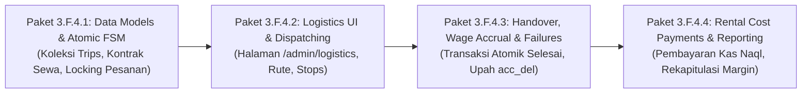

# SOGIL FURNITURE — SPESIFIKASI TEKNIS ARSITEKTUR
## Phase 3.F.4: Logistics & Delivery Operations (Armada Sewa & Serah Terima Pesanan)

---

### METADATA DOKUMEN & BASELINE REPOSITORY

| Parameter | Keterangan / Nilai Terverifikasi | Klasifikasi |
| :--- | :--- | :--- |
| **Nomor Dokumen** | `SPEC-TECH-2026-3F4-v1.0` | `[PROPOSED]` |
| **Judul Dokumen** | Spesifikasi Teknis Operasional Logistik, Armada Sewa, Serah Terima, dan Upah Pengantaran | `[PROPOSED]` |
| **Versi Dokumen** | `v1.0 (Final Accounting Reconciliation, Partial Trip Closure, & Scope Lock Pass)` | `[PROPOSED]` |
| **Status Dokumen** | **`SPECIFICATION READY FOR OWNER REVIEW`** | `[PROPOSED]` |
| **Target Repository** | `/Users/syahidmujahid/Sogil-Project/Sogil-Furniture` | `[VERIFIED]` |
| **Git Branch / Commit** | `main` @ `1d8f4e59f6637a30820e42bab1f1253b9b5fb512` | `[VERIFIED]` |
| **Dependencies** | Phase 3.B.1 (Handover Revenue), Phase 3.F.3 (Wage Settlement Engine) | `[VERIFIED]` |
| **Kategori Finansial** | Biaya Armada: `"Naql"` (`server.py:5752`), Upah Pekerja: `"Pekerja"` (`server.py:3988`) | `[VERIFIED]` |

---

## 1. RINGKASAN EKSEKUTIF & TUJUAN ARSITEKTUR

Spesifikasi teknis ini menetapkan arsitektur dan rancangan implementasi terperinci untuk **Phase 3.F.4 — Logistics & Delivery Operations** pada platform Sogil Furniture. Dokumen ini disusun berdasarkan audit statis mendalam terhadap basis kode aktual (`backend/server.py`), mengintegrasikan 7 keputusan final Owner (`DECIDED BY OWNER`), dan mendefinisikan invariant serta *acceptance criteria* konkret yang dapat diuji secara otomatis:

1. **Idempotensi Upah Lintas Trip:** Menstabilkan identitas hak upah pengantaran berbasis `(order_id, worker_id, task_category)` tanpa memuat identitas trip. Membedakan constraint database eksisting (`uniq_wage_obligation_accrual_event`) dari usulan indeks parsial baru yang mensyaratkan verifikasi migrasi pra-implementasi.
2. **Penyatuan Transaksi Serah Terima & Pengakuan Pendapatan:** Mengidentifikasi bahwa endpoint penyelesaian pesanan eksisting (`server.py:2102-2312`) belum menerima sesi transaksi MongoDB (`session`). Menetapkan spesifikasi helper internal bersama (`execute_order_handover_completion`) yang mempertahankan 100% perilaku kanonikal (revenue snapshot, riwayat status, dan audit trail) dalam satu transaksi atomik.
3. **Pemisahan Kewajiban Sewa vs Arus Kas Keluar (Per-Trip Scope):** Mengunci batasan pengelolaan sewa armada murni per-trip (tanpa Accounts Payable multi-trip pada V1). Membedakan secara tegas pengembalian uang kas (*actual cash refund*) dari pembatalan/pengurangan kewajiban kontrak. Refund kas tidak otomatis membatalkan kewajiban; status kewajiban wajib mengikuti hasil penyelesaian vendor yang terdokumentasi, sementara transaksi kas mempertahankan jejak audit imutabel pada kategori `"Naql"`.
4. **Penguncian Penugasan Pesanan Atomik, Pembatalan Multi-Stop & Penutupan Trip Parsial:** Mendefinisikan prakondisi (*preconditions*), mutasi atomik, dan invariant pasca-commit (*postconditions*) untuk 7 operasi logistik utama. Menetapkan aturan ketat bahwa trip yang telah memiliki stop `delivered` dilarang dibatalkan total, melainkan diselesaikan melalui alur penutupan trip parsial (*partial trip closure*) guna melindungi pesanan yang sukses, snapshot pendapatan, dan upah helper yang sah.

---

## 2. KEPUTUSAN OWNER YANG TELAH FINAL (DECIDED BY OWNER)

Berdasarkan penetapan Owner, keputusan-keputusan berikut telah final dan mengikat arsitektur V1 `[DECIDED BY OWNER]`:

1. **Cap Upah Helper Belum Ditetapkan:**  
   Batas atas nominal upah pengiriman per pesanan belum ditetapkan oleh Owner. Tarif dan operasi trip dispatch yang memerlukan tarif tetap **terkunci penuh (fail-closed)** hingga Owner mengonfigurasi angka cap secara resmi. Sistem dilarang membuat angka default atau asumsi, dan Manager tidak memiliki izin bypass.
2. **Model Tarif Per Trip:**  
   Satu tarif per helper per pesanan dalam satu trip ditetapkan oleh Manager saat penyusunan trip, dengan syarat wajib berada di bawah batas cap Owner. Snapshot tarif dikunci saat dispatch dan digunakan secara konsisten saat retry. Tidak ada diferensiasi tarif berdasarkan ukuran/dimensi mebel pada kebijakan V1.
3. **Standar Bukti Serah Terima V1:**  
   Bukti serah terima fisik sah terdiri dari:
   - Nama terang penerima di lokasi;
   - Catatan serah terima (*handover notes*);
   - Konfirmasi centang oleh helper/manager.  
   *(Foto dokumentasi dan tanda tangan digital BUKAN prasyarat rilis V1)*.
4. **Retry Pengiriman Gagal:**  
   Pengantaran yang gagal boleh dicoba kembali (*retry*) dalam trip yang sama atau dijadwalkan ulang ke trip berikutnya. Setiap percobaan dicatat secara berurutan dalam riwayat stop. Upah pengantaran **hanya diterbitkan tepat satu kali** untuk kombinasi pesanan dan helper yang sukses melakukan serah terima fisik.
5. **Kewajiban & Pembayaran Rental Per Trip:**  
   Kewajiban biaya sewa dan pencatatan pembayaran armada dikelola murni per-trip. Konsolidasi tagihan vendor untuk multi-trip (Accounts Payable vendor berkala) **bukan kebutuhan V1** dan dikeluarkan dari scope.
6. **Otorisasi Pembayaran Rental:**  
   Manager dengan izin keuangan (`access_finance`) atau peran `owner` berwenang mencatat pembayaran aktual sewa armada sesuai prosedur dan bukti yang sah.
7. **Larangan Penagihan COD:**  
   Kurir/helper **DILARANG KERAS** menagih pelunasan atau sisa pembayaran pesanan di lokasi pelanggan. Seluruh penyelesaian finansial pesanan wajib melalui kasir/toko.
8. **Pemisahan Sopir Rental vs Helper Internal:**  
   Sopir kendaraan rental disediakan oleh pihak penyedia rental; jasanya menyatu dalam tarif paket sewa armada (kategori `"Naql"`). Sogil **tidak menggaji** sopir rental secara terpisah. Upah pekerja (kategori `"Pekerja"`) murni diterbitkan untuk helper internal toko dari `db.admins`.

---

## 3. AUDIT KODE SUMBER AKTUAL & PEMISAHAN KEMAMPUAN EKSISTING VS KEBUTUHAN IMPLEMENTASI

Audit statis dilakukan terhadap repositori `Sogil-Furniture` commit `1d8f4e59f6637a30820e42bab1f1253b9b5fb512`:

### 3.1 Klasifikasi Status Fitur & Constraint Basis Data

| Komponen Arsitektur | Status Aktual di Kode | Klasifikasi & Bukti Kode |
| :--- | :--- | :--- |
| **Indeks `uniq_wage_obligation_accrual_event`** | Aktif di basis data | `[VERIFIED - EXISTING]` (`server.py:7909`) |
| **Indeks `uniq_obligation_number`** | Aktif di basis data | `[VERIFIED - EXISTING]` (`server.py:7919`) |
| **Kategori `"delivery"` di `CONTROLLED_TASK_CATEGORIES`** | Belum terdaftar | `[REQUIRED REFACTORING]` (Saat ini hanya `whole_item`, `assembly`, `finishing`, `cutting`, `custom` di `server.py:453`) |
| **Usulan Partial Unique Index Delivery** | Belum ada di basis data | `[PROPOSED - TO BE IMPLEMENTED]` (Perlu migrasi script) |
| **Shared Order Completion Helper dengan `session`** | Belum ada di kode | `[REQUIRED REFACTORING]` (`server.py:2102-2312` belum menerima `session`) |
| **Model Koleksi `delivery_trips`** | Belum ada di kode/DB | `[PROPOSED - TO BE IMPLEMENTED]` |
| **Kategori Kas Sewa Armada `"Naql"`** | Sudah ada di master | `[VERIFIED - EXISTING]` (`server.py:5752`) |
| **Kalkulasi Saldo Kas `_compute_balances()`** | Type `refund` memotong kas | `[VERIFIED - EXISTING]` (`server.py:5773-5777`: `income` menambah saldo, `refund`/`expense` memotong saldo) |
| **Guard Linkage pada `PUT /finance/transactions`** | Belum memuat trip rental | `[REQUIRED REFACTORING]` (Saat ini baru memuat `wage_settlement_id` di `server.py:5886`) |

---

## 4. PENYELESAIAN ISU A: IDEMPOTENSI UPAH LINTAS TRIP & MODEL TARIF

### 4.1 Pemisahan Konsep Idempotensi & Identitas Hak Upah

Spesifikasi membedakan secara tegas tiga tingkatan proteksi:

```
[1. Request / Event Idempotency]
   Header X-Idempotency-Key / Payload Key mencegah network retry mengeksekusi endpoint 2x.
              ↓
[2. Stable Business Entitlement Identity]
   Identitas hak upah: Satu hak upah lahir jika dan hanya jika sebuah pesanan (order_id)
   berhasil diserahkan secara fisik oleh seorang helper internal (worker_id).
              ↓
[3. Database Constraints Enforcement]
   Indeks unik MongoDB menolak secara keras (duplicate key error) setiap usaha penyisipan
   dokumen upah ganda untuk hak upah bisnis yang sama.
```

Kunci bisnis hak upah pengantaran **TIDAK BOLEH MEMUAT `trip_id` ATAU `trip_number`**, karena pembatalan atau penjadwalan ulang pesanan ke trip baru akan mematahkan keunikan jika kunci memuat identitas trip.

Format kunci event akrual upah kanonikal yang stabil:
$$\text{accrual\_event\_key} = \text{"acc\_del\_"} + \text{order\_id} + \text{"\_"} + \text{worker\_id}$$

*Contoh:* `acc_del_6a8fc3c6d7ae98fcf9f4590d_6a903257e895ef02b51d9637` `[PROPOSED]`

### 4.2 Evaluasi Kritis Constraint Database & Risiko Data Riil

1. **Temuan Inkompatibilitas Terhadap Data Produksi Manufaktur:**
   - Dalam alur produksi manufaktur mebel eksisting (`server.py:3460-3570`), satu pesanan dapat memiliki beberapa item (misalnya 1 Meja Makan dan 6 Kursi).
   - Pekerja yang sama dapat ditugaskan untuk melakukan pekerjaan finishing pada Item 1 dan juga finishing pada Item 2 dalam pesanan yang sama.
   - Kedua penugasan tersebut memiliki `order_id`, `worker_id`, dan `task_category: "finishing"` yang identik, namun dibedakan oleh `order_item_id`.
   - **KESIMPULAN AUDIT:** Jika dibuat compound unique index *tanpa filter*, indeks tersebut **AKAN MENOLAK PENUGASAN MANUFAKTUR YANG SAH DAN MERUSAK OPERASIONAL PABRIK** `[NOT VERIFIED / DANGEROUS IF UNFILTERED]`.
2. **Constraint Unik yang Ditetapkan:**
   - **Primary Guard (Eksisting Terverifikasi):** Memanfaatkan indeks unik yang sudah terbukti aktif di produksi:
     `uniq_wage_obligation_accrual_event` pada field `accrual_event_key` (`server.py:7909`). Karena format kunci delivery adalah `acc_del_{order_id}_{worker_id}`, keunikan dijamin secara deterministik di level basis data.
   - **Secondary Guard (Usulan Indeks Parsial):** Indeks komposit tambahan **WAJIB MENYERTAKAN FILTER PARSIAL**:
     ```python
     await db.wage_obligations.create_index(
         [("order_id", 1), ("worker_id", 1), ("task_category", 1)],
         unique=True,
         partialFilterExpression={"task_category": "delivery"},
         name="uniq_delivery_wage_order_worker"
     )
     ```
3. **Strategi Migrasi & Prasyarat Pra-Implementasi:**
   - Sebelum mendaftarkan indeks parsial di atas, script migrasi wajib melakukan pemindaian data riil:
     `db.wage_obligations.find({"task_category": "delivery"})`.
   - Jika ditemukan dokumen dengan duplikasi `(order_id, worker_id)`, proses migrasi **WAJIB DIBATALKAN / DIHENTIKAN (*ABORTED*)** dan sistem menolak startup hingga data dibersihkan secara manual.

### 4.3 Acceptance Criteria yang Dapat Diuji (Testable Acceptance Criteria)

1. **AC-WOB-1 (Concurrent Handovers):** Dua request serah terima stop yang sama dikirim bersamaan oleh dua koneksi berbeda. Tepat satu request berhasil (`HTTP 200`), request kedua gagal karena write conflict atau duplicate key error pada `accrual_event_key` (`HTTP 409`), dan seluruh transaksi request kedua di-*rollback*.
2. **AC-WOB-2 (Timeout Replay):** Request serah terima berhasil dicommit di server tetapi koneksi klien timeout sebelum menerima respons. Klien mengirim ulang request dengan idempotency key yang sama. Server mendeteksi stop sudah `delivered` dan mengembalikan respons sukses (`HTTP 200`) tanpa menyisipkan dokumen `wage_obligations` kedua.
3. **AC-WOB-3 (Cross-Trip Rescheduling):** Pesanan X gagal diantar pada Trip 1 (stop outcome = `failed`, jumlah dokumen upah = 0). Pesanan X dijadwalkan ulang ke Trip 2 dan sukses diantar oleh Helper B. Tepat satu dokumen upah terbit dengan kunci `acc_del_{order_X}_{helper_B}`. Helper Trip 1 memiliki 0 dokumen upah.
4. **AC-WOB-4 (No Duplicate for Same Helper):** Jika Pesanan X gagal di Trip 1 dan dijadwalkan ulang ke Trip 2 dengan Helper A yang sama, saat serah terima sukses di Trip 2, Helper A hanya memperoleh tepat satu dokumen upah. Usaha kedua untuk menerbitkan upah bagi Helper A pada order yang sama ditolak oleh basis data.
5. **AC-WOB-5 (Manufacturing Isolation):** Pembuatan kewajiban upah pengantaran (`task_category: "delivery"`) tidak mempengaruhi pembuatan banyak kewajiban upah manufaktur (`task_category: "finishing"`) untuk pekerja yang sama pada pesanan yang sama dengan `order_item_id` berbeda.
6. **AC-WOB-6 (Pre-Migration Duplicate Abort):** Script migrasi startup memeriksa koleksi `wage_obligations`. Jika ditemukan duplikasi pada `(order_id, worker_id)` untuk `task_category: "delivery"`, pembuatan indeks dihentikan dan melempar `CriticalFinanceIndexError` (fail-closed).
7. **AC-WOB-7 (Erroneous Handover Voiding):** Koreksi administratif terhadap serah terima yang keliru dilakukan dengan menandai dokumen `wage_obligations` menjadi `status: "voided"` dan mencatat `void_reason`. Riwayat historis tidak dihapus dari basis data.

### 4.4 Model Snapshot Tarif & Penegakan Cap Fail-Closed

- **Penetapan Tarif:** Manager menetapkan tarif upah per helper per pesanan pada level trip (`trip_wage_rate_le`).
- **Snapshot Imutabel saat Dispatch:** Saat trip bertransisi dari `scheduled` ke `in_transit`, nilai `trip_wage_rate_le` disalin secara imutabel ke dalam `trip.rate_policy_snapshot.applied_rate_le`. Snapshot ini digunakan untuk menghitung upah seluruh stop (termasuk stop yang mengalami retry).
- **Penegakan Cap Gagal-Aman (*Fail-Closed*):**
  - Angka nominal cap upah belum ditetapkan oleh Owner `[DECIDED BY OWNER]`.
  - Jika konfigurasi `db.settings.delivery_wage_policy.max_helper_wage_per_order_le` bernilai `null` atau belum diset oleh Owner, sistem secara tegas **MENOLAK dispatch trip** (`HTTP 422 Unprocessable Entity: Batas atas upah pengiriman belum ditetapkan oleh Owner`).
  - Sistem dilarang menerapkan nilai cap default atau asumsi, dan Manager dilarang melakukan bypass.

---

## 5. PENYELESAIAN ISU B: MODEL KEWAJIBAN, PEMBAYARAN, REFUND & REKONSILIASI RENTAL

### 5.1 Perbedaan Konseptual: Pembatalan Kewajiban vs Koreksi Salah Input vs Refund Vendor Kas Riil

Spesifikasi memisahkan secara tegas tiga skenario administratif dan dampaknya terhadap kas:

1. **Pembatalan Kewajiban Sebelum Dibayar (*Obligation Voiding*):**
   - *Kondisi:* Trip dibatalkan sebelum mobil disewa atau disepakati biaya batal Rp 0.
   - *Perlakuan:* `cost_obligation.obligation_status = "voided"`.
   - *Dampak Kas:* **NOL dampak kas** (karena belum ada pembayaran riil yang diterbitkan ke `db.finance_transactions`).
2. **Koreksi Kesalahan Input Pembayaran (*Erroneous Entry Voiding*):**
   - *Kondisi:* Manager salah mencatat pembayaran yang belum terjadi atau salah input nominal.
   - *Perlakuan:* Entri pembayaran pada array `payments` ditandai `is_void = True`. Dokumen transaksi kas di `db.finance_transactions` ditandai `is_void = True`.
   - *Dampak Kas:* Menghapus pengeluaran fiktif tersebut dari perhitungan saldo kas di `_compute_balances()`. Tidak ada mutasi fisik uang masuk.
3. **Refund Pembayaran Sewa Riil dari Vendor (*Actual Vendor Cash Refund*):**
   - *Kondisi:* Uang kas toko telah diserahkan secara nyata kepada vendor (misal sewa 500 LE dicatat dan dibayar). Di perjalanan armada mogok, dan vendor mengembalikan uang tunai (misal 500 LE penuh atau 200 LE) kembali ke kasir Sogil.
   - *Prinsip Pemisahan Kas vs Kewajiban Kontrak:*
     - **Refund kas fisik TIDAK OTOMATIS membatalkan atau mengurangi kewajiban sewa kontrak (`cost_obligation`).**
     - Penerimaan fisik uang tunai dicatat sebagai transaksi kas masuk kanonikal di `db.finance_transactions` dengan `type: "income"` (karena pada `server.py:5773-5777`, `type: "refund"` memotong kas toko), kategori `"Naql"`, dan deskripsi `"Pengembalian dana / refund sewa armada trip TRP-..."`.
     - Catatan pembayaran awal di array `payments` **TETAP DIPERTAHANKAN** sebagai jejak audit historis pengeluaran riil, dan entri pengembalian dicatat pada array `refunds` pada dokumen trip.
     - **Penyesuaian Status & Saldo Kewajiban:** Status dan nilai kewajiban kontrak (`cost_obligation`) **WAJIB MENGIKUTI HASIL PENYELESAIAN VENDOR YANG TERTULIS/TERDOKUMENTASI (*documented vendor settlement outcome*)**:
       - *Kasus A (Amandemen Pengurangan Kontrak Disepakati):* Jika vendor dan Sogil sepakat memangkas biaya sewa (misal dari 500 LE menjadi 350 LE karena mogok), kewajiban disesuaikan melalui amandemen formal (`cost_obligation.agreed_rental_cost_le = 350.00`, mencatat `adjustment_reason` dan kwitansi kesepakatan).
       - *Kasus B (Refund Tanpa Pengurangan Kontrak):* Jika vendor mengembalikan uang jaminan/deposit atau refund sementara tanpa pembatalan kontrak pokok, nilai kewajiban pokok `cost_obligation` tetap utuh sebesar komitmen awal sampai ada kesepakatan final.
       - *Kasus C (Pembatalan Total & Pelunasan Refund):* Jika trip batal total dan seluruh uang 500 LE dikembalikan penuh, status kewajiban diubah menjadi `obligation_status = "settled_refunded"` berdasarkan bukti berita acara pengembalian vendor.

### 5.2 Formula Rekonsiliasi Saldo Kewajiban Trip

Perhitungan saldo kewajiban per trip dihitung secara deterministik tanpa saldo mengambang:

$$\text{gross\_paid\_le} = \sum_{\{p \in \text{payments} \mid \neg p.\text{is\_void}\}} p.\text{amount\_le}$$

$$\text{gross\_refunded\_le} = \sum_{\{r \in \text{refunds} \mid \neg r.\text{is\_void}\}} r.\text{amount\_le}$$

$$\text{net\_paid\_le} = \text{gross\_paid\_le} - \text{gross\_refunded\_le}$$

$$\text{remaining\_payable\_le} = \max(0.0, \text{total\_obligation\_le} - \text{net\_paid\_le})$$

- **Status Pembayaran Trip (`payment_status`):**
  - `unpaid`: jika $\text{net\_paid\_le} = 0$.
  - `partially_paid`: jika $0 < \text{net\_paid\_le} < \text{total\_obligation\_le}$.
  - `paid`: jika $\text{net\_paid\_le} \ge \text{total\_obligation\_le}$.
  - `overpaid`: jika $\text{net\_paid\_le} > \text{total\_obligation\_le}$ (memerlukan investigasi kasir).

### 5.3 Struktur Data Ledger Rental per Trip `[PROPOSED]`

```json
{
  "vehicle_rental": {
    "is_rented": true,
    "rental_provider": "Rental Pick-up Darasah",
    "vehicle_plate_or_desc": "Suzuki Carry Box Putih",
    "driver_provided_by_rental": true,
    "rental_driver_name": "Ibrahim (Sopir Bawaan Rental)",
    
    "cost_obligation": {
      "agreed_rental_cost_le": 450.00,
      "additional_cost_le": 0.0,
      "total_obligation_le": 450.00,
      "obligation_status": "incurred",
      "agreement_reference": "Kwitansi Sewa #104",
      "settlement_outcome": "active_agreement",
      "incurred_at": "2026-10-15T08:00:00Z",
      "incurred_by_id": "admin_oid",
      "incurred_by_name": "Manager Operasional"
    },
    
    "payments": [
      {
        "payment_id": "rpay_670f81a1b2c3",
        "amount_le": 450.00,
        "payment_date": "2026-10-15",
        "payment_method": "cash",
        "finance_transaction_id": "ftx_670f81b2d4e5",
        "recorded_by_id": "admin_oid",
        "recorded_by_name": "Manager Operasional",
        "receipt_reference": "Nota Lunas No. 881",
        "idempotency_key": "idem_rpay_TRP-20261015-0001_1",
        "is_void": false,
        "notes": "Pelunasan tunai armada"
      }
    ],

    "refunds": [
      {
        "refund_id": "rfnd_670f92c1e4f5",
        "payment_id": "rpay_670f81a1b2c3",
        "amount_le": 100.00,
        "refund_date": "2026-10-15",
        "finance_transaction_id": "ftx_670f92d2f6a7",
        "recorded_by_id": "admin_oid",
        "recorded_by_name": "Manager Operasional",
        "idempotency_key": "idem_rfnd_TRP-20261015-0001_1",
        "reason": "Armada dipulangkan lebih awal, vendor kembalikan 100 LE",
        "settlement_reference": "Nota Retur Tunai No. 12",
        "is_void": false
      }
    ],
    
    "gross_paid_le": 450.00,
    "gross_refunded_le": 100.00,
    "net_paid_le": 350.00,
    "remaining_payable_le": 100.00,
    "payment_status": "partially_paid"
  }
}
```

### 5.4 Rekonsiliasi Otomatis Antara Trip Ledger dan `db.finance_transactions`

Sistem menyediakan fungsi audit deterministik untuk mencocokkan mutasi kas:

$$\sum \text{finance\_transactions}(\text{expense, Naql, related\_trip\_id}) - \sum \text{finance\_transactions}(\text{income, Naql, related\_trip\_id}) \equiv \text{net\_paid\_le}$$

- Jika audit menemukan ketidakcocokan (misalnya transaksi diedit langsung secara ilegal di menu finance), sistem menandai trip dengan flag `ledger_discrepancy: True` dan memunculkan peringatan pada laporan keuangan mingguan.
- Modul `PUT /admin/finance/transactions/{id}` (`server.py:5885`) **WAJIB DILINDUNGI** dengan guard untuk menolak pengeditan manual dokumen ber-`related_trip_id`.

### 5.5 Acceptance Criteria Pembayaran & Refund Rental

1. **AC-RENT-1 (Idempotent Replay):** Request pembayaran dengan `idempotency_key` dan payload identik mengembalikan record yang ada tanpa menerbitkan transaksi kas kedua.
2. **AC-RENT-2 (Payload Mismatch Rejection):** Request dengan `idempotency_key` sama tetapi nominal/tanggal berbeda ditolak (`HTTP 409 Conflict`).
3. **AC-RENT-3 (Concurrent Payment Race):** Dua request pembayaran bersamaan yang melebihi `remaining_payable_le` dikunci secara transaksional; tepat 1 request berhasil dan request kedua ditolak overpayment (`HTTP 422`).
4. **AC-RENT-4 (Actual Cash Refund Accounting):** Refund uang tunai dari vendor menerbitkan transaksi kas masuk `type: "income"`, `category: "Naql"`, menambah saldo kas toko di `_compute_balances()`, dan mengembalikan `remaining_payable_le` secara tepat.
5. **AC-RENT-5 (Disputed Proof Handling):** Pembayaran tanpa bukti sah yang dibatalkan oleh Owner melalui void administratif mengubah `payments[i].is_void = True` dan `finance_transactions.is_void = True` tanpa menghapus log historis.
6. **AC-RENT-6 (Transaction Rollback Safety):** Jika pembuatan transaksi keuangan gagal, mutasi array pembayaran pada dokumen trip dibatalkan (*all-or-nothing rollback*).

---

## 6. PENYELESAIAN ISU C: TRANSAKSI ATOMIK HANDOVER & REVENUE RECOGNITION

### 6.1 Spesifikasi Shared Order Completion Helper

Audit terhadap `server.py:2102-2312` (`admin_update_order`) membuktikan bahwa endpoint lama mengeksekusi operasi basis data secara langsung tanpa parameter `session`. Untuk menjamin atomisitas serah terima stop tanpa merusak perilaku kanonikal, implementasi masa depan wajib mengekstrak logika penyelesaian order ke dalam internal helper:

```python
# SPESIFIKASI INTERNAL HELPER BERSAMA (FUTURE IMPLEMENTATION REQUIREMENT)
async def execute_order_handover_completion(
    order_id: str,
    admin: dict,
    now_iso: str,
    session: Optional[AsyncIOMotorClientSession] = None,
    delivery_context: Optional[dict] = None
) -> dict:
    """
    Ekstraksi logika kanonikal transisi order -> 'selesai' dan pengakuan pendapatan.
    Wajib mempertahankan 100% perilaku eksisting:
    1. Validasi keberadaan pesanan dan status aktif.
    2. Concurrency guard: memeriksa completed_at dan recognized_revenue_le.
    3. Stamping snapshot permanen:
       - completed_at = now_iso
       - completed_by_id = admin.get("id")
       - completed_by_name = admin.get("name")
       - recognized_revenue_le = float(order.get("total_le", 0.0))
    4. Audit trail status_history lengkap:
       - from_status, to_status ('selesai'), changed_at, changed_by_id, changed_by_name.
    5. Update audit_fields: updated_at, updated_by_id, updated_by_name.
    6. Stamping delivery_logistics_status = 'delivered' dan delivered_trip_id jika ada context delivery.
    """
```

### 6.2 Koordinasi Transaksi Sesi MongoDB Handover `[PROPOSED]`

Saat helper mengonfirmasi serah terima fisik (`POST /api/admin/delivery-trips/{id}/stops/{order_id}/deliver`), backend membuka satu sesi transaksi MongoDB replica-set:

```
                  ┌──────────────────────────────────────────────┐
                  │          POST .../stops/{id}/deliver         │
                  └──────────────────────┬───────────────────────┘
                                         │
                   Buka Sesi Transaksi: session.start_transaction()
                                         │
        ┌────────────────────────────────┴────────────────────────────────┐
        │                                                                 │
        ▼                                                                 ▼
[1. Mutasi Stop Trip]                                           [2. Mutasi Pesanan]
Update db.delivery_trips                                        Panggil execute_order_handover_completion()
- outcome = "delivered"                                         - order_status = "selesai"
- delivered_at = now_iso                                        - recognized_revenue_le = total_le
- recipient_name = ...                                          - completed_at = now_iso
- handover_notes = ...                                          - delivery_logistics_status = "delivered"
        │                                                                 │
        └────────────────────────────────┬────────────────────────────────┘
                                         │
                                         ▼
                     [3. Mutasi Hak Upah Pekerja]
                     Insert db.wage_obligations per helper internal
                     - accrual_event_key = "acc_del_{order_id}_{helper_id}"
                     - task_category = "delivery"
                     - rate_le = trip.rate_policy_snapshot.applied_rate_le
                     - status = "accrued"
                                         │
                                         ▼
                     [4. Pencatatan Audit Trail]
                     Append audit_logs pada trip & status_history pada pesanan
                                         │
                         Commit Transaksi Berhasil
```

### 6.3 Acceptance Criteria yang Dapat Diuji (Testable Acceptance Criteria)

1. **AC-REV-1 (Lifecycle Snapshot Preservation):** Snapshot pendapatan (`recognized_revenue_le`) hanya dibuat jika pesanan bertransisi ke status `selesai` dan belum memiliki snapshot sebelumnya (`completed_at is None`). Nilainya persis sama dengan `order.total_le`.
2. **AC-REV-2 (All-or-Nothing Handover Atomicity):** Mutasi status pesanan $\to$ `selesai`, mutasi stop $\to$ `delivered`, dan pembuatan dokumen `wage_obligations` commit bersama atau rollback bersama dalam satu transaksi MongoDB.
3. **AC-REV-3 (Retry After Commit Safety):** Pengiriman ulang request handover setelah commit berhasil mengembalikan respons `HTTP 200` dengan snapshot yang sudah ada tanpa menduplikasi pendapatan atau kewajiban upah.
4. **AC-REV-4 (Already Completed Order Rejection):** Jika pesanan telah berstatus `selesai` (misalnya diambil mandiri oleh pelanggan di toko), endpoint serah terima logistik menolak proses dengan `HTTP 409 Conflict: Pesanan telah selesai di luar alur pengantaran`.
5. **AC-REV-5 (Pre-Commit Failure Safety):** Simulasi kegagalan sebelum commit (misalnya koneksi putus atau validasi upah gagal) menjamin status pesanan tetap `siap`, pendapatan tidak diakui, stop tetap `out_for_delivery`, dan tidak ada kewajiban upah yang terbit.
6. **AC-REV-6 (Replica-Set Enforcement):** Jika lingkungan runtime tidak mendukung transaksi multi-dokumen (koneksi MongoDB standalone tanpa replica set), fitur serah terima menolak eksekusi secara fail-closed (`HTTP 503: Layanan transaksi multi-dokumen tidak tersedia`).

---

## 7. PENYELESAIAN ISU D: PENUGASAN ORDER, ATOMISITAS MULTI-STOP, & PENUTUPAN TRIP PARSIAL

### 7.1 Prasyarat & Desain Atomik Pembatalan Trip Multi-Stop (`POST .../cancel`)

Untuk trip yang memuat banyak stop (multi-stop), pembatalan tidak boleh dilakukan secara iteratif tanpa transaksi karena kegagalan di tengah proses dapat meninggalkan pesanan dalam kondisi *partially released* atau *ghost lock*.

#### Prasyarat Pembatalan Trip:
1. Status trip berada dalam `["draft", "scheduled", "in_transit"]`.
2. **SYARAT MUTLAK BEBAS STOP DELIVERED:** Trip **DILARANG DIBATALKAN** jika ada stop yang telah berstatus `outcome == "delivered"`. Jika ada stop yang sudah diserahkan, pendapatan telah diakui dan upah helper telah terbit; trip tersebut wajib ditutup melalui alur penyelesaian trip parsial (Bagian 7.2 Operasi 6), bukan dibatalkan total.
3. Seluruh stop yang belum selesai berstatus `outcome in ["pending", "out_for_delivery", "failed"]`.

#### Alur Transaksi Pembatalan Multi-Stop Atomik:

```python
async with await client.start_session() as session:
    async with session.start_transaction():
        # 1. Optimistic Locking pada trip
        trip = await db.delivery_trips.find_one_and_update(
            {
                "_id": id_query(trip_id),
                "status": {"$in": ["draft", "scheduled", "in_transit"]},
                "stops.outcome": {"$ne": "delivered"}  # Guard mutlak
            },
            {
                "$set": {
                    "status": "cancelled",
                    "cancellation_reason": reason,
                    "cancelled_at": now_iso,
                    "cancelled_by_id": admin.get("id"),
                    "stops.$[elem].outcome": "cancelled"
                }
            },
            array_filters=[{"elem.outcome": {"$in": ["pending", "out_for_delivery", "failed"]}}],
            session=session
        )
        if not trip:
            raise HTTPException(409, "Trip tidak valid, telah dibatalkan, atau memuat stop yang sudah delivered.")

        # 2. Ambil seluruh order_id dari stop yang dibatalkan
        active_order_ids = [s["order_id"] for s in trip.get("stops", []) if s.get("outcome") != "delivered"]

        # 3. Bulk Conditional Atomic Update pada seluruh pesanan terkait
        if active_order_ids:
            res = await db.orders.update_many(
                {
                    "_id": {"$in": [id_query(oid) for oid in active_order_ids]},
                    "active_delivery_trip_id": str(trip["_id"])
                },
                {
                    "$set": {
                        "active_delivery_trip_id": None,
                        "active_delivery_trip_number": None,
                        "delivery_logistics_status": "unassigned",
                        "updated_at": now_iso
                    },
                    "$push": {
                        "status_history": {
                            "from_status": "siap",
                            "to_status": "siap",
                            "changed_at": now_iso,
                            "changed_by_id": admin.get("id"),
                            "reason": f"Pelepasan penugasan logistik: Trip {trip.get('trip_number')} dibatalkan ({reason})"
                        }
                    }
                },
                session=session
            )
            # Invariant: Seluruh order wajib berhasil dicocokkan dan dilepas
            if res.matched_count != len(active_order_ids):
                # Terjadi inkonsistensi: ada order yang lock-nya telah diubah proses lain
                raise HTTPException(409, "Inkonsistensi penugasan pesanan. Transaksi dibatalkan total.")
```

### 7.2 Matriks 7 Operasi Siklus Hidup Logistik: Prakondisi, Mutasi, dan Invariant Pasca-Commit

| Operasi Logistik | Kondisi Sebelum (Preconditions) | Mutasi Atomik yang Wajib Terjadi | Invariant Pasca-Commit (Postconditions) |
| :--- | :--- | :--- | :--- |
| **1. Klaim Pesanan (`POST .../add-stop`)** | `order.order_status == "siap"`, `active_delivery_trip_id == None`, `trip.status in ["draft", "scheduled"]`. | `order.active_delivery_trip_id = trip_id`, push stop baru ke `trip.stops` dengan `outcome = "pending"`. | Pesanan terkunci eksklusif; klaim kedua oleh manager lain melempar `HTTP 409`. |
| **2. Batal Assignment (`DELETE .../stops/{id}`)** | `trip.status in ["draft", "scheduled"]`, stop `outcome == "pending"`, `order.active_delivery_trip_id == trip_id`. | Tarik stop dari `trip.stops`, `order.active_delivery_trip_id = None`, `delivery_logistics_status = "unassigned"`. | Pesanan kembali ke *ready queue*; trip tidak memuat stop tersebut. |
| **3. Gagal Kirim & Retry (`POST .../fail`)** | `trip.status == "in_transit"`, stop `outcome == "out_for_delivery"`. | Stop `outcome = "failed"`, `attempt_count += 1`. Jika retry di trip sama: lock dipertahankan (`retry_pending`). Jika gagal final: `active_delivery_trip_id = None` (`delivery_failed`). | Nol upah terbit; order tetap `"siap"`. Jika gagal final, order bebas dijadwalkan ulang. |
| **4. Pindah Trip (*Reschedule*)** | Stop Trip A `failed`/`cancelled`, Trip B `status in ["draft", "scheduled"]`. | Stop Trip A ditutup `rescheduled`, stop Trip B dibuat `pending`, `order.active_delivery_trip_id = trip_B_id`. | Lock beralih atomik ke Trip B dalam 1 transaksi. |
| **5. Batal Trip Multi-Stop (`POST .../cancel`)** | `trip.status in ["draft", "scheduled", "in_transit"]`, **TIDAK ADA stop `delivered`**. | `trip.status = "cancelled"`, seluruh stop aktif `outcome = "cancelled"`, bulk update pelepasan lock pada seluruh order. | Seluruh order kembali ke *ready queue* secara serentak; tidak ada *ghost locks*. |
| **6. Penutupan Trip Parsial (`POST .../complete`)** | Trip `in_transit`, $\ge 1$ stop `delivered`, stop lainnya `failed`, **TIDAK ADA stop `out_for_delivery`**. | Stop `delivered` dipertahankan imutabel; stop `failed` ditutup (`failed_closed`); pesanan gagal dilepaskan (`active_delivery_trip_id = None`); trip `status = "completed"`. | Pesanan sukses tetap `selesai` + revenue snapshot + upah sah; pesanan gagal kembali ke *ready queue*. |
| **7. Serah Terima Sukses (`POST .../deliver`)** | Stop `outcome in ["pending", "out_for_delivery"]`, order `status == "siap"`, `active_delivery_trip_id == trip_id`. | Stop `outcome = "delivered"`, helper completion dipanggil (order $\to$ `selesai` + revenue snapshot), insert upah helper. | Pesanan `selesai`, snapshot permanen terkunci, upah helper terbit. |

### 7.3 Acceptance Criteria Atomisitas Multi-Stop & Pelepasan Lock

1. **AC-FSM-1 (Multi-Stop Bulk Release):** Pembatalan trip dengan 5 stop aktif melepaskan kelima order secara serentak ke status `unassigned` dalam satu commit transaksi.
2. **AC-FSM-2 (Delivered Stop Prevents Cancellation):** Percobaan pembatalan trip yang telah memiliki 1 stop `delivered` ditolak keras (`HTTP 409 Conflict: Trip memuat pesanan yang sudah diserahterimakan`).
3. **AC-FSM-3 (Order Mismatch Aborts Trip Cancellation):** Jika 1 dari 5 order pada trip telah diubah lock-nya oleh proses lain, transaksi pembatalan gagal secara menyeluruh; trip tetap aktif dan 4 order lainnya tetap terkunci (*no partial unlinking*).
4. **AC-FSM-4 (Concurrent Cancel Conflict):** Dua manager mencoba membatalkan trip yang sama bersamaan; tepat 1 request berhasil (`HTTP 200`), request kedua menghasilkan `HTTP 409 Conflict`.
5. **AC-FSM-5 (Post-Commit Replay):** Request pembatalan ulang setelah commit sukses mengembalikan data trip yang telah berstatus `cancelled` (`HTTP 200`) secara idempoten.
6. **AC-FSM-6 (Partial Trip Closure Integrity):** Penutupan trip yang memiliki 2 stop `delivered` dan 1 stop `failed` mempertahankan kedua order `selesai` beserta snapshot pendapatan dan kewajiban upah helper internal, sementara 1 order yang gagal dilepaskan kuncinya (`active_delivery_trip_id = None`) dan kembali ke *ready queue* secara sah.
7. **AC-FSM-7 (No Ghost Locks):** Tidak ada order di database yang memiliki `active_delivery_trip_id` jika trip terkait telah berstatus `cancelled` atau `completed`.

---

## 8. TAHAPAN IMPLEMENTASI & RENCANA KERJA MODULAR



- **3.F.4.1 (Core Data & Locking Engine):** Skema `db.delivery_trips`, counter format `TRP-YYYYMMDD-XXXX`, penambahan `"delivery"` ke `CONTROLLED_TASK_CATEGORIES`, script verifikasi migrasi indeks parsial, FSM penugasan, transaksi pembatalan multi-stop, dan penutupan trip parsial.
- **3.F.4.2 (Logistics Dispatcher PWA):** Halaman antarmuka `/admin/logistics`, antrean pesanan siap kirim, penyusunan rute multi-stop, tautan Google Maps rute, dan penguncian snapshot tarif saat dispatch.
- **3.F.4.3 (Handover Engine & Wage Integration):** Refaktorisasi shared completion helper `execute_order_handover_completion`, endpoint `/deliver` dan `/fail`, transaksi MongoDB replica-set atomik, dan penerbitan kewajiban upah helper.
- **3.F.4.4 (Rental Accounting & Margin Reporting):** Endpoint pencatatan pembayaran sewa armada dan refund ke `db.finance_transactions` di bawah kategori `"Naql"`, rutin rekonsiliasi ledger otomatis, widget margin trip, dan suite pengujian integrasi otomatis.

---

## 9. KEPUTUSAN OWNER YANG MASIH TERBUKA (OPEN DECISION)

Hanya tersisa **SATU parameter kebijakan** yang memerlukan penetapan angka pasti dari Owner sebelum fitur dapat dijalankan penuh di produksi `[OWNER DECISION REQUIRED]`:

1. **Besaran Nominal Cap Upah Helper per Pesanan:**  
   Berapa nilai nominal batas atas maksimum (dalam mata uang EGP / LE) per pesanan yang disetujui Owner untuk disimpan pada `db.settings.delivery_wage_policy.max_helper_wage_per_order_le`?  
   *(Catatan: Spesifikasi menetapkan sistem tetap terkunci / fail-closed dan menolak dispatch trip hingga Owner memasukkan angka ini ke dalam konfigurasi settings toko)*.

---

## 10. STATUS AKHIR SPESIFIKASI & MATRIKS RESOLUSI TEKNIS

Evaluasi status penyelesaian spesifikasi teknis berdasarkan audit statis dan identifikasi prasyarat implementasi:

| Isu Teknis | Status Evaluasi | Dasar Penilaian Teknis & Bukti Kode | Prasyarat Implementasi Lanjutan |
| :--- | :--- | :--- | :--- |
| **Isu A: Idempotensi Upah Lintas Trip** | **`PARTIALLY RESOLVED`** | Kunci stabil `acc_del_{order_id}_{worker_id}` konkret dan dilindungi oleh `uniq_wage_obligation_accrual_event` (`server.py:7909`). Compound index tanpa filter terbukti inkompatibel dengan manufaktur. Kategori `"delivery"` belum ada di `CONTROLLED_TASK_CATEGORIES` (`server.py:453`). | 1. Registrasi `"delivery"` ke `CONTROLLED_TASK_CATEGORIES`.<br>2. Verifikasi pra-migrasi data riil sebelum membuat indeks parsial unik. |
| **Isu B: Kewajiban & Pembayaran Rental** | **`PARTIALLY RESOLVED`** | Desain per-trip, formula ledger rekonsiliasi, pemisahan refund kas fisik vs amandemen kewajiban kontrak, dan transaksi kas kanonikal (`"Naql"`) telah dirancang lengkap. Namun seluruh model trip, endpoint payment/refund, dan guard pada `PUT /finance/transactions` merupakan kode baru yang belum diimplementasikan. | 1. Pembuatan endpoint payment dan refund per trip.<br>2. Penambahan guard linkage pada `PUT /admin/finance/transactions/{id}`.<br>3. Implementasi rutin audit rekonsiliasi ledger. |
| **Isu C: Transaksi Handover & Revenue Recognition** | **`PARTIALLY RESOLVED`** | Alur penyelesaian order kanonikal `server.py:2260-2309` telah dianalisis lengkap, namun kode eksisting belum menerima argumen `session` transaksi MongoDB. Atomisitas transaksi belum dapat diwujudkan tanpa refaktorisasi internal helper bersama. | Ekstraksi logika penyelesaian pesanan ke shared helper `execute_order_handover_completion(..., session)`. |
| **Isu D: Penugasan Order & Pelepasan Lock** | **`PARTIALLY RESOLVED`** | Matriks FSM 7 operasi siklus hidup, transaksi pembatalan multi-stop atomik, dan alur penutupan trip parsial telah dirancang tuntas. Namun fungsi bulk conditional update dan penanganan rollback transaksi MongoDB merupakan kode baru yang wajib diuji pada suite integrasi. | 1. Pembuatan endpoint penugasan, update stop, pembatalan trip, dan penutupan trip parsial.<br>2. Pengujian otomatis rollback fail-closed pada lingkungan replica set. |

---

**FINAL ARTIFACT STATUS:**  
# `SPECIFICATION READY FOR OWNER REVIEW`
