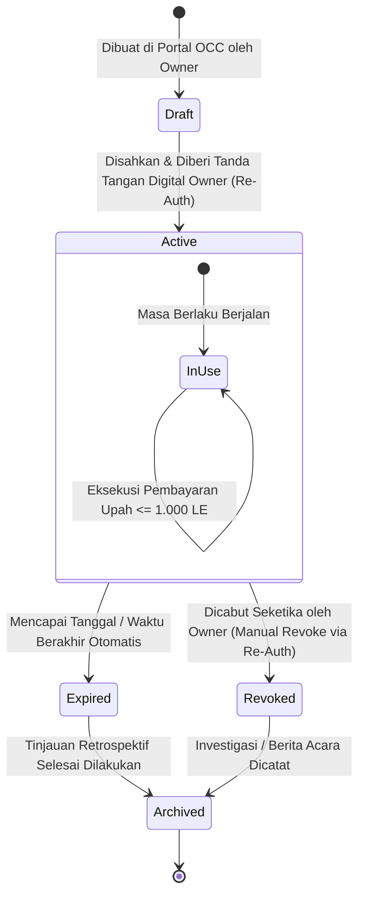
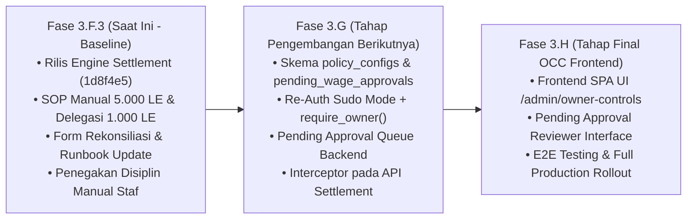

# SPESIFIKASI KONSEPTUAL DAN PROPOSAL ARSITEKTUR
# OWNER CONTROL CENTER & MANAGER DELEGATION
## Sogil Furniture — Desain Tata Kelola Kebijakan Finansial & Otorisasi Berjenjang

---

### METADATA SPESIFIKASI

| Parameter | Keterangan |
| :--- | :--- |
| **Nomor Dokumen** | `SPEC-ARCH-2026-004-OCC-DRAFT` |
| **Judul Dokumen** | Spesifikasi Konseptual dan Proposal Arsitektur Owner Control Center & Manager Delegation |
| **Versi Dokumen** | `v1.1-DRAFT (Pending Approval Queue, Re-Auth, & SoD Alignment)` |
| **Tanggal Penyusunan** | 14 Oktober 2026 |
| **Penyusun** | Tim Arsitektur Perangkat Lunak & Analis Kontrol Finansial |
| **Status Dokumen** | **DRAFT — MENUNGGU PENGESAHAN FINAL OWNER** |
| **Target Rilis Baseline** | Commit `1d8f4e59f6637a30820e42bab1f1253b9b5fb512` (Phase 3.F.3) |
| **Target Implementasi** | Tahap Pengembangan Pasca-Phase 3.F.3 (Proposed Phase 3.G / Next Milestone) |
| **Status Fitur Perangkat Lunak**| **PROPOSED — NOT IMPLEMENTED** (Cetak Biru Konseptual Masa Depan) |

> [!WARNING]
> **PERNYATAAN RESMI DRAF PROPOSAL ARSITEKTUR (PROPOSED — NOT IMPLEMENTED):**  
> Dokumen ini merupakan **spesifikasi konseptual, cetak biru arsitektur perangkat lunak, dan proposal tata kelola masa depan**. Seluruh fitur perangkat lunak yang dirancang di dalam dokumen ini (termasuk modul antarmuka Owner Control Center, antrean persetujuan tertunda (*Pending Approval Queue*), autentikasi ulang (*re-authentication*), middleware penegakan ambang batas otomatis, koleksi database mandat delegasi, dan log audit kebijakan) **BELUM DIIMPLEMENTASIKAN** ke dalam kode basis data maupun kode aplikasi (`backend/server.py`) pada commit `1d8f4e5`.  
> Pada saat ini, seluruh aturan tata kelola ditegakkan murni melalui kepatuhan operasional manual sesuai pedoman [`PHASE_3_F_3_FINANCE_SOP_DRAFT_v1.md`](file:///Users/syahidmujahid/Sogil-Project/Sogil-Furniture/docs/operations/PHASE_3_F_3_FINANCE_SOP_DRAFT_v1.md).

---

## 1. RINGKASAN EKSEKUTIF DAN REALITAS BISNIS SOGIL FURNITURE

### 1.1. Latar Belakang & Kebutuhan Arsitektur
Sogil Furniture adalah bisnis manufaktur furnitur dengan dinamika perputaran kas operasional harian yang cepat. Pada implementasi Phase 3.F.3 (commit `1d8f4e59f6637a30820e42bab1f1253b9b5fb512`), mesin pencatatan pelunasan upah pekerja (*wage settlement engine*) dan penjagaan integritas buku besar (*Guard 4*) telah aktif.

Namun, audit keamanan dan operasional menunjukkan bahwa rute backend `POST /api/admin/wages/settlements` saat ini masih menggunakan pengaman berbasis peran tunggal `require_finance_or_owner()`. Artinya, siapa pun dengan atribut `access_finance: true` dapat memproses pembayaran upah dengan nominal tak terbatas tanpa memerlukan persetujuan khusus Owner di tingkat kode.

Untuk menjembatani kesenjangan antara fleksibilitas operasional harian dan perlindungan modal bisnis Owner, dirancanglah spesifikasi arsitektur **Owner Control Center (OCC)**, **Pending Approval Queue**, dan **Kerangka Kerja Delegasi Sementara (Temporary Delegation Framework)**.

### 1.2. Struktur Organisasi Bisnis Riil & Pemisahan Tugas (Segregation of Duties)
Struktur organisasi Sogil Furniture terdiri dari:
1. **Owner (Satu Orang):**  
   - Pemilik bisnis tunggal yang memegang hak kepemilikan modal penuh, penentu arah strategis, pengambil keputusan akhir, dan pengesah kebijakan bisnis.
   - Bertindak sebagai **Approver** untuk pembayaran upah besar ($\ge 5.000\text{ LE}$) dan **Reviewer** utama pada rekonsiliasi harian serta tinjauan retrospektif.
2. **Manager Operational merangkap Admin (Satu Orang):**  
   - Tenaga profesional operasional yang dibayar berbasis pesanan sesuai pekerjaan/peran yang dijalankan.
   - Bertanggung jawab mengoordinasikan lantai produksi workshop, mengatur logistik material, mengelola pesanan pelanggan, memverifikasi penugasan kerja harian/borongan, serta bertindak sebagai **Preparer** dalam penyiapan data pembayaran upah kasir.
3. **Petugas Kasir / Disburser:**  
   - Bertindak sebagai **Disburser / Executor** yang melaksanakan penyerahan uang tunai fisik nyata dari laci kasir atau eksekusi transfer perbankan setelah settlement tercatat.
4. **Pekerja (*Workers* — Beberapa Orang):**  
   - Tenaga kerja lapangan dengan sistem kerja borongan per unit pesanan (*piece-rate*) atau harian penugasan khusus (*task-based*). Hak upah terbit saat penugasan diverifikasi selesai (`completed`) dan dicatat sebagai kewajiban terutang perusahaan (`wage_obligations`).

> [!IMPORTANT]
> **PRINSIP PEMISAHAN FUNGSI (SEGREGATION OF DUTIES):**  
> Satu orang tidak boleh dianggap memenuhi seluruh fungsi (Preparer, Approver, Disburser, Reviewer) hanya karena memiliki akses login ke aplikasi.

### 1.3. Ketentuan Khusus Kompensasi Kerja Nyata Owner
1. **Ketiadaan Gaji Tetap:** Owner tidak menerima alokasi gaji bulanan tetap (*fixed monthly overhead*) dari kasir harian.
2. **Pekerjaan Fisik & Desain Nyata:** Owner berhak menerima upah hanya jika Owner secara nyata melakukan penugasan produksi workshop fisik atau pekerjaan perancangan desain khusus furnitur kustom (*custom furniture design*).
3. **Pencatatan Transparan & Pencegahan Double-Counting:** Seluruh penugasan kerja nyata Owner dicatat secara transparan di sistem penugasan (`wage_obligations`), sehingga kalkulasi harga pokok produksi (HPP) setiap pesanan tetap akurat dan tidak dihitung ganda sebagai biaya produksi maupun dividen pemilik.
4. **Larangan Persetujuan Sepihak oleh Manager:** Manager Operational merangkap Admin **DILARANG KERAS** menjadi pihak tunggal yang menyetujui atau mencairkan pembayaran upah atas nama Owner. Pencairan hak upah Owner wajib diverifikasi dan disetujui langsung oleh Owner sendiri sebelum dana disalurkan.

---

## 2. ARSITEKTUR KONSEPTUAL OWNER CONTROL CENTER (OCC)

### 2.1. Prinsip Desain OCC
Owner Control Center dirancang sebagai subsistem terisolasi di dalam backend dan frontend Sogil Furniture dengan prinsip-prinsip utama:
1. **Eksklusivitas Owner (*Owner Exclusivity*):**  
   Seluruh antarmuka konfigurasi, endpoint API, dan log audit kebijakan OCC dilindungi oleh middleware khusus Owner yang memanfaatkan dependensi backend `require_owner()` yang telah ada di `backend/server.py:195`. Pengguna dengan peran `manager`, `admin`, maupun `employee` akan ditolak secara mutlak (`HTTP 403 Forbidden`).
2. **Autentikasi Ulang untuk Tindakan Sensitif (*Re-Authentication / Sudo Mode*) [PROPOSED — NOT IMPLEMENTED]:**  
   Untuk mencegah penyalahgunaan saat perangkat ditinggalkan tanpa pengawasan, aksi-aksi sensitif wajib mengharuskan Owner memasukkan kembali kata sandinya (*password confirmation*), meliputi:
   - Mengubah kebijakan keuangan kritis (ambang batas 5.000 LE atau batas delegasi).
   - Menerbitkan surat mandat delegasi baru.
   - Mengubah atau mencabut wewenang sensitif.  
   *(Catatan Arsitektur: Autentikasi ulang adalah proteksi lapisan aplikasi. Keamanan backend tetap harus memverifikasi role Owner, validitas token JWT, proteksi CSRF, validasi input schema, dan pencatatan audit trail).*
3. **Pemisahan Kebijakan Dinamis vs. Invarian Akuntansi Permanen:**  
   OCC membedakan secara tegas antara kebijakan bisnis yang dapat diubah sesuai kondisi operasional dengan prinsip dasar pembukuan yang tidak boleh diubah:
   - **Invarian Akuntansi Permanen (*Immutable Invariants*):** Prinsip entri ganda (*double-entry balancing*), Guard 4 (pencegah manipulasi transaksi kas pelunasan upah), sesi multi-dokumen ACID MongoDB, dan aturan pelarangan pembayaran melebihi hutang (*over-settlement rejection*). Aturan ini dikunci mati di tingkat kode dan tidak dapat diubah oleh siapa pun, termasuk Owner.
   - **Kebijakan Bisnis Dinamis (*Dynamic Policies*):** Ambang batas persetujuan pembayaran besar (5.000 LE), batas maksimal nominal transaksi delegasi Manager (1.000 LE), batasan saldo kas kecil harian (*petty cash ceiling*), dan masa berlaku mandat delegasi.
4. **Pencatatan Audit Lengkap (*Complete Audit Trail*):**  
   Setiap perubahan kebijakan dinamis merekam *diff* perubahan (nilai lama vs. nilai baru), justifikasi bisnis, waktu efektif, dan alamat IP ke dalam koleksi audit khusus yang bersifat *append-only* (tidak dapat diedit atau dihapus).

```mermaid
flowchart TD
    subgraph Owner["Aktor: Owner (1 Orang)"]
        O_Cred[Autentikasi Sesi Owner]
        O_ReAuth[Re-Authentication / Sudo Mode Kata Sandi]
    end

    subgraph Manager["Aktor: Manager Operational (1 Orang)"]
        M_Cred[Autentikasi Sesi Manager]
    end

    subgraph OCC_Boundary["Owner Control Center Boundary (require_owner() + Sudo Mode)"]
        OCC_API["OCC API Engine (/api/admin/owner/*)"]
        OCC_Policy["Konfigurasi Kebijakan Dinamis"]
        OCC_Delegation["Penerbitan / Pencabutan Mandat Delegasi"]
        OCC_Audit["Audit Log Viewer Kebijakan"]
        OCC_Queue["Pending Approval Queue Reviewer"]
    end

    subgraph Settlement_Pipeline["Wage Settlement Pipeline"]
        Settlement_API["POST /api/admin/wages/settlements"]
        Policy_Interceptor{"Policy Interceptor: Evaluasi Nilai & Wewenang"}
        Threshold_Check{"Nominal >= 5.000 LE?"}
        Delegation_Check{"Manager Memiliki Mandat Aktif?"}
        Pending_Queue["Koleksi Pengajuan Tertunda (Pending Approval Queue)<br/>• Belum memotong kas<br/>• Belum melunasi kewajiban"]
        ACID_Engine["MongoDB Multi-Document ACID Session<br/>(Recorded Settlement & Ledger Sync)"]
    end

    O_Cred --> OCC_API
    OCC_API --> O_ReAuth
    O_ReAuth --> OCC_Policy
    O_ReAuth --> OCC_Delegation
    OCC_API --> OCC_Audit
    OCC_API --> OCC_Queue

    M_Cred -.->|HTTP 403 Forbidden| OCC_Boundary
    
    O_Cred -->|Eksekusi Langsung Mandiri| Settlement_API
    M_Cred -->|Input Pengajuan / Eksekusi Terbatas| Settlement_API

    Settlement_API --> Policy_Interceptor
    Policy_Interceptor --> Threshold_Check
    Threshold_Check -->|Ya & Aktor Bukan Owner| Pending_Queue
    Threshold_Check -->|Tidak / Aktor Adalah Owner| Delegation_Check
    Delegation_Check -->|Manager Tanpa Mandat Aktif / Nominal > 1.000 LE| Reject_Mandate["Tolak (HTTP 403): Di Luar Wewenang Mandat"]
    Delegation_Check -->|Sesuai Mandat Aktif (<= 1.000 LE)| ACID_Engine

    Pending_Queue -->|Notifikasi Masuk ke OCC| OCC_Queue
    OCC_Queue -->|Owner Setujui (Approved)| ACID_Engine
    OCC_Queue -->|Owner Tolak (Rejected)| Rejected_State["Status: Ditolak Owner (Pengajuan Batal)"]
```

---

## 3. MESIN KEBIJAKAN KEUANGAN & PENDING APPROVAL QUEUE (PROPOSED)

### 3.1. Kebijakan Ambang Batas Pembayaran Besar (5.000 LE) & Pending Approval Queue
Berdasarkan keputusan resmi Owner, sistem masa depan dirancang menggunakan mekanisme **Pending Approval Queue**, bukan penolakan buta:

1. **Definisi Ambang Batas:**  
   Pembayaran upah pekerja yang nominalnya mencapai atau melampaui **5.000 LE (Lima Ribu Egyptian Pounds)** diklasifikasikan sebagai *Pengeluaran Pembayaran Besar*.
2. **Alur Kerja Pending Approval Queue [PROPOSED — NOT IMPLEMENTED]:**  
   - **Tahap 1 (Pengajuan):** Manager Operational (*Preparer*) menyiapkan dan mengajukan pembayaran upah bernominal $\ge 5.000\text{ LE}$ melalui antarmuka aplikasi.
   - **Tahap 2 (Penyimpanan Status Pending):** Sistem menyimpan pengajuan tersebut dengan status `pending_owner_approval` pada antrean khusus.
   - **Tahap 3 (Isolasi Dampak Finansial):** Pengajuan yang berstatus *pending* **TIDAK BOLEH** mengurangi saldo kas, **TIDAK BOLEH** menambah akumulasi pembayaran terbayar (`paid_amount_le`), dan **TIDAK BOLEH** menandai kewajiban upah sebagai lunas.
   - **Tahap 4 (Pemeriksaan Owner):** Owner memeriksa rincian pengajuan di portal OCC, mencakup identitas pekerja, rincian penugasan, nominal, metode pembayaran, dan bukti fisik pendukung.
   - **Tahap 5 (Persetujuan / Penolakan):** Owner memberikan keputusan secara digital (*Approve* atau *Reject*).
   - **Tahap 6 (Eksekusi Settlement Atomik):** Hanya setelah persetujuan sah dari Owner, sistem melanjutkan pencatatan settlement resmi berstatus `recorded` melalui sesi transaksi multi-dokumen ACID MongoDB.
   - **Tahap 7 (Realisasi Pembayaran Nyata):** Pembayaran fisik uang tunai atau transfer bank tetap wajib dilaksanakan dan dibuktikan secara terpisah dengan tanda terima fisik asli.
   - **Tahap 8 (Penanganan Ambigu):** Jika terjadi gangguan jaringan pada saat memproses pengajuan, sistem dilarang membuat settlement duplikat dan kasir dilarang menyerahkan uang sebelum hasil transaksi terkonfirmasi konklusif.
3. **Pembedaan Status yang Tegas:**  
   Sistem membedakan secara mutlak antara:
   - `HTTP 403 Forbidden`: Penolakan akses karena pengguna tidak memiliki izin (misal: non-admin mencoba memanggil API).
   - `pending_owner_approval`: Pengajuan sah yang menunggu peninjauan Owner di antrean.
   - `rejected_by_owner`: Pengajuan yang ditolak oleh Owner.
   - `recorded`: Settlement yang telah disahkan dan dicatat secara atomik di buku besar keuangan.
   - `disbursed`: Realisasi uang fisik atau mutasi bank yang terverifikasi terpisah oleh tanda terima fisik.
4. **Siklus Evaluasi 30 Hari:**  
   Parameter ambang batas 5.000 LE berstatus operasional awal dan ditinjau ulang secara berkala setiap 30 hari kalender oleh Owner.

### 3.2. Aturan Anti-Structuring dan Agregasi Kewajiban
Keputusan resmi Owner: **Agregasikan pembayaran berdasarkan kewajiban pekerjaan atau pesanan yang sama. Pekerjaan independen yang berbeda tidak otomatis digabungkan.**

1. **Definisi Pemecahan Transaksi (*Anti-Structuring*):**  
   Dilarang keras memecah satu kewajiban pekerjaan atau satu kesepakatan pembayaran upah yang sebenarnya mencapai atau melampaui 5.000 LE menjadi beberapa pembayaran bernominal kecil guna menghindari antrean persetujuan Owner.
2. **Agregasi Pembayaran Parsial pada Kewajiban yang Sama:**  
   Pembayaran bertahap untuk satu kewajiban penugasan yang sama dinilai berdasarkan **nilai total kewajiban proyek/pesanan tersebut**. Jika total kewajiban $\ge 5.000\text{ LE}$, maka seluruh pencairannya wajib melalui persetujuan Owner.
3. **Kewajiban Independen Tidak Otomatis Digabungkan:**  
   Penugasan independen dari pesanan yang benar-benar berbeda tidak otomatis digabungkan hanya karena penerima upahnya sama.
4. **Prasyarat Desain Otomatisasi Masa Depan:**  
   Diperlukan penambahan atribut relasi pesanan/kewajiban (`order_id`, `obligation_group_id`) pada skema database sebelum logika agregasi otomatis dapat diterapkan. Backend saat ini tidak memiliki kontrol otomatis atau aturan *rolling 24 jam*.
5. **Kewajiban Klarifikasi Saat Hubungan Tidak Jelas:**  
   Jika petugas ragu apakah beberapa penugasan merupakan satu proyek yang sama, pembayaran wajib dihentikan dan dimintakan klarifikasi Owner.

### 3.3. Batas Delegasi Manager & Ketentuan Ketidakhadiran Owner
1. **Ketiadaan Wewenang Otomatis:**  
   Manager Operational **TIDAK MEMILIKI** kewenangan pengganti secara otomatis saat Owner berhalangan hadir.
2. **Kewajiban Penundaan Tanpa Mandat:**  
   Tanpa surat mandat aktif yang sah dari Owner, seluruh pembayaran upah **HARUS DITUNDA**, termasuk pembayaran dengan nominal di bawah 5.000 LE.
3. **Batas Delegasi Awal:**  
   Maksimal **1.000 LE (Satu Ribu Egyptian Pounds) per transaksi**, hanya untuk pembayaran yang secara eksplisit dicakup dalam mandat tertulis yang sah.
4. **Persetujuan Jarak Jauh Spesifik vs. Mandat Delegasi:**  
   - *Persetujuan Transaksi Tertentu:* Persetujuan Owner untuk satu pembayaran spesifik yang dapat diverifikasi (identitas, nomor kewajiban, nominal, dan metode jelas).
   - *Mandat Delegasi:* Pemberian wewenang terbatas untuk kategori pembayaran rutin selama periode tertentu ($\le 1.000\text{ LE}$).
   - Pesan umum tanpa rincian (seperti *"bayar upah hari ini"*) **TIDAK SAH**.
5. **Target SLA Review Retrospektif:**  
   Maksimal **hari kerja berikutnya** setelah Owner kembali tersedia. Eskalasi seketika wajib dilakukan jika ditemukan selisih kas atau transaksi ambigu.

### 3.4. Penanganan Transparan Upah Nyata Owner
1. **Transparansi Sistem:** Penugasan kerja Owner dimasukkan ke dalam daftar kewajiban terutang dengan akun penerima atas nama Owner.
2. **Pencegahan Double Counting:** Menjamin bahwa biaya tenaga kerja Owner diperhitungkan dalam harga pokok pesanan terkait dan tidak dibayarkan ganda melalui penarikan modal pemilik (*owner draw*).
3. **Pemisahan Wewenang Pencairan:** Manager Operational merangkap Admin dilarang keras menjadi eksekutor atau approver pencairan upah atas nama Owner. Mesin kebijakan OCC memblokir transaksi settlement upah jika `worker_id == owner_account_id` dan `executor_id != owner_account_id`.

### 3.5. Prinsip Zero Silent Write-Off
1. **Larangan Manipulasi Pembukuan:**  
   Dilarang keras menyembunyikan selisih kas fisik dengan cara menyeimbangkan paksa data sistem, memasukkan kas pribadi tanpa pencatatan, atau membuat voucher jurnal fiktif.
2. **Otoritas Eksklusif Penyesuaian Saldo:**  
   Hanya Owner yang memiliki wewenang untuk menyetujui jurnal penyesuaian (*reconciliation adjustment journal*) atas selisih kas fisik. Menu posting jurnal penyesuaian kas hanya dapat dibuka di dalam portal OCC oleh Owner.

---

## 4. MATRIKS PERAN DAN IZIN PENGGUNA (ROLE & PERMISSION MATRIX)

### 4.1. Realitas Kode Saat Ini (`backend/server.py` Commit `1d8f4e5`)
1. **Tipe Akun Terdaftar:**  
   `ACCOUNT_TYPES = ["owner", "manager", "admin", "employee"]` (Line 121).
2. **Kunci Perizinan (*Permission Keys*):**  
   `PERMISSION_KEYS = ["manage_orders", "modify_products", "manage_settings", "access_finance", "delete_data", "manage_admins"]` (Line 122).
3. **Implementasi Default Role:**
   - `owner`: Seluruh izin `True`. Pembuatan akun owner tambahan diblokir secara mutlak pada Line 5684 (*Single-Owner Enforcement*).
   - `manager`: `manage_orders: True`, `modify_products: True`, `manage_settings: True`, `access_finance: True`, `delete_data: False`, `manage_admins: False`.
   - `admin`: Default `access_finance: False` (dapat diubah via `manage_admins`).
   - `employee`: `manage_orders: True`, izin finansial dan pengaturan seluruhnya `False`.
4. **Kesenjangan Keamanan (*The Security Gap*):**  
   Karena peran `manager` secara bawaan memiliki `access_finance: True`, dan endpoint pelunasan upah `POST /api/admin/wages/settlements` hanya menggunakan pengaman `require_finance_or_owner()`, seorang Manager yang masuk ke aplikasi saat ini memiliki kapabilitas teknis yang setara dengan Owner dalam mencatat pelunasan dan pembatalan upah, tanpa batasan nominal otomatis.

### 4.2. Matriks Otorisasi Terencana dengan Owner Control Center (Masa Depan — PROPOSED)

| Fitur / Operasi Sistem | Owner (1 Orang) | Manager Operational (Mandat Aktif) | Manager Operational (Tanpa Mandat) | Admin Biasa / Produksi | Pekerja (Employee) |
| :--- | :---: | :---: | :---: | :---: | :---: |
| **Akses Antarmuka OCC (`/admin/owner-controls`)** | **IZIN PENUH (Wajib Re-Auth)** | DITOLAK (403) | DITOLAK (403) | DITOLAK (403) | DITOLAK (403) |
| **Konfigurasi Kebijakan Finansial (Thresholds)** | **IZIN PENUH (Wajib Re-Auth)** | DITOLAK (403) | DITOLAK (403) | DITOLAK (403) | DITOLAK (403) |
| **Penerbitan & Pencabutan Mandat Delegasi** | **IZIN PENUH (Wajib Re-Auth)** | DITOLAK (403) | DITOLAK (403) | DITOLAK (403) | DITOLAK (403) |
| **Review & Approve Pending Approval Queue** | **IZIN PENUH (Wajib Re-Auth)** | DITOLAK (403) | DITOLAK (403) | DITOLAK (403) | DITOLAK (403) |
| **Melihat Log Audit Kebijakan Bisnis** | **IZIN PENUH** | DITOLAK (403) | DITOLAK (403) | DITOLAK (403) | DITOLAK (403) |
| **Pencatatan Upah Rutin (< 1.000 LE)** | **IZIN PENUH** | **IZIN (Sesuai Mandat)** | DITOLAK (Wajib Mandat Saat Owner Absen) | DITOLAK (403) | DITOLAK (403) |
| **Pencatatan Upah Menengah (1.000 LE s/d 4.999 LE)**| **IZIN PENUH** | DITOLAK (Melebihi Mandat 1.000 LE) | DITOLAK (Wajib Mandat Saat Owner Absen) | DITOLAK (403) | DITOLAK (403) |
| **Pencatatan Upah Besar ($\ge 5.000\text{ LE}$)** | **IZIN PENUH (Langsung)** | **KIRIM KE ANTREAN PENDING** | **KIRIM KE ANTREAN PENDING** | DITOLAK (403) | DITOLAK (403) |
| **Pencairan Upah Kerja Nyata Owner** | **IZIN PENUH** | DITOLAK MUTLAK | DITOLAK MUTLAK | DITOLAK MUTLAK | DITOLAK (403) |
| **Pembatalan Pelunasan (*Void Settlement*)** | **IZIN PENUH** | DITOLAK MUTLAK | DITOLAK MUTLAK | DITOLAK MUTLAK | DITOLAK (403) |
| **Jurnal Penyesuaian Selisih Kas (*Adjustment*)**| **IZIN PENUH** | DITOLAK MUTLAK | DITOLAK MUTLAK | DITOLAK MUTLAK | DITOLAK (403) |
| **Verifikasi Tugas Fisik Pekerja (*Completed*)** | **IZIN PENUH** | **IZIN PENUH** | **IZIN PENUH** | **IZIN PENUH** | DITOLAK (403) |
| **Melihat Rekap Hutang Upah Sendiri** | **IZIN PENUH** | **IZIN PENUH** | **IZIN PENUH** | DITOLAK (403) | **IZIN (Read-Only)**|

---

## 5. KERANGKA KERJA DELEGASI SEMENTARA (TEMPORARY DELEGATION FRAMEWORK)

### 5.1. Prinsip Isolasi Akun & Larangan Credential Sharing
1. **Larangan Mutlak Berbagi Sandi (*Zero Credential Sharing*):**  
   Dilarang keras bagi Owner untuk memberikan kata sandi (*password*) atau token akun Owner kepada Manager Operational, apa pun alasannya. Manager wajib masuk menggunakan akunnya sendiri (`role == "manager"`).
2. **Keterlacakan Audit (*Accountability*):**  
   Setiap transaksi pelunasan yang dieksekusi di bawah wewenang delegasi mencatat ID pengguna Manager bersangkutan (`processed_by_admin_id`), referensi nomor surat mandat delegasi (`delegation_mandate_id`), serta stempel waktu nyata.

### 5.2. Siklus Hidup Mandat Delegasi (*Mandate Lifecycle*)



1. **Tahap Draft:** Owner mengisi formulir mandat di OCC (menentukan akun Manager, tanggal awal, tanggal akhir, batas nominal, dan alasan delegasi).
2. **Tahap Pengesahan (Active):** Mandat disahkan oleh Owner melalui verifikasi kata sandi ulang (*Re-Authentication*) dan menjadi aktif.
3. **Tahap Operasi (In-Use):** Manager dapat memproses pembayaran upah rutin pekerja hingga $\le 1.000\text{ LE}$ per transaksi.
4. **Tahap Kedaluwarsa (Expired):** Setelah tanggal berakhir terlampaui, hak eksekusi otomatis mati tanpa memerlukan tindakan manual.
5. **Tahap Pencabutan (Revoked):** Owner dapat membatalkan mandat aktif sewaktu-waktu jika ditemukan indikasi penyimpangan.
6. **Tahap Tinjauan & Arsip (Archived):** Seluruh histori transaksi yang terjadi selama mandat aktif ditinjau oleh Owner (SLA: hari kerja berikutnya) dan diarsipkan permanen.

### 5.3. Batasan Kewenangan Mutlak Manager (*Explicit Non-Powers*)
Penerima mandat delegasi DILARANG KERAS dan diblokir secara sistem dari:
1. Menerbitkan surat mandat baru atau memperpanjang masa berlaku mandat delegasinya sendiri (*self-delegation prohibition*).
2. Mengubah pengaturan toko, profil perusahaan, atau izin akses akun lain (`manage_settings`, `manage_admins`).
3. Melakukan eksekusi pembatalan (*void*) terhadap transaksi pelunasan yang telah tercatat.
4. Menyetujui atau mencairkan pembayaran upah untuk dirinya sendiri (upah peran Manager) atau upah Owner.
5. Mengubah nominal transaksi yang sudah selesai dicatat di buku besar kas.
6. Mengakses atau menginstruksikan pemindahan dana dari rekening bank utama Sogil Furniture.

### 5.4. Tata Kelola Kasir Fisik & Rekening Bank
1. **Laci Kasir Fisik (*Cash Drawer*):** Saldo kas tunai yang ditinggalkan di kasir selama masa delegasi dibatasi maksimal sebesar nilai *petty cash* operasional yang disetujui Owner.
2. **Rekening Bank:** Pembayaran upah via transfer bank selama masa delegasi hanya dapat dilakukan jika nomor rekening pekerja telah diverifikasi dan masuk dalam daftar putih (*whitelisted accounts*) yang disahkan Owner sebelumnya.

---

## 6. JEJAK AUDIT KEBIJAKAN, VERSI KEBIJAKAN, & PENGELOLAAN TRANSAKSI (POLICY AUDIT TRAIL & VERSIONING)

### 6.1. Format Dokumen Log Audit Kebijakan Terstruktur
Setiap perubahan pada konfigurasi kebijakan bisnis atau manipulasi mandat wajib menghasilkan satu dokumen *immutable* pada koleksi `policy_audit_logs`.

```json
{
  "_id": "PAL-20261014-001",
  "actor_id": "usr_owner_001",
  "actor_username": "owner_sogil",
  "actor_role": "owner",
  "ip_address": "192.168.1.50",
  "user_agent": "Mozilla/5.0 (Macintosh; Intel Mac OS X 10_15_7)...",
  "action_type": "UPDATE_FINANCIAL_POLICY",
  "policy_scope": "wage_settlement_limits",
  "policy_version": 2,
  "changes": {
    "large_payment_threshold_le": {
      "old_value": 5000.0,
      "new_value": 6000.0
    },
    "manager_delegation_max_le": {
      "old_value": 1000.0,
      "new_value": 1500.0
    }
  },
  "justification_reason": "Penyesuaian kenaikan skala volume produksi proyek Meja Rapat Utama",
  "effective_from": "2026-10-15T00:00:00Z",
  "created_at": "2026-10-14T15:30:00Z"
}
```

### 6.2. Versi Kebijakan dan Perilaku Pengajuan Tertunda (*Policy Versioning & Pending Submissions*)
Untuk menjamin integritas data saat kebijakan finansial diperbarui:
1. **Pemberian ID Versi Kebijakan (*Policy Version ID*):**  
   Setiap pengajuan pada Pending Approval Queue wajib menyertakan identitas versi kebijakan yang berlaku saat pengajuan dibuat (`policy_version: 1`).
2. **Perilaku Pengajuan Saat Kebijakan Berubah:**  
   Apabila Owner mengubah kebijakan ambang batas saat masih terdapat pengajuan dengan status `pending_owner_approval`:
   - Pengajuan lama **TIDAK OTOMATIS BERUBAH ATAU TERSETUJUI**.
   - Sistem menandai pengajuan tersebut sebagai *Requires Policy Re-Evaluation* (memerlukan peninjauan ulang terhadap parameter baru).
   - Owner wajib mengonfirmasi secara sadar apakah pengajuan tersebut disetujui di bawah kebijakan lama atau disesuaikan dengan kebijakan baru.
3. **Pencegahan Perubahan Transaksi Historis Secara Diam-Diam:**  
   Perubahan kebijakan dinamis dilarang keras mengubah atau membatalkan transaksi yang telah berhasil berstatus `recorded` di masa lalu. Seluruh transaksi historis terkunci permanen (*immutable historical records*).
4. **Ketiadaan Snapshot Isolation Otomatis Saat Ini:**  
   Konsep evaluasi versi kebijakan ini merupakan kebutuhan perancangan sistem masa depan (Fase 3.G) dan saat ini belum tersedia di kode aplikasi commit `1d8f4e5`.

### 6.3. Sifat Immutabilitas (*Append-Only*)
Koleksi `policy_audit_logs` dan `delegation_mandates` diatur dengan proteksi indeks basis data dan guard backend:
- Larangan operasi `update` dan `delete`.
- Hanya menerima operasi `insert` (append-only) untuk menjamin keabsahan bukti forensik jika terjadi audit internal.

---

## 7. CETAK BIRU IMPLEMENTASI TEKNIS (TECHNICAL IMPLEMENTATION BLUEPRINT — PROPOSED)

### 7.1. Usulan Skema Koleksi MongoDB Baru (Fase 3.G)

#### Koleksi 1: `policy_configs`
Menyimpan konfigurasi parameter kebijakan bisnis dinamis:
```javascript
{
  "_id": "policy_financial_settlements",
  "large_payment_threshold_le": 5000.0,      // Ambang batas persetujuan Owner
  "manager_delegation_max_le": 1000.0,       // Batas maksimal delegasi per transaksi
  "review_cycle_days": 30,                   // Siklus evaluasi kebijakan berkala
  "retrospective_sla_hours": 24,             // SLA tinjauan retrospektif Owner
  "version": 1,                              // Penanda versi kebijakan aktif
  "updated_at": ISODate("2026-10-14T15:30:00Z"),
  "updated_by": "usr_owner_001"
}
```

#### Koleksi 2: `pending_wage_approvals` (Koleksi Antrean Persetujuan Owner)
Menyimpan pengajuan pembayaran $\ge 5.000\text{ LE}$ yang menunggu persetujuan Owner:
```javascript
{
  "_id": "PWA-20261015-001",
  "submission_number": "PWA-20261015-0001",
  "worker_id": "wrk_670...",
  "worker_name": "Ahmad Tukang Kayu",
  "order_ids": ["ORD-2026-10-001"],
  "obligation_ids": ["OBL-2026-0001", "OBL-2026-0002"],
  "total_amount_le": 6500.0,
  "payment_method": "cash",                  // cash | bank_transfer | other
  "status": "pending_owner_approval",        // pending_owner_approval | approved | rejected
  "policy_version_applied": 1,
  "notes": "Pelunasan borongan pembuatan Meja Makan Custom",
  "submitted_by_admin_id": "adm_manager_001",
  "submitted_at": ISODate("2026-10-15T09:00:00Z"),
  "reviewed_by_owner_id": null,
  "reviewed_at": null,
  "rejection_reason": null,
  "resulting_settlement_id": null            // Terisi setelah settlement atomik berhasil
}
```

#### Koleksi 3: `delegation_mandates`
Menyimpan surat mandat delegasi operasional sementara:
```javascript
{
  "_id": "MDT-202610-001",
  "mandate_number": "MDT-SOGIL-2026-X-01",
  "grantee_user_id": "usr_manager_001",
  "grantee_name": "Manager Operational Sogil",
  "status": "active",                        // active | expired | revoked
  "valid_from": ISODate("2026-10-15T08:00:00Z"),
  "valid_until": ISODate("2026-10-16T18:00:00Z"),
  "max_amount_per_tx_le": 1000.0,
  "allowed_scopes": ["wage_routine_settlement"],
  "reason": "Owner dinas luar kota koordinasi bahan baku kayu jati",
  "revoked_at": null,
  "revoked_by": null,
  "revocation_reason": null,
  "created_at": ISODate("2026-10-14T15:30:00Z"),
  "created_by": "usr_owner_001"
}
```

#### Koleksi 4: `policy_audit_logs`
Menyimpan riwayat lengkap perubahan kebijakan dan manipulasi mandat sebagaimana didefinisikan pada Bagian 6.1.

### 7.2. Pemanfaatan Dependensi Backend Eksisting (`server.py:195`)
Kode backend saat ini (`backend/server.py` Line 195) **sudah memiliki implementasi dependensi `require_owner()`** yang menggunakan `get_current_admin`:

```python
# Kode yang telah ada di backend/server.py (Line 195):
def require_owner():
    async def dep(admin: dict = Depends(get_current_admin)) -> dict:
        if admin.get("role") != "owner":
            raise HTTPException(status_code=403, detail="Hanya Owner/CEO yang dapat melakukan ini")
        return admin
    return dep
```

Spesifikasi OCC **tidak membuat ulang** fungsi ini, melainkan memanfaatkan dependensi yang telah ada, serta memperluasnya dengan dependensi autentikasi ulang kata sandi (*Sudo Mode*):

```python
# Usulan Dependensi Tambahan Re-Authentication Sudo Mode (Fase 3.G - PROPOSED):
async def require_owner_sudo(
    request: Request,
    owner: dict = Depends(require_owner())
) -> dict:
    sudo_token = request.headers.get("X-Owner-Sudo-Token")
    if not sudo_token or not verify_sudo_token(owner["id"], sudo_token):
        raise HTTPException(
            status_code=status.HTTP_401_UNAUTHORIZED,
            detail="Autentikasi ulang kata sandi Owner diperlukan untuk operasi kritis ini."
        )
    return owner

# Usulan Endpoint Manajemen Kebijakan & Antrean Pending:
@api_router.get("/admin/owner/policies", dependencies=[Depends(require_owner())])
async def get_financial_policies():
    """Mengambil parameter kebijakan bisnis dinamis yang aktif."""
    pass

@api_router.put("/admin/owner/policies", dependencies=[Depends(require_owner_sudo)])
async def update_financial_policies(payload: PolicyUpdateSchema):
    """Memperbarui kebijakan dinamis dengan konfirmasi kata sandi dan mencatat audit log."""
    pass

@api_router.get("/admin/owner/pending-approvals", dependencies=[Depends(require_owner())])
async def list_pending_approvals():
    """Melihat daftar seluruh pengajuan pembayaran upah yang menunggu persetujuan Owner."""
    pass

@api_router.post("/admin/owner/pending-approvals/{approval_id}/approve", dependencies=[Depends(require_owner_sudo)])
async def approve_pending_wage(approval_id: str):
    """Menyetujui pengajuan upah besar dan mengeksekusi settlement multi-dokumen ACID."""
    pass

@api_router.post("/admin/owner/pending-approvals/{approval_id}/reject", dependencies=[Depends(require_owner_sudo)])
async def reject_pending_wage(approval_id: str, payload: RejectionSchema):
    """Menolak pengajuan upah besar dan mencatat alasan penolakan."""
    pass
```

### 7.3. Modifikasi Terencana pada `POST /api/admin/wages/settlements` (Fase 3.G)
Untuk menghubungkan rute pelunasan kasir dengan Pending Approval Queue di masa depan:

```python
# Cetak Biru Logika Interseptor Kebijakan (PROPOSED — NOT IMPLEMENTED):
# 1. Cek apakah penerima adalah Owner:
if target_worker_id == owner_worker_id and current_admin["role"] != "owner":
    raise HTTPException(403, "Pembayaran upah Owner hanya boleh disetujui dan dieksekusi langsung oleh Owner.")

# 2. Cek apakah nominal melampaui batas besar (>= 5.000 LE):
if amount_le >= policy.large_payment_threshold_le and current_admin["role"] != "owner":
    # Bukan penolakan buta 403, melainkan kirim ke Pending Approval Queue:
    pending_doc = await create_pending_approval_request(payload, current_admin)
    return JSONResponse(
        status_code=status.HTTP_202_ACCEPTED,
        content={
            "status": "pending_owner_approval",
            "submission_id": str(pending_doc["_id"]),
            "message": "Pembayaran >= 5.000 LE telah diajukan ke Antrean Persetujuan Owner. Uang kas dilarang diserahkan sebelum Owner menyetujui."
        }
    )

# 3. Cek pembatasan Manager di bawah delegasi:
if current_admin["role"] == "manager":
    active_mandate = await find_active_mandate(current_admin["id"])
    if not active_mandate:
        raise HTTPException(403, "Manager memerlukan Surat Mandat Delegasi aktif untuk memproses pembayaran upah saat Owner tidak tersedia.")
    if amount_le > active_mandate.max_amount_per_tx_le:
        raise HTTPException(403, f"Nominal ({amount_le} LE) melampaui batas mandat delegasi ({active_mandate.max_amount_per_tx_le} LE). Wajib persetujuan Owner.")
```

### 7.4. Konsep Antarmuka Frontend (UI Mockup Spesifikasi — PROPOSED)
Pada aplikasi SPA frontend, dibuat halaman terlindung `/admin/owner-controls`:
1. **Pemeriksaan Navigasi:** Menu samping *Owner Control Center* hanya dirender jika `user.role === 'owner'`.
2. **Modal Autentikasi Ulang:** Memunculkan pop-up konfirmasi kata sandi saat Owner mengakses tab sensitif atau mengklik tombol persetujuan besar.
3. **Tab 1: Antrean Pengajuan (Pending Approval Queue):** Tabel interaktif pengajuan upah $\ge 5.000\text{ LE}$ dengan tombol *Approve* (hijau) dan *Reject* (merah).
4. **Tab 2: Kebijakan Finansial:** Kartu pengaturan interaktif untuk batas 5.000 LE, batas delegasi 1.000 LE, dan jendela evaluasi berkala.
5. **Tab 3: Delegasi Manager:** Panel penerbitan mandat tertulis digital dengan pemilih tanggal, kolom nominal, dan tombol *Cabut Mandat Seketika*.
6. **Tab 4: Jejak Audit Kebijakan:** Tabel kronologis perubahan kebijakan dengan penampil perbedaan (*diff viewer*) visual hijau/merah.

---

## 8. CHECKLIST KEPUTUSAN & ROADMAP IMPLEMENTASI

### 8.1. Status Keputusan Owner (Phase 3.F.3.17 Alignment)

| Item Keputusan | Status Keputusan | Ketetapan Resmi Owner |
| :--- | :---: | :--- |
| **Ambang Batas Pembayaran Besar** | **DISETUJUI** | Ditetapkan **5.000 LE**. Pembayaran $\ge 5.000\text{ LE}$ wajib persetujuan Owner. Evaluasi 30 hari. |
| **Pending Approval Queue** | **DISETUJUI (Desain Target)** | Digunakan sebagai arsitektur sistem masa depan untuk pengajuan $\ge 5.000\text{ LE}$. |
| **Re-Authentication (Sudo Mode)** | **DISETUJUI (Desain Target)** | Wajib memasukkan ulang kata sandi untuk aksi sensitif (kebijakan, mandat, persetujuan). |
| **Batas Delegasi Manager** | **DISETUJUI** | Parameter usulan awal **1.000 LE per transaksi**. Wajib surat mandat tertulis resmi bernomor. |
| **Wewenang Saat Owner Tidak Ada** | **DISETUJUI** | Tanpa mandat aktif, **pembayaran wajib ditunda**, termasuk nominal $< 5.000\text{ LE}$. |
| **Aturan Anti-Structuring** | **DISETUJUI** | Agregasi berdasarkan kewajiban/pesanan yang sama. Penugasan independen tidak otomatis digabung. |
| **Persetujuan Jarak Jauh** | **DISETUJUI** | Persetujuan tertulis spesifik (penerima, kewajiban, nominal jelas) yang dapat diverifikasi & diarsipkan. |
| **Upah Kerja Nyata Owner** | **DISETUJUI** | Diizinkan hanya untuk kerja fisik/desain nyata, transparan di sistem, larangan approver sepihak Manager. |
| **SLA Tinjauan Retrospektif** | **DISETUJUI** | Target **maksimal hari kerja berikutnya**. Kasus ambigu/selisih wajib eskalasi seketika. |
| **Kebijakan Selisih Kas** | **DISETUJUI** | **Zero Silent Write-Off**. Selisih berapa pun wajib dilaporkan. Otoritas penyesuaian eksklusif Owner. |

### 8.2. Rencana Tahapan Rilis (Milestone Roadmap)



1. **Tahap 1 — Fase 3.F.3 (Operasional Manual — Baseline Saat Ini):**  
   - Merilis mesin penyelesaian upah dengan Guard 4 pada basis commit `1d8f4e59f6637a30820e42bab1f1253b9b5fb512`.
   - Menegakkan batas 5.000 LE, mandat delegasi 1.000 LE, aturan anti-structuring kewajiban sejenis, dan form rekonsiliasi harian secara disiplin operasional manual tim.
2. **Tahap 2 — Fase 3.G (Implementasi Backend OCC & Pending Approval Queue — PROPOSED):**  
   - Penambahan koleksi `policy_configs`, `pending_wage_approvals`, `delegation_mandates`, dan `policy_audit_logs`.
   - Implementasi dependensi `require_owner_sudo` memperluas `require_owner()` yang sudah ada.
   - Pemasangan *Policy Interceptor* otomatis pada `POST /api/admin/wages/settlements` untuk mengalirkan transaksi $\ge 5.000\text{ LE}$ ke antrean pending.
3. **Tahap 3 — Fase 3.H (Antarmuka Frontend OCC & E2E Verification — PROPOSED):**  
   - Pembuatan menu dan antarmuka `/admin/owner-controls` pada frontend SPA.
   - Pengujian integrasi menyeluruh (*end-to-end*) antara portal Owner dan eksekusi kasir Manager.

---

### TANDA TANGAN PENGAJUAN SPESIFIKASI

| Pihak | Nama Jelas | Tanda Tangan | Tanggal |
| :--- | :--- | :--- | :--- |
| **Tim Arsitektur Perangkat Lunak** | *Lead Software Architect* | `________________________` | 14 Oktober 2026 |
| **Tim Analis Kontrol Finansial** | *Senior Finance Controller* | `________________________` | 14 Oktober 2026 |
| **Pengesahan Akhir (Owner)** | **Owner Sogil Furniture** | `________________________` | `[ PENDING OWNER SIGN-OFF ]` |

