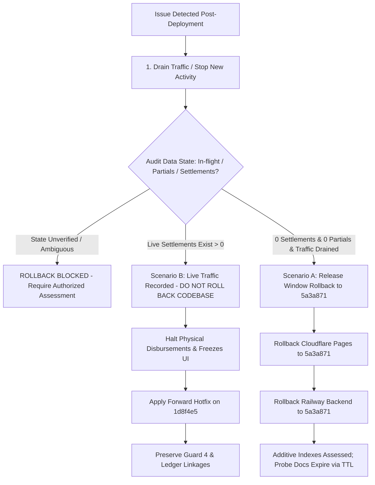

# TECHNICAL DEPLOYMENT RUNBOOK: PHASE 3.F.3
## Sogil Furniture — Worker Wage Obligations & Settlement Engine

> **DOCUMENT STATUS: DRAFT — MENUNGGU PENGESAHAN FINAL OWNER**  
> **Version:** 1.3 (Phase 3.F.3.19 — Minimum Safe Procedures Alignment)  
> **Target Release Commit:** `1d8f4e59f6637a30820e42bab1f1253b9b5fb512`  
> **Previous Production Baseline:** `5a3a871`  
> **Target Environments:** Railway (Backend API & MongoDB Service), Cloudflare Pages (Frontend SPA)

> [!IMPORTANT]
> **PERNYATAAN PENTING: DOKUMEN INI BUKAN OTORISASI DEPLOYMENT.**  
> Dokumen runbook ini menyajikan panduan teknis langkah demi langkah, namun **TIDAK MEMBERIKAN OTORISASI** untuk memulai deployment. Eksekusi deployment ke server produksi Railway maupun Cloudflare memerlukan otorisasi terpisah dan eksplisit dari Owner Sogil Furniture. Kondisi kesehatan kluster produksi, indeks MongoDB, dan hosting saat ini berstatus **BELUM DIVERIFIKASI (NOT VERIFIED)** karena akses live belum diotorisasi.

---

## 1. OBJECTIVE, SCOPE, AND CRITICAL SAFETY DIRECTIVES

This deployment runbook provides technical procedures for releasing Phase 3.F.3 (Worker Wage Obligations & Settlement Engine) to production.

### ABSOLUTE SAFETY RULES:
1. **NO AUTOMATED DEPLOYMENTS:** Railway Auto-deploy must remain **OFF**. Cloudflare automatic branch triggers must be verified before proceeding.
2. **EXPLICIT HUMAN AUTHORIZATION GATES:** No technical deployment step may begin without explicit sign-off from the technical operator/Owner at checkpoints 1 and 2.
3. **ZERO SYNTHETIC TEST SETTLEMENTS IN PRODUCTION:**
   - **STRICTLY PROHIBITED:** Creating fake worker settlements, test disbursements, or test voids on the production database as smoke tests.
   - Any transaction created in production immediately impacts aggregate finance balances and physical cash accounting. Verification must be strictly read-only.
4. **CREDENTIAL PROTECTION:** Never inspect `.env`, print production connection strings, or expose auth tokens in terminal logs or console outputs.
5. **STATE-AWARE ROLLBACK:** Rollback must account for live transactions and database side effects; do not blindly roll back to `5a3a871` once live traffic or settlements have been processed.

---

## 2. PRE-DEPLOYMENT VERIFICATION (PHASE 1)

### 2.1 Git Repository & Branch State Verification
Before taking any deployment actions, run the following local checks in `/Users/syahidmujahid/Sogil-Project/Sogil-Furniture`:

```bash
# 1. Verify current branch is main and HEAD commit matches target release
git rev-parse HEAD
# EXPECTED OUTPUT: 1d8f4e59f6637a30820e42bab1f1253b9b5fb512

# 2. Verify remote tracking branch is identical
git fetch origin main
git rev-parse origin/main
# EXPECTED OUTPUT: 1d8f4e59f6637a30820e42bab1f1253b9b5fb512

# 3. Confirm clean working tree (preserving untracked protected documentation)
git status --short
```

### 2.2 Infrastructure State Checks
1. **Railway Project Dashboard:**
   - Navigate to Sogil Furniture Backend service.
   - Confirm **Auto-deploy is disabled (OFF)** for the `main` branch.
   - Record active deployment ID and commit (`5a3a871`).
2. **MongoDB Connection / Replica Set Status:**
   - Confirm MongoDB cluster is reported Healthy on Railway / Atlas.
   - Note: Phase 3.F.3 requires active replica set transaction support. The probe status from Phase 3.F.3.3 (`Phase 2 Transaction Probe capability status: True`) confirms replica set transactions are supported.

---

## 3. APPROVAL CHECKPOINT 1: BACKEND DEPLOYMENT GATE

> [!CAUTION]
> **GATE 1 APPROVAL REQUIRED BEFORE PROCEEDING**  
> Operator confirmation required:
> - [ ] Git HEAD `1d8f4e5` matches `origin/main`.
> - [ ] Railway Auto-deploy is confirmed OFF.
> - [ ] Baseline production commit `5a3a871` is documented.
> - [ ] Owner / Lead Operator has granted explicit permission to trigger backend deployment.

---

## 4. BACKEND DEPLOYMENT EXECUTION (PHASE 2)

### 4.1 Trigger Manual Railway Deployment
1. In the Railway Dashboard:
   - Go to Sogil Furniture Backend service.
   - Trigger **Deploy** manually selecting commit `1d8f4e59f6637a30820e42bab1f1253b9b5fb512`.
2. Alternatively via Railway CLI:
   ```bash
   # Deploy specific commit without enabling auto-deploy
   railway up --detach
   ```

### 4.2 Startup Log Verification (Crucial)
Inspect live deployment build and runtime logs for the following milestone events:

1. **Database Index Initialization (`server.py` `seed()`):**
   Verify the successful initialization of the 4 new indexes on `wage_settlements`:
   - `uniq_settlement_number`: `[("settlement_number", 1)]` (unique=True)
   - `uniq_wage_settlements_idempotency`: `[("idempotency_key", 1)]` (unique=True, partialFilterExpression={"idempotency_key": {"$type": "string"}})
   - `idx_wage_settlements_worker_date`: `[("worker_id", 1), ("settlement_date", -1)]`
   - `idx_wage_settlements_finance_txn`: `[("finance_transaction_id", 1)]`
   *(Note: Indexes on `wage_obligations` such as `uniq_obligation_number` and `idx_wage_obligations_worker_status` were established in Phase 2. Confirm that `seed()` completes without raising `CriticalFinanceIndexError`).*

2. **Transaction Probe Capability Verification:**
   Search for the exact probe log line generated during FastAPI application startup:
   ```text
   Phase 2 Transaction Probe capability status: True
   ```
   *If status is `False` or an exception is logged, MongoDB transactions are NOT active. Halt immediately and consult Section 7 (Rollback Protocol).*

3. **HTTP Server Health:**
   Confirm Uvicorn / FastAPI server is listening:
   ```text
   Application startup complete.
   Uvicorn running on http://0.0.0.0:8080 (or configured port)
   ```

### 4.3 Read-Only Backend Smoke Checks
Run read-only API requests against the production backend URL using an authorized admin session token (or curl):

```bash
# 1. Health check / Public categories ping (Unauthenticated, returns 200)
curl -s -o /dev/null -w "%{http_code}\n" https://<BACKEND_PROD_URL>/api/categories
# EXPECTED: 200

# 2. Verify products endpoint (Unauthenticated, returns 200)
curl -s -o /dev/null -w "%{http_code}\n" https://<BACKEND_PROD_URL>/api/products
# EXPECTED: 200

# 3. Read-only wage obligations pending summary endpoint
# Note on authentication:
# - An unauthenticated request to this route will return HTTP 401 or 403 (verifying the route is mounted and protected by require_finance_or_owner).
# - A 401/403 demonstrates route existence and security boundary reachability, but does not prove database query execution.
# - An authenticated request with valid admin credentials/cookies will return HTTP 200 with JSON payload.
curl -s -o /dev/null -w "%{http_code}\n" https://<BACKEND_PROD_URL>/api/admin/wages/pending-summary
# EXPECTED: 200 (if authenticated) or 401/403 (if unauthenticated test)

# 4. Read-only wage obligations list
curl -s -o /dev/null -w "%{http_code}\n" https://<BACKEND_PROD_URL>/api/admin/wage-obligations
# EXPECTED: 200 (if authenticated) or 401/403 (if unauthenticated test)

# 5. Read-only wage settlements list
curl -s -o /dev/null -w "%{http_code}\n" https://<BACKEND_PROD_URL>/api/admin/wages/settlements
# EXPECTED: 200 (if authenticated) or 401/403 (if unauthenticated test)
```
> [!WARNING]
> **STRICT PROHIBITION ON PRODUCTION STATE MUTATION:**  
> **DO NOT CALL** `POST /api/admin/wages/settlements` or `POST /api/admin/wages/settlements/{id}/void`.  
> Creating fake or synthetic settlements in production will permanently corrupt accounting ledger numbers and alter real wage obligation statuses.

---

## 5. APPROVAL CHECKPOINT 2: FRONTEND DEPLOYMENT GATE

> [!CAUTION]
> **GATE 2 APPROVAL REQUIRED BEFORE PROCEEDING**  
> Operator confirmation required:
> - [ ] Backend startup log verified: `Transaction Probe capability status: True`.
> - [ ] Backend index creation verified.
> - [ ] Read-only API smoke checks returned 200 OK.
> - [ ] Operator authorizes deployment of Cloudflare Pages frontend.

---

## 6. FRONTEND DEPLOYMENT EXECUTION (PHASE 3)

### 6.1 Trigger Cloudflare Pages Deployment
1. In Cloudflare Pages dashboard:
   - Select Sogil Furniture frontend project.
   - Trigger manual deployment targeting commit `1d8f4e59f6637a30820e42bab1f1253b9b5fb512`.
2. Monitor build output:
   - Verify `npm run build` (Vite) completes with exit code 0.
   - Verify bundle asset generation and cache upload.

### 6.2 Read-Only Frontend Smoke Verification
1. Open production web URL in private / incognito browser window.
2. Log in with authorized Finance / Admin account.
3. Navigate to `/admin/wages/pending` (the frontend SPA route for Worker Wages, distinct from backend API routes).
4. **Verify UI elements render correctly:**
   - Table of pending worker obligations displays proper columns (Worker Name, Total Accrued LE, Paid LE, Outstanding LE, Actions).
   - Verify Settlement History tab loads data from backend API endpoint `GET /api/admin/wages/settlements`.
   - Verify browser console shows zero JavaScript runtime errors or broken asset 404s.
5. **REMINDER:** DO NOT SUBMIT TEST SETTLEMENTS.

---

## 7. STATE-AWARE ROLLBACK PROTOCOL

> [!CAUTION]
> **ROLLBACK SAFETY REALITY:**  
> A financial application rollback is **NEVER automatically safe, risk-free, or trivial**. Simply observing that `wage_settlements` has zero records is necessary, but **NOT sufficient on its own** to justify an immediate rollback.  
> Rollback must only be executed after an authorized release operator performs a comprehensive assessment through approved, read-only procedures.



### 7.1. Mandatory Pre-Rollback Assessment Checklist
Before initiating any rollback of the backend or frontend:
1. **Traffic Drain & In-Flight Request Check:**
   - Ensure no administrators are currently attempting to submit wage settlements or orders.
   - Wait for active HTTP connections to terminate cleanly.
2. **Comprehensive Data State Verification (Read-Only Assessment):**
   - Verify settlement collection state: `wage_settlements` contains 0 records.
   - Verify related finance transactions: `finance_transactions` contains 0 documents referencing `wage_settlement_id` or `related_settlement_number`.
   - Verify obligation integrity: `wage_obligations` has no modified `paid_amount_le` from new settlements.
   - Verify employee wage mirror: `employee_wages` has no new settlement entries.
3. **Database Side Effects, Additive Indexes, & Startup Probe Awareness:**
   - On startup, the backend provisions temporary probe infrastructure (`_system_probe_assignments` and `_system_probe_obligations`) and executes `run_transaction_probe()`. This probe inserts and deletes probe documents with a 300-second TTL fallback.
   - **Do not mistake temporary probe collection activity for worker settlement records.**
   - The 4 new indexes created on `wage_settlements` by `seed()` (`uniq_settlement_number`, `uniq_wage_settlements_idempotency`, `idx_wage_settlements_worker_date`, `idx_wage_settlements_finance_txn`) are additive database artifacts. Their presence alone in the database schema does not prove that rollback is safe. Compatibility and rollback eligibility must be assessed against the actual database state, the application version (`5a3a871`), in-flight requests, and any related financial records across linked collections.
   - Do not delete or modify indexes in MongoDB during rollback.
4. **BLOCKED Rollback Condition:**
   - If the necessary state cannot be safely verified through an approved, read-only procedure, or if there is uncertainty about in-flight requests or partial writes, **ROLLBACK REMAINS BLOCKED**. Do not issue ad-hoc production mutations; escalate to the Owner and Lead Architect.

---

### Scenario A: Release Window Failure (Zero Settlements & Clean Data State)
*Condition:* An issue occurs during the deployment window (e.g., frontend asset 404, container startup failure, transaction probe failed), traffic has been drained, and **zero settlements or partial linked records exist in the database**.

> [!WARNING]
> **COMMIT `5a3a871` IS NOT AUTOMATICALLY SAFE TO ROLL BACK TO:**  
> Rolling back to commit `5a3a871` must NOT be treated as an automatically safe or trivial procedure. A rigorous state and compatibility assessment must be completed before any rollback, evaluating database side effects, additive indexes, probe collections, and verifying that zero settlements or partial writes exist.  
> **IF SAFETY OR DATA STATE IS UNCERTAIN: STOP IMMEDIATELY AND ESCALATE** to the Owner and Lead Architect. Do NOT perform a blind rollback. Rollback execution requires separate, explicit authorization from the Owner and is not pre-authorized by this runbook.

1. **Pre-Rollback State Verification:** Verify via read-only inspection that zero settlement records or in-flight writes exist.
2. **Frontend Rollback (If Explicitly Authorized):**
   - In Cloudflare Pages dashboard, roll back the active deployment to previous production release commit `5a3a871`.
3. **Backend Rollback (If Explicitly Authorized):**
   - In Railway dashboard, roll back deployment to previous production release commit `5a3a871`.
4. **Post-Rollback Compatibility Verification:**
   - Confirm backend starts cleanly on `5a3a871`.
   - Run read-only checks: `/api/categories` and `/api/products` return 200 OK.
   - Confirm additive `wage_settlements` indexes do not cause unexpected query or operational side effects under `5a3a871`.

---

### Scenario B: Post-Release Failure with Live Data (Settlements Have Been Recorded)
*Condition:* Live worker settlements have already been processed in production, but a defect is discovered.

> [!CAUTION]
> **CRITICAL ARCHITECTURAL PROHIBITION: DO NOT BLINDLY ROLL BACK TO `5a3a871`**  
> Rolling back backend code to `5a3a871` while live settlements exist in the database will cause severe data desynchronization and ledger corruption:
> 1. **Absence of Guard 4:** Commit `5a3a871` **does not have Guard 4** on `finance_update` (`server.py:5885`) and `finance_delete` (`server.py:6023`). If rolled back, an admin could edit or void a settlement's linked expense transaction directly in the finance module, permanently desynchronizing financial cash balances from wage obligations.
> 2. **Hiding Frontend Routes is Not Security:** Hiding or rolling back the frontend SPA does NOT prevent direct API access or protect against data corruption if the backend is rolled back.
> 3. **Missing Settlement Endpoints:** Commit `5a3a871` lacks endpoints to inspect, reconcile, or void settlements.

**Mandatory Action for Scenario B:**
1. **Immediate Operational Halt:** Instruct Finance to stop recording settlements and halt physical cash disbursements.
2. **Maintain Backend Code:** Keep backend running on `1d8f4e59f6637a30820e42bab1f1253b9b5fb512` to preserve database integrity guards.
3. **Develop & Deploy Forward Hotfix:** Resolve the issue via a forward patch commit on top of `1d8f4e5`.
4. **Data Reconciliation:** If specific records require voiding, use authorized administrative void procedures or prepare an audited migration script approved by the Owner.

---

### Scenario C: Operational Ambiguity or Cash Discrepancy
*Condition:* Physical cash does not match system records, or a network timeout occurred during settlement submission.

1. **DO NOT MODIFY DATABASE DIRECTLY.**
2. Follow **Section 8 (Network Interruption & Ambiguous Outcomes)** of [`PHASE_3_F_3_FINANCE_SOP_DRAFT_v1.md`](file:///Users/syahidmujahid/Sogil-Project/Sogil-Furniture/docs/operations/PHASE_3_F_3_FINANCE_SOP_DRAFT_v1.md).
3. Complete the physical cash drawer audit using [`PHASE_3_F_3_DAILY_RECONCILIATION_FORM_DRAFT_v1.md`](file:///Users/syahidmujahid/Sogil-Project/Sogil-Furniture/docs/operations/PHASE_3_F_3_DAILY_RECONCILIATION_FORM_DRAFT_v1.md).
4. Escalate to Owner for formal review before resuming payments.

---

## 8. POST-DEPLOYMENT HANDOVER CHECKLIST

Once deployment is confirmed healthy:
- [ ] Railway Auto-deploy confirmed remaining OFF.
- [ ] Active deployment ID and timestamp logged in deployment records.
- [ ] Finance team and Manager Operational notified that Phase 3.F.3 is live under the operating rules of [`PHASE_3_F_3_FINANCE_SOP_DRAFT_v1.md`](file:///Users/syahidmujahid/Sogil-Project/Sogil-Furniture/docs/operations/PHASE_3_F_3_FINANCE_SOP_DRAFT_v1.md).
- [ ] Daily Reconciliation Form printed or prepared for cashier desk ([`PHASE_3_F_3_DAILY_RECONCILIATION_FORM_DRAFT_v1.md`](file:///Users/syahidmujahid/Sogil-Project/Sogil-Furniture/docs/operations/PHASE_3_F_3_DAILY_RECONCILIATION_FORM_DRAFT_v1.md)).
- [ ] Operational roles confirmed: 1 Owner, 1 Manager Operational merangkap Admin, and per-order workers (Segregation of Duties: Preparer, Approver, Disburser, Reviewer).
- [ ] Large payment threshold (5.000 LE manual Persetujuan Owner untuk Pembayaran Besar) and anti-structuring rules (aggregation by related obligation/order) explained to staff.
- [ ] Manager Operational temporary delegation mandate limits (max 1.000 LE per transaction, written mandate required, zero automatic substitute authority) briefed.
- [ ] Owner Retrospective Review SLA confirmed (target: next business day after Owner availability; immediate escalation for discrepancies).
- [ ] Zero Silent Write-Off rule reinforced: all physical cash variances require written incident reports to Owner.
- [ ] Technical gap acknowledged: threshold, delegation enforcement, and Pending Approval Queue are NOT active in current code (`1d8f4e5`), but are strictly manual operational controls with future software automation specified in [`OWNER_CONTROL_CENTER_AND_DELEGATION_SPEC_DRAFT_v1.md`](file:///Users/syahidmujahid/Sogil-Project/Sogil-Furniture/docs/operations/OWNER_CONTROL_CENTER_AND_DELEGATION_SPEC_DRAFT_v1.md).
