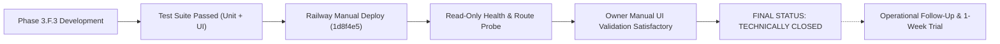

# LAPORAN PENUTUPAN AKHIR (FINAL CLOSURE REPORT): PHASE 3.F.3
## Sogil Furniture — Worker Wage Obligations & Settlement Engine

---

### METADATA DOKUMEN & RELEASE BASELINE

| Parameter | Nilai / Temuan Terverifikasi | Status |
| :--- | :--- | :--- |
| **Fitur / Modul** | Phase 3.F.3: Worker Wage Obligations & Settlement Engine | **SELESAI / CLOSED** |
| **Status Penutupan** | **`TECHNICALLY CLOSED — OPERATIONAL FOLLOW-UP CONTINUES`** | **RESMI** |
| **Repository** | `/Users/syahidmujahid/Sogil-Project/Sogil-Furniture` | Terverifikasi |
| **Git Branch** | `main` | Terverifikasi |
| **Git Commit HEAD** | `1d8f4e59f6637a30820e42bab1f1253b9b5fb512` | Terverifikasi |
| **Remote Sync (`origin/main`)** | `1d8f4e59f6637a30820e42bab1f1253b9b5fb512` (Sinkron penuh) | Terverifikasi |
| **Railway Service ID** | `c16db012-f71d-4d73-999e-e4f69392fa74` (`Sogil-Furniture`) | Terverifikasi |
| **Railway Project / Env** | `feisty-insight` (`d0af2055`) / `production` (`f8caf8ec`) | Terverifikasi |
| **Active Deployment ID** | `4dc97af5-0fdc-45e4-9c51-47cc4090c975` | Terverifikasi (`SUCCESS`) |
| **Railway Auto-Deploy** | **CONFIRMED OFF** (`edges: []` triggers pada GraphQL API) | Terverifikasi |
| **Cloudflare Pages Frontend** | `https://sogilfurniture.com`, `https://team.sogilfurniture.com` (Bundle: `main.54888aed.js`) | Terverifikasi |
| **Pemeriksaan UI Produksi** | Konfirmasi manual Owner memuaskan (*satisfactory*) | **DISETUJUI OWNER** |
| **Tanggal Penutupan** | 2026-10-14 | **FINAL** |

---

## 1. RINGKASAN EKSEKUTIF (EXECUTIVE SUMMARY)

Fase 3.F.3 (*Worker Wage Obligations & Settlement Engine*) secara resmi dinyatakan **ditutup dari sisi teknis dan deployment produksi** (*Technically Closed*). 

Fitur ini mengimplementasikan siklus pencatatan kewajiban upah berbasis penugasan kerja per pesanan (*order-based work assignment obligations*), mesin pembayaran upah bertahap maupun lunas (*settlement engine*), pembatalan administratif (*settlement void*), serta pencatatan akuntansi kanonikal pada buku besar kas (`finance_transactions`) dengan cermin keterbacaan riwayat pekerja (`employee_wages`).

Deployment manual backend ke server produksi Railway telah berhasil dilaksanakan pada commit `1d8f4e59f6637a30820e42bab1f1253b9b5fb512` (Deployment ID: `4dc97af5-0fdc-45e4-9c51-47cc4090c975`). Indeks MongoDB yang disyaratkan telah terinisialisasi secara otomatis saat aplikasi dinyalakan, kapabilitas transaksi ACID replica-set terbukti aktif, seluruh rute backend terverifikasi, dan Owner telah menyelesaikan pengecekan antarmuka manual (*manual UI check*) di lingkungan produksi dengan hasil yang memuaskan.

> [!IMPORTANT]
> **PERNYATAAN BATASAN PENUTUPAN TEKNIS:**  
> Penutupan teknis Phase 3.F.3 **TIDAK MENGIMPLIKASIKAN** bahwa seluruh fitur tata kelola keuangan masa depan (*Owner Control Center*, dynamic policy engine berbasis database, antrean persetujuan multi-level otomatis di UI, atau integrasi bank otomatis) telah diimplementasikan.  
> Sistem saat ini menerapkan **kebijakan operasional minimum yang aman (Minimum Safe Procedures)** melalui SOP formal dan disiplin verifikasi Owner, bukan melalui penegakan kode dinamis yang rumit. Tindak lanjut operasional tetap berlanjut melalui uji coba formulir rekonsiliasi harian selama satu minggu.

---

## 2. STATUS PENYELESAIAN TEKNIS (TECHNICAL COMPLETION)

Semua komponen inti Phase 3.F.3 yang terkunci dalam spesifikasi telah selesai diimplementasikan pada basis kode:

### 2.1 Logika Akumulasi dan Pembayaran Upah (Accrual & Settlement Engine)
- **Akumulasi Otomatis (Accrual):** Kewajiban upah (`wage_obligations`) terakumulasi saat tugas pesanan dibuat dan disetujui, mencatat `accrued_amount_le`, `paid_amount_le`, serta sisa `outstanding_amount_le`.
- **Fleksibilitas Pembayaran (Partial & Full):** Mendukung pelunasan penuh, pelunasan sebagian (*partial settlement*), maupun pembayaran sekaligus untuk banyak kewajiban (*multi-obligation settlement*) bagi satu pekerja dalam satu transaksi.
- **Pencegahan Kelebihan Bayar (Overpayment Rejection):** Backend secara ketat menolak pembayaran yang melebihi saldo kewajiban yang masih terutang (`HTTP 400 Bad Request`).
- **Idempotensi & Konkurensi:** Mendukung header/payload `idempotency_key` dengan penguncian parsial unik pada MongoDB, mencegah duplikasi pembayaran ganda saat terjadi *retry* jaringan atau klik ganda kasir.
- **Batas Transaksi Atomik (ACID):** Seluruh mutasi—pembaruan kewajiban upah, pencatatan dokumen `wage_settlements`, pencatatan pengeluaran kas kanonikal `finance_transactions`, dan pembaruan `employee_wages`—dieksekusi dalam satu sesi transaksi MongoDB replica-set (`async with await client.start_session() as session: async with session.start_transaction():`). Jika terjadi kegagalan, transaksi otomatis dibatalkan sepenuhnya (*fail-closed*).

### 2.2 Akuntansi Kanonikal dan Kaca Keterbacaan (Accounting & Read Mirror)
- **Pencatatan Buku Besar Utama (`finance_transactions`):** Setiap penyelesaian upah mencatat transaksi pengeluaran kas kanonikal dengan `type="expense"`, `category="Upah Pekerja"`, mengikat referensi permanen `wage_settlement_id` dan `related_settlement_number`.
- **Kaca Riwayat Pekerja (`employee_wages`):** Dokumen riwayat upah pekerja diperbarui secara konsisten sebagai cermin baca audit (*read mirror*) tanpa mengorbankan integritas kas utama.

### 2.3 Mekanisme Pembatalan (Void Safeguards) & Proteksi Modul Finansial
- **Pembatalan Administratif (Void):** Endpoint `POST /api/admin/wages/settlements/{id}/void` mengembalikan saldo kewajiban upah ke status belum terbayar (*unpaid/pending*), menandai settlement sebagai `voided`, dan mencatat transaksi penyeimbang (*reversing expense*) pada buku besar finansial tanpa menghapus rekaman historis (*immutable audit trail*).
- **Proteksi Guard 4 Finansial:** Pada `server.py:5885` (`finance_update`) dan `server.py:6023` (`finance_delete`), transaksi pengeluaran yang terikat pada penyelesaian upah (`wage_settlement_id`) **diblokir secara permanen dari edit langsung atau penghapusan manual** di modul Keuangan Umum (`HTTP 409 Conflict`). Koreksi keuangan wajib dilakukan melalui mekanisme void settlement yang sah.

### 2.4 Indeks Basis Data Baru (`wage_settlements`)
Fungsi startup `seed()` di `server.py` secara otomatis menginisialisasi 4 indeks kritikal:
1. `uniq_settlement_number`: `[("settlement_number", 1)]` (unique=True)
2. `uniq_wage_settlements_idempotency`: `[("idempotency_key", 1)]` (unique=True, partialFilterExpression={"idempotency_key": {"$type": "string"}})
3. `idx_wage_settlements_worker_date`: `[("worker_id", 1), ("settlement_date", -1)]`
4. `idx_wage_settlements_finance_txn`: `[("finance_transaction_id", 1)]`

### 2.5 Rute Antarmuka & Backend Produksi
- **Backend API Endpoints:**
  - `GET /api/admin/wages/pending-summary`: Ringkasan kewajiban pending per pekerja.
  - `GET /api/admin/wage-obligations`: Rincian daftar kewajiban upah.
  - `POST /api/admin/wages/settlements`: Eksekusi pencatatan pembayaran upah.
  - `GET /api/admin/wages/settlements`: Riwayat penyelesaian upah dengan filter pekerja/tanggal.
  - `GET /api/admin/wages/settlements/{id}`: Detail satu penyelesaian upah.
  - `POST /api/admin/wages/settlements/{id}/void`: Eksekusi pembatalan penyelesaian upah.
- **Frontend SPA Routing:**
  - `/admin/wages/pending`: Antarmuka manajemen upah dengan tab navigasi daftar kewajiban pending (`kewajiban`) dan tab riwayat pembayaran upah (`settlements`).

---

## 3. BUKTI VERIFIKASI & PENGUJIAN (VERIFICATION EVIDENCE)

Kualifikasi pengujian dan validasi dibedakan secara tegas antara pengujian audit lokal, pengujian historis, log kontainer produksi, inspeksi HTTP read-only, dan verifikasi antarmuka manual Owner:

| Kategori Bukti | Lingkup & Rincian Bukti | Hasil |
| :--- | :--- | :--- |
| **Audit Unit Test Lokal (Terbaru)** | • `backend/tests/test_phase3_f_3_wage_settlement.py` (12/12 passed, 1.10s) • `frontend/src/__tests__/AdminWorkerPendingWages.test.js` (19/19 passed, 0.837s) | **PASS (100%)** |
| **Pengujian Integrasi Historis** | • Pengujian integrasi replica-set native Phase 3.F.3.3 (5/5 passed) • Regresi penuh Phase 3 Finance adjustments suite Phase 3.F.3.2 (194/194 passed) | **HISTORICAL PASS** |
| **Log Runtime Startup Produksi** | Log Deployment `4dc97af5-0fdc-45e4-9c51-47cc4090c975`: • `Phase 2 Transaction Probe capability status: True` • Inisialisasi indeks `seed()` tanpa `CriticalFinanceIndexError` • Uvicorn listening on port 8080 | **VERIFIED LIVE** |
| **Inspeksi HTTP Read-Only** | • `GET /api/categories` → 200 OK (Katalog live) • `GET /api/products` → 200 OK (Produk live) • `GET /api/admin/wages/pending-summary` → 401 Unauthorized (Auth guard aktif) • `GET /api/admin/wages/settlements` → 401 Unauthorized (Auth guard aktif; sebelumnya 404 pada baseline lama) • `GET https://sogilfurniture.com/admin/wages/pending` → 200 OK (SPA shell aktif) | **VERIFIED LIVE** |
| **Inspeksi UI Manual Produksi** | Konfirmasi langsung oleh Owner pada antarmuka produksi: Navigasi rute, pemuatan data tabel kewajiban, dan akses riwayat pembayaran berjalan normal | **VERIFIED SATISFACTORY** |
| **Integritas Data Produksi** | Nol transaksi fiktif/sintetis (*zero test settlements/voids*) dibuat di basis data produksi selama proses verifikasi | **VERIFIED SAFE** |
| **Isolasi Rilis** | Nol perubahan deployment tambahan atau mutasi kode selama fase validasi akhir | **VERIFIED ISOLATED** |

---

## 4. STATUS DOKUMEN OPERASIONAL & KEBIJAKAN YANG DISETUJUI

Owner telah menelaah dan menyetujui substansi dari tiga dokumen operasional utama:
1. `docs/operations/PHASE_3_F_3_FINANCE_SOP_DRAFT_v1.md` (Versi 1.3-FINAL-DRAFT)
2. `docs/operations/PHASE_3_F_3_DAILY_RECONCILIATION_FORM_DRAFT_v1.md` (Versi 1.3-FINAL-DRAFT)
3. `docs/operations/PHASE_3_F_3_DEPLOYMENT_RUNBOOK_DRAFT_v1.md` (Versi 1.3-FINAL-DRAFT)

### 4.1 Catatan Inkonsistensi Penamaan Berkas (Documentation Issue)
- **Temuan:** Nama file fisik ketiga dokumen tersebut di atas masih mengandung sufiks `_DRAFT_v1.md`, sementara status substansialnya telah resmi disahkan oleh Owner sebagai prosedur operasional acuan rilis.
- **Tindakan:** Sesuai batas instruksi, nama file fisik dipertahankan apa adanya untuk menghindari disrupsi tracking Git, namun secara formal dicatat dalam laporan ini bahwa dokumen-dokumen tersebut **telah disahkan dan berlaku efektif**.

### 4.2 Parameter Kebijakan Minimum yang Berlaku Efektif
- **Ambang Batas Persetujuan Owner (Approval Threshold):** Pembayaran upah dengan nominal $\ge$ **5.000 LE** wajib mendapatkan pemeriksaan dan persetujuan tertulis eksplisit dari Owner sebelum kas fisik dibayarkan.
- **Batas Mandat Delegasi Manager:** Pembayaran yang dilakukan secara mandiri oleh Manager dibatasi maksimal **1.000 LE per transaksi**, hanya berlaku bila ada mandat penugasan tertulis aktif dari Owner dengan batasan waktu yang jelas.
- **Persetujuan Jarak Jauh (Remote Approval):** Jika Owner berhalangan hadir secara fisik, persetujuan tertulis spesifik yang dapat diverifikasi (misal via pesan pesan resmi WhatsApp/Email terdokumentasi) sah digunakan. Jika tidak ada konfirmasi valid, pembayaran **wajib ditunda**.
- **Koreksi Pasca-Pembayaran Fisik:** Jika ditemukan kelebihan bayar setelah uang fisik diserahkan kepada pekerja, Manager **dilarang membatalkan (*void*) transaksi secara sepihak**. Manager wajib melapor ke Owner, dan penyelesaian dilakukan melalui kesepakatan tertulis. **Dilarang melakukan pemotongan otomatis sepihak dari upah pekerjaan di masa depan**.
- **Uji Coba Formulir Rekonsiliasi Harian:** Formulir fisik harian dijalankan dalam masa uji coba operasional selama **1 (satu) minggu**, diselesaikan dalam 10–15 menit di akhir hari kerja oleh kasir/manager, dan direviu oleh Owner.
- **Sifat Dokumen Runbook:** Dokumen runbook deployment berkedudukan sebagai panduan teknis operasional, bukan otorisasi deployment otomatis.

---

## 5. ANALISIS RISIKO BACKUP & PEMULIHAN (RECOVERY RISK)

Berdasarkan hasil inspeksi langsung pada dasbor MongoDB Atlas kluster `sogil-furniture`:

1. **Kondisi Kluster Atlas Riil:**
   - Halaman kluster menampilkan status: `Backups Inactive`.
   - Halaman menu Backup menawarkan opsi upgrade berbayar untuk *continuous cloud backups* dan *daily snapshot backups*.
   - **Kesimpulan Faktual:** Kluster produksi pada paket langganan Atlas saat ini **tidak memiliki backup otomatis berkala aktif maupun kapabilitas Point-in-Time Recovery (PITR)**.
2. **Arsip Backup Lokal (Historical Local Archive):**
   - Arsip snapshot database lokal tercatat pernah dibuat pada tanggal **2026-10-13**.
   - Keberadaan arsip tersebut belum membuktikan bahwa data mencakup mutasi terbaru produksi pasca-tanggal tersebut, dan integritas pemulihannya (*restoration drill*) belum pernah diuji secara formal.
3. **Penilaian Risiko & Mitigasi Operasional:**
   - Kondisi backup ini dicatat sebagai **keterbatasan risiko pemulihan infrastruktur (known recovery-risk limitation)**, bukan kegagalan dari kode perangkat lunak Phase 3.F.3.
   - Karena settlement engine menggunakan transaksi ACID dengan validasi saldo ketat, risiko korupsi internal data sangat rendah. Namun, ketiadaan PITR di tingkat hosting mengharuskan kehati-hatian ekstra terhadap operasi database administratif manual.

---

## 6. TINDAK LANJUT OPERASIONAL (REMAINING OPERATIONAL FOLLOW-UP)

Tindak lanjut non-teknis yang harus dijalankan pada fase operasional awal meliputi:

1. **Menjalankan Uji Coba Rekonsiliasi 1 Minggu:** Kasir/Manager mencatat penerimaan dan pengeluaran fisik kas harian pada formulir uji coba, kemudian Owner mengevaluasi kecukupan formulir tersebut setelah 7 hari kalender.
2. **Pencatatan Settlement Riil Perdana:** Memproses pembayaran upah nyata pertama kali melalui sistem ketika ada pekerjaan custom yang telah selesai dan kewajiban upah pekerjanya telah jatuh tempo sesuai ketentuan SOP.
3. **Rekonsiliasi Fisik Bukti Kas:** Mencocokkan bukti tanda terima fisik (tanda tangan pekerja/nota kasbon) dengan nomor settlement (`SET-YYYYMM-XXXX`) yang diterbitkan oleh sistem.
4. **Verifikasi Integritas Backup Lokal:** Menjadwalkan pengujian restore independen terhadap file arsip backup lokal tanggal 2026-10-13 ke lingkungan pengujian terisolasi untuk memastikan kesiapan jika terjadi *disaster recovery*.
5. **Evaluasi Biaya Backup Atlas:** Owner mempertimbangkan apakah akan mengaktifkan fitur automated snapshot berbayar di MongoDB Atlas sesuai dengan skala pertumbuhan transaksi bisnis.

---

## 7. REKOMENDASI TAHAP BERIKUTNYA (NEXT FEATURE HANDOFF)

### 7.1 Kandidat Fitur Selanjutnya: Phase 3.F.4 — Logistik & Operasional Pengiriman (Delivery Operations)
Berdasarkan dokumen arsitektur historis (`SOGIL_PHASE_2_ARCHITECTURE_SCOPE_LOCK_v1.2.x`), modul pengiriman dan armada sebelumnya ditandai sebagai:  
*“Delivery logistics, driver assignments, and delivery wages $\to$ Deferred to Future Logistics Phase”*.

Mengingat alur pesanan dari `siap` menuju `selesai` (handover pelanggan) telah terkunci pada Phase 3.B.1 dan penyelesaian upah pekerja berbasis tugas telah selesai pada Phase 3.F.3, maka pengelolaan kurir/pengemudi pengiriman adalah kandidat kelanjutan alami yang diusulkan.

### 7.2 Lingkup Usulan (Proposed Scope)
- Penugasan armada/driver untuk pesanan yang berada pada status `siap dikirim`.
- Rute pengiriman multi-titik (*delivery stops*) dan pelacakan status serah terima barang di lapangan.
- Rekonsiliasi ongkos kirim pelanggan (*delivery fee collected*) terhadap biaya riil transportasi/payout driver.
- Akumulasi upah pengantaran driver ke dalam sistem kewajiban upah (`wage_obligations`).

### 7.3 Prasyarat & Dependensi yang Telah Terpenuhi
- Arsitektur pengakuan pendapatan saat serah terima (*Handover Revenue Recognition* pada status `selesai`).
- Mesin penyelesaian upah pekerja dan proteksi transaksi buku besar kas (Phase 3.F.3).
- Master data zona pengiriman (`delivery_zones`) yang telah ada di backend.

### 7.4 Keputusan Bisnis yang Memerlukan Arahan Owner
Sebelum spesifikasi teknis Phase 3.F.4 dirancang, Owner perlu menentukan:
1. **Model Kurir:** Apakah pengiriman menggunakan kurir internal tetap, pekerja lepas per pengantaran (*per-trip freelance*), atau ekspedisi pihak ketiga (cargo luar)?
2. **Skema Upah Driver:** Apakah driver menerima tarif flat per zona pengiriman, komisi berbasis jarak, atau persentase dari nilai pesanan?
3. **Penanganan Kas COD (Cash on Delivery):** Jika pesanan belum lunas dan sisa pembayaran ditagihkan saat barang tiba di lokasi pelanggan, bagaimana prosedur penyerahan kas dari driver ke kasir toko beserta bukti serah terimanya?

---

## 8. KESIMPULAN AKHIR

Fitur **Phase 3.F.3: Worker Wage Obligations & Settlement Engine** telah selesai secara penuh, terpasang di lingkungan produksi secara aman, dan siap digunakan untuk melayani operasional harian Sogil Furniture.

**FINAL STATUS:**  
# `TECHNICALLY CLOSED — OPERATIONAL FOLLOW-UP CONTINUES`
