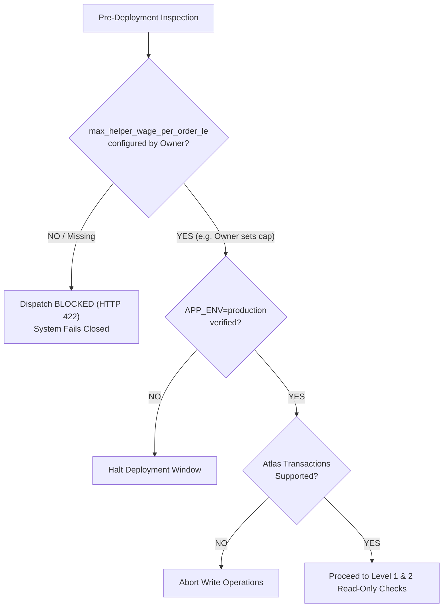
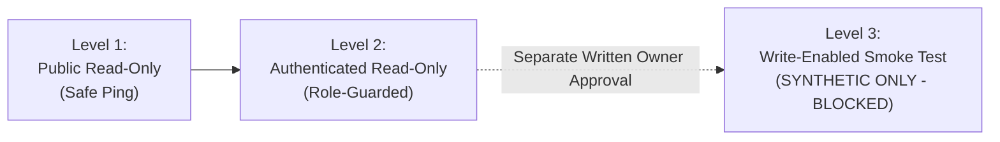
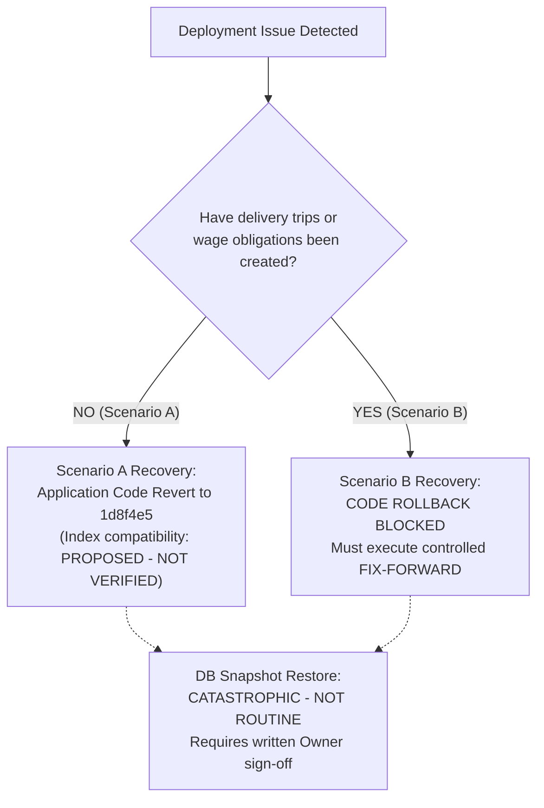

# TECHNICAL DEPLOYMENT RUNBOOK: PHASE 3.F.4
## Sogil Furniture — Delivery Logistics Engine & Delivery-Helper Wage System

> [!WARNING]
> **DOCUMENT STATUS: DRAFT PROPOSAL — AWAITING OWNER AUTHORIZATION**<br/>
> **Target Release Commit:** `7257f7d7d3e015eb5918e6fe39da1053fd903ef2`<br/>
> **Previous Production Baseline:** `1d8f4e59f6637a30820e42bab1f1253b9b5fb512`<br/>
> **Target Branch:** `main`<br/>
> **Target Environments:** Railway (FastAPI Backend & MongoDB Service), Cloudflare Pages (React SPA Frontend)<br/>
> **Technical Validation Verdict:** `PASS WITH FINDINGS` (Source & Architecture Audit, 2026-10-16)<br/>
> **Document Reference:** `docs/operations/PHASE_3_F_4_DEPLOYMENT_RUNBOOK_DRAFT_v1.md`

---

## 1. PURPOSE AND CRITICAL SAFETY DIRECTIVES

This deployment runbook provides technical procedures for releasing Phase 3.F.4 (Delivery Logistics Engine & Helper Wage System) to production.

Operational procedures for post-handover worker wage disbursements, cash reconciliation, and settlement voiding are governed separately by [phase-3-f-3-settlement-void-sop.md](./phase-3-f-3-settlement-void-sop.md).

### ABSOLUTE SAFETY RULES:
1. **NO AUTOMATED DEPLOYMENTS:**
   - Railway Auto-deploy must remain disabled (**OFF**).
   - Cloudflare Pages automatic branch triggers must be verified prior to release.
2. **DOCUMENTATION APPROVAL IS NOT DEPLOYMENT AUTHORIZATION:**
   - Approving this runbook does **NOT** authorize production deployment, Git push, database migration, or credential access.
   - Deployment execution requires separate, explicit written authorization from the Owner.
3. **READ-ONLY VERIFICATION BY DEFAULT:**
   - All standard post-deployment healthchecks must be strictly read-only.
   - Write-enabled production smoke tests are strictly blocked until explicitly authorized with a dedicated synthetic test fixture.
4. **CREDENTIAL & SECRET PROTECTION:**
   - Never inspect `.env`, print production connection strings, or expose auth tokens in terminal logs or console outputs.

---

## 2. SECTION A: CURRENT READINESS STATUS

Based on the Final Technical Validation performed on 2026-10-16:

- **Technical Validation Verdict:** `PASS WITH FINDINGS`.
- **Code & Test Evidence:** Application source code and existing test suites demonstrate that the delivery engine, wage calculation, trip cancellation guards, and state machines are structurally sound and ready for a controlled, phased deployment process.
- **Production Readiness Limit:** Production readiness is **NOT fully proven**.
  - **No production smoke test** has been executed or verified.
  - **Production MongoDB Atlas multi-document transaction behavior**, replica set write concerns (`w: "majority"`), and network latency under live load remain **UNVERIFIED (`NOT VERIFIED`)**.
  - **Live environment configuration**, including verification of `APP_ENV=production`, remains **UNVERIFIED (`NOT VERIFIED`)**.
  - **Active production commit hashes** and live Railway Auto-deploy toggle state have not been verified via authorized dashboards during this review (**`NOT VERIFIED`**).
- **Rule of Truth:** The system must never be represented to operators or stakeholders as fully production-validated until all live pre-deployment and level 1–2 checks are verified with physical evidence.

---

## 3. SECTION B: EXPLICIT OWNER PREREQUISITES

Before any deployment execution or trip dispatch can proceed, the following prerequisites must be satisfied and recorded:



### 1. Helper Wage Cap Configuration (`max_helper_wage_per_order_le`):
- **Requirement:** The Owner must independently choose and set the authoritative ceiling (`max_helper_wage_per_order_le`) via `/admin/delivery-wage-settings`.
- **Fail-Closed Behavior:** If this parameter is not explicitly configured in `db.settings`, any attempt to dispatch a delivery trip fails closed with **HTTP 422**.
- **Status:** **PENDING OWNER DECISION**.

### 2. Operational Threshold vs. Authoritative Wage Cap:
- **Confirmation Threshold (`unusual_amount_threshold_le`):** Defaults to **500.0 LE**. This is strictly a UI confirmation dialog trigger to prevent typographical errors during manual overrides.
- **Authoritative Wage Cap (`max_helper_wage_per_order_le`):** Represents the executive financial liability ceiling per delivered order.
- **CRITICAL DIRECTIVE:** **Never assume, suggest, or silently assign 500 LE as the wage cap.** The cap must remain unconfigured until the Owner makes a formal business determination.

### 3. Production Environment Verification:
- Operators must verify that `APP_ENV=production` is set in the Railway dashboard environment tab prior to deployment.
- Verification must use safe operational observation without dumping environment variables to log streams.
- **Status:** **NOT VERIFIED**.

### 4. MongoDB Atlas Multi-Document Transaction Support:
- The delivery engine requires atomic multi-document transactions across `delivery_trips`, `orders`, `wage_obligations`, and `finance_transactions`.
- Standalone MongoDB instances or unsupported tier configurations will cause transaction failure. Multi-document transaction capability must be confirmed on the production cluster before write-level testing.
- **Status:** **NOT VERIFIED**.

### 5. Deployment Baseline & Commit Verification:
- Target deployment commit must match HEAD: `7257f7d7d3e015eb5918e6fe39da1053fd903ef2`.
- Previous baseline commit: `1d8f4e59f6637a30820e42bab1f1253b9b5fb512`.
- Active deployed commit hashes and Auto-deploy toggle status (`OFF`) must be recorded from dashboards.
- **Status:** **NOT VERIFIED**.

---

## 4. SECTION C: DEPLOYMENT LEVELS AND AUTHORIZATION

Verification is divided into three strictly isolated procedural levels:



### Level 1 — Public Read-Only Healthchecks (Safe, Unauthenticated)
- **Objective:** Verify HTTP service responsiveness, ASGI event loop health, and basic MongoDB read access.
- **Endpoints:**
  - `GET /api/categories` — returns active category list.
  - `GET /api/products` — returns active product list.
- **Authorization:** No credentials required.
- **Safety Boundary:** Read-only queries (`find({"active": True})`). Level 1 does **NOT** prove multi-document transaction capability, admin authorization, or delivery engine readiness.

### Level 2 — Authenticated Read-Only Checks (Safe, Role-Guarded)
- **Objective:** Verify that administrative routing, role permissions, and delivery policy endpoints respond correctly without state mutation.
- **Important Technical Limitation on Index Verification:**
  - Successful GET responses confirm route accessibility, permission enforcement, and basic document queries.
  - **Successful GET requests DO NOT prove that required database indexes exist or are used.** In MongoDB, queries like `find()` will succeed via a collection scan (`COLLSCAN`) even if indexes are missing.
  - Verifying database index existence and utilization requires a separate authorized administrative inspection (e.g. `db.collection.index_information()`) or query plan examination (`.explain()`). Neither check may be run against production without explicit operational authorization.
- **Endpoints & Permissions:**
  - `GET /api/admin/delivery-trips` (Requires `manage_orders`): Retrieves trip list.
  - `GET /api/admin/delivery-trips/unassigned-orders` (Requires `manage_orders`): Retrieves queue of ready unassigned delivery orders (`order_status: "siap"`, `delivery_method: "delivery"`, `active_delivery_trip_id: null`).
  - `GET /api/admin/delivery-wage-policy` (Requires `access_finance`): Retrieves active delivery wage policy document.
  - Frontend SPA Views: Navigate to `/admin/logistics` and `/admin/delivery-wage-settings` to verify clean component rendering.
- **Safety Boundary:** Zero database writes. Safe to execute during maintenance window. Successful execution must be backed by live HTTP 200 response logs.

### Level 3 — Production Write-Enabled Smoke Test (High Risk — STRICTLY BLOCKED)
- **Status:** **BLOCKED** until all prerequisites in Section B are satisfied and explicit written authorization is signed by the Owner.
- **STRICT PROHIBITION ON REAL CUSTOMER ORDERS:**
  - **Using real customer orders as test fixtures is strictly forbidden.**
  - Testing with real orders risks customer notification confusion, irreversible order lifecycle changes, and false wage accruals.
- **Synthetic Test Fixture Requirements:**
  - Requires a dedicated synthetic test order created solely for this validation (e.g. `TEST-DELIVERY-YYYYMMDD-01`).
  - Order must carry synthetic customer data, zero commercial value, and explicit test markings in notes.
- **Pre-Execution Protocol Requirements:**
  1. Detailed step sequence documented in advance (Draft trip -> Add stop -> Dispatch -> Handover -> Complete).
  2. Defined expected financial entries (`wage_obligations` accrued, `finance_transactions` untouched until settlement).
  3. Pre-planned reconciliation verification and post-test void/cleanup plan.
  4. Named responsible technical operator.
- **Non-Authorization Clause:** Including this Level 3 specification does **NOT** constitute permission to run write tests.

---

## 5. SECTION D: FINANCIAL AND DELIVERY INVARIANTS

All operational procedures and system behaviors must preserve the core financial and logistics invariants:

| # | Invariant Rule | Operational Enforcement | Architectural Rationale |
|:---|:---|:---|:---|
| **1** | **Canonical Customer Payments** | `db.payments` is the sole source of truth for customer payments. | Customer order payments must never be derived from general ledger entries. |
| **2** | **Canonical Financial Reporting** | `finance_transactions` is the sole source of truth for financial accounting and P&L. | Cash flow and expense statements pull exclusively from verified ledger transactions. |
| **3** | **Employee Wage Read Mirror** | `employee_wages` is strictly a read mirror. | Eliminates duplicate expense counting in financial reporting and aggregate statistics. |
| **4** | **Accrual vs. Cash Outflow** | Wage accrual upon handover is a liability (`wage_obligations`), not a cash expense. | No cash leaves the company upon delivery handover. Cash expense occurs only upon formal settlement voucher recording. |
| **5** | **Physical Handover Prerequisite** | Delivery wage obligation requires verified physical delivery: non-empty `recipient_name` and `helper_confirmed: true`. | Prevents wage accrual on unverified or incomplete stops. |
| **6** | **Failed Delivery Attempts** | Failed delivery attempts (`outcome: "failed"`) create **zero wage obligations** and **zero finance expenses**. | Wages are payable only for completed handovers. Failed stops return the order for reschedule or shop return. |
| **7** | **Idempotency & Replay Protection** | Replays or retries of handover events must not duplicate wage obligations. | Enforced by deterministic event keys and partial unique database indexes. |
| **8** | **Wage Settlement Categorization** | Wage settlements create exactly **one canonical finance expense** categorized as `Pekerja`, denominated in **EGP**. | Consistent categorization and currency across all operational payroll reports. |
| **9** | **Vehicle Rental (`Naql`) vs. Internal Helper** | Vehicle rental expense is categorized as `Naql`. Rental driver compensation is included in rental rate; Sogil pays **only** internal helpers. | Third-party rental drivers are not Sogil payroll employees. Sogil never disburses wage vouchers to third-party drivers. |
| **10** | **Base Wage & Exact Piastre Splitting** | Base wage defaults to **50.0 LE** per delivered order/location. Split equally among helpers with exact integer piastre arithmetic (`ROUND_HALF_UP`) and deterministic residual allocation. | Example: 3 helpers split 50 LE into **16.67 LE, 16.67 LE, and 16.66 LE**. Prevents fractional piastre leaks. |
| **11** | **Legacy Trip Protection** | Legacy trips without an immutable wage snapshot require explicit `custom_wage_le`. | System must never silently apply current active policy to historical delivery trips. |
| **12** | **Prohibition of COD (Cash on Delivery)** | Delivery drivers and helpers are strictly forbidden from collecting cash for orders. | All cash collections occur exclusively at the shop cashier desk or via bank transfer. |
| **13** | **Trip Cancellation Immutability** | A trip containing any delivered stop (`outcome: "delivered"`) **cannot be cancelled** (HTTP 409). | Operators must use the supported **Partial Completion** endpoint (`complete-partial`) to preserve accrued helper wages. |
| **14** | **Atomic Cancellation & Order Unlocking** | Cancellation of non-delivered trips atomically resets assigned orders to `order_status: "siap"`, `delivery_method: "delivery"`, and `active_delivery_trip_id: null`. | Transactional guarantee: any database failure rolls back the entire cancellation, preventing orphaned order locks. |
| **15** | **Order Lifecycle Sequence** | Strict lifecycle progression: `pesanan_masuk` → `dikonfirmasi` → `diproses` → `siap` → `selesai`. | State machine enforces delivery trip assignment only from `siap` status. |

---

## 6. SECTION E: ROLLBACK AND RECOVERY

If deployment verification fails or severe operational anomalies occur, recovery procedures depend strictly on database state:



### Scenario A — No Delivery Trips or Wage Obligations Exist in Database
- **Condition:** Release was deployed, but no trips were created, no orders were dispatched, and no delivery wage obligations were inserted.
- **Procedure:**
  1. Application code may be reverted to the previous commit `1d8f4e59f6637a30820e42bab1f1253b9b5fb512` on Railway and Cloudflare Pages.
  2. Additive database indexes created on startup (`idx_delivery_trips_*`, `wage_obligations` delivery event keys) are generally non-destructive for prior reads.
  3. **Compatibility Limitation:** Backward compatibility of the prior commit reading collections modified by startup hooks is **`PROPOSED — NOT VERIFIED`**.

### Scenario B — Active Delivery Trips, Order Locks, or Wage Obligations Exist
- **Condition:** One or more delivery trips have been created, orders have been locked with `active_delivery_trip_id`, or wage obligations have accrued.
- **CRITICAL SAFETY DIRECTIVE: CODE ROLLBACK IS STRICTLY BLOCKED.**
  - Reverting code to `1d8f4e5` in this state is dangerous.
  - The previous application version has no knowledge of `active_delivery_trip_id`, causing assigned orders to remain indefinitely locked in `siap` status without UI release mechanisms.
  - The previous version's wage summary endpoints do not account for delivery wage types, leading to corrupted pending wage calculations.
- **Mandatory Procedure:**
  - Execute a controlled **Fix-Forward** patch.
  - If a rollback is unavoidable, an audited, peer-reviewed data migration script must be executed to safely cancel trips, release order locks, and reconcile wage obligations before code is reverted.

### Database Snapshot Restoration Policy (Both Scenarios)
- **PROHIBITION:** Restoring a MongoDB Atlas database snapshot is **strictly rejected as a routine code rollback mechanism**.
- **Catastrophic Impact:** Restoring a snapshot erases all customer orders, payments, invoice numbers, inventory adjustments, and cash register entries made since the snapshot was captured.
- **Emergency Exception Only:** Snapshot restoration is permitted solely in the event of catastrophic data corruption where the primary database is unrecoverable, requiring formal written emergency authorization from the Owner.

---

## 7. SECTION F: EVIDENCE AND LIMITATIONS

This document establishes operational requirements based on verified repository artifacts and explicit limitations:

### 1. Source-Code Inspection Evidence
- Inspection of `backend/server.py` confirmed read-only behavior for healthcheck endpoints (`/categories`, `/products`, `/admin/delivery-trips`, `/unassigned-orders`, `/delivery-wage-policy`).
- Inspection confirmed fail-closed trip dispatch enforcement on unconfigured `max_helper_wage_per_order_le`.
- Inspection confirmed atomic order-lock release and HTTP 409 delivered-trip cancellation guards in `cancel_trip_multi_stop_core`.

### 2. Previously Reported Automated Test Evidence (Historical Baseline)
- **Backend Delivery Suites:** 143 passed across 7 dedicated test suites:
  - `test_phase3_f_4_1_trip_core_engine.py`
  - `test_phase3_f_4_2_delivery_wages.py`
  - `test_phase3_f_4_2_b_package_1.py`
  - `test_phase3_f_4_3_package8_1.py`
  - `test_phase3_f_4_3_package8_e2e_integration.py`
  - `test_phase3_f_4_1_replica_set_integration.py`
  - `test_phase3_f_4_2_replica_set_integration.py`
- **Frontend Logistics Suites:** 59 passed in `AdminLogistics.test.js`.
- **Frontend Regression Suites:** 19 passed (13 in `AdminOrderDetail.test.js`, 6 in `AdminWorkerPendingWages.test.js`).
- **Total Passing Automated Tests:** 221 tests documented.
- **Isolated Replica Set Integration Tests:** Passed on local containerized MongoDB 8.0.32 replica sets.
- *Notice:* These results represent documented test execution history. **No automated tests were rerun during this documentation task.**

### 3. Operational Limitations & Unverified Items
The following items could not be verified from repository files and remain outstanding:
1. **Production Atlas Transaction Performance:** Network latency, connection pool scaling, and multi-document transaction behavior on live Atlas have not been verified (**`NOT VERIFIED`**).
2. **Production Environment Variables:** Confirmation of live environment settings (`APP_ENV=production`) requires dashboard inspection (**`NOT VERIFIED`**).
3. **Live Service Commits:** Active deployed commit hashes on Railway and Cloudflare Pages are unverified (**`NOT VERIFIED`**).
4. **Railway Auto-deploy Status:** Physical toggle status on Railway dashboard is unverified (**`NOT VERIFIED`**).
5. **Prior Version Lock Compatibility:** Backward compatibility of commit `1d8f4e5` reading orders with `active_delivery_trip_id` has not been tested (**`NOT VERIFIED`**).

---

## 8. SECTION G: OPERATIONAL CHECKLIST AND SIGN-OFF

Every operational gate must be verified with tangible evidence before advancing:

| Phase / Gate | Item to Verify | Required State | Current Status | Verifier / Evidence |
|:---|:---|:---:|:---:|:---|
| **Pre-Release Gate 1** | Local HEAD Commit | Matches `7257f7d7d3e0...` | **VERIFIED WITH EVIDENCE** | Git commit log verified |
| **Pre-Release Gate 2** | Railway Auto-Deploy Toggle | Disabled (`OFF`) | **NOT VERIFIED** | Awaiting Dashboard Check |
| **Pre-Release Gate 3** | Environment Variables | `APP_ENV=production` verified | **NOT VERIFIED** | Awaiting Dashboard Check |
| **Pre-Release Gate 4** | Helper Wage Cap Configuration | Owner sets `max_helper_wage_per_order_le` | **PENDING OWNER DECISION** | Unset (Fails Closed 422) |
| **Pre-Release Gate 5** | Atlas Transaction Support | Replica Set multi-doc tx supported | **NOT VERIFIED** | Awaiting Live Probe |
| **Level 1 Verification** | Public Read-Only Healthchecks | `GET /api/categories` returns 200 | **NOT VERIFIED** | Post-deployment HTTP log |
| **Level 1 Verification** | Public Catalog Healthcheck | `GET /api/products` returns 200 | **NOT VERIFIED** | Post-deployment HTTP log |
| **Level 2 Verification** | Delivery Trips Endpoint | `GET /api/admin/delivery-trips` returns 200 | **NOT VERIFIED** | Post-deployment HTTP log |
| **Level 2 Verification** | Ready Orders Queue | `GET .../unassigned-orders` returns 200 | **NOT VERIFIED** | Post-deployment HTTP log |
| **Level 2 Verification** | Delivery Policy Endpoint | `GET /api/admin/delivery-wage-policy` 200 | **NOT VERIFIED** | Post-deployment HTTP log |
| **Level 2 Verification** | Frontend Logistics UI | `/admin/logistics` loads cleanly | **NOT VERIFIED** | Operator Browser Check |
| **Level 3 Smoke Test** | Synthetic Order Write Test | Dedicated synthetic order only | **BLOCKED** | Requires Separate Written Sign-off |
| **Emergency Gate** | Code Rollback Readiness | Scenario A evaluated; Scenario B Fix-Forward | **PROPOSED — NOT VERIFIED** | Architecture Review Complete |
| **Emergency Gate** | DB Snapshot Restore Policy | Non-routine emergency only | **POLICY ENFORCED** | Governed by Section E |

---

## 9. FORMAL SIGN-OFF PROTOCOL

Execution of any step beyond documentation review requires formal sign-off:

```
DOCUMENTATION REVIEW & APPROVAL:
Reviewer: _______________________    Role: Technical Lead / Architect    Date: _______________
Status:   [X] APPROVED AS DRAFT SPECIFICATION ONLY (NO DEPLOYMENT AUTHORIZATION)

DEPLOYMENT EXECUTION AUTHORIZATION (MANDATORY GATE):
Owner:    _______________________    Signature: _________________________    Date: _______________
Status:   [ ] AUTHORIZED TO PROCEED TO LEVEL 1 & 2 VERIFICATION ONLY

LEVEL 3 WRITE-ENABLED SMOKE TEST AUTHORIZATION:
Owner:    _______________________    Signature: _________________________    Date: _______________
Status:   [ ] AUTHORIZED FOR SYNTHETIC ORDER TEST ONLY
```
