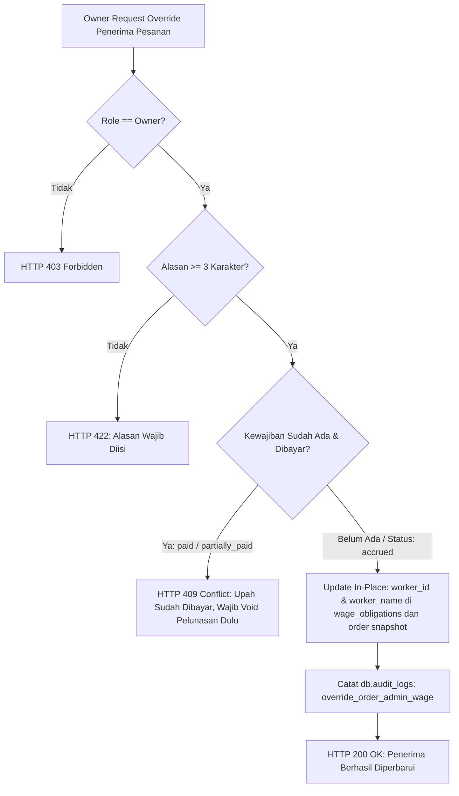
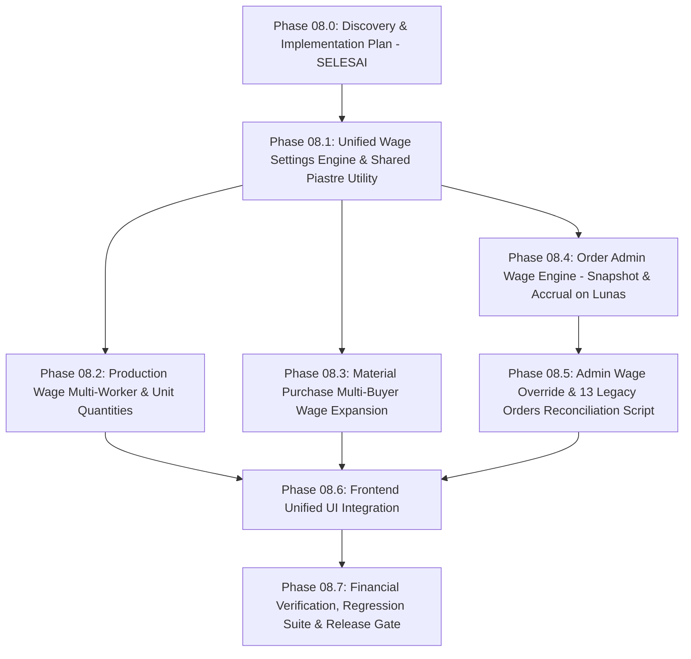

# SOGIL FURNITURE — PHASE 08.0: DISCOVERY & IMPLEMENTATION PLAN
## Wage System Expansion: Unified Configuration & Multi-Worker Recording Blueprint

**Project:** Sogil Furniture (`/Users/syahidmujahid/Sogil-Project/Sogil-Furniture`)
**Role:** Senior Software Architect, Senior Backend Engineer, Financial Systems Engineer, and QA Engineer
**Date:** 2026-10-28
**Audit Mode:** STRICTLY READ-ONLY (No Source Code / Database Mutation)
**Git HEAD Baseline:** `9bd1adab4e7a9a7303917ee573f9053bbfce123b` on `main`
**Status:** **DISCOVERY & ARCHITECTURAL PLANNING COMPLETED — PENDING OWNER APPROVAL**

---

## 1. Ringkasan Kondisi Aktual Repository

Pemeriksaan komprehensif terhadap repositori lokal menunjukkan kondisi yang sangat stabil, bersih, dan konsisten:
1. **Branch & Remote Synchronization:** Local `main` dan remote `origin/main` tersinkronisasi 100% pada commit hotfix `9bd1adab4e7a9a7303917ee573f9053bbfce123b`. Tidak ada perbedaan commit (*ahead* / *behind*: 0).
2. **Working Tree Cleanliness:** Seluruh file kode sumber (*tracked files*) berada dalam kondisi bersih tanpa modifikasi yang belum ter-commit. File untracked murni berupa dokumentasi operasional (`docs/operations/*.md`) dan dua file skrip/pengujian pemeliharaan.
3. **Integritas Rilis Sebelumnya:**
   - Perbaikan impor ikon `Clock` pada [`AdminLayout.jsx`](file:///Users/syahidmujahid/Sogil-Project/Sogil-Furniture/frontend/src/pages/admin/AdminLayout.jsx#L6) terverifikasi utuh di lokal dan terbukti aktif pada bundle live Cloudflare Pages `main.d76d0df9.js` (`icon:km`).
   - Rute kanonikal `/admin/pending-payments` dan alias retrokompatibel `/admin/wages/*` terdaftar aktif pada backend Railway (145 rute OpenAPI).
   - Pengujian regresi otomatis lokal lulus 100%: **114 frontend tests** (2.79s) dan **164 backend tests** (2.28s) tanpa ada kegagalan.

---

## 2. Baseline Git yang Benar-Benar Ditemukan

| Parameter Git | Nilai Aktual Terverifikasi | Status |
|---|---|---|
| **Active Branch** | `main` | Terkonfirmasi |
| **Local Commit HEAD** | `9bd1adab4e7a9a7303917ee573f9053bbfce123b` | Terkonfirmasi |
| **Origin HEAD SHA** | `9bd1adab4e7a9a7303917ee573f9053bbfce123b` | 100% Sinkron |
| **Commit Pesan Terakhir** | `fix(frontend): import missing Clock icon to prevent admin blank screen` | Terkonfirmasi |
| **Feature Commit Terdahulu** | `ecb0541970a2265b106257785da78f352f706efd` (`HEAD~1`) | Terkonfirmasi |
| **Status Tracked Files** | 0 modified, 0 staged | Bersih |

---

## 3. Matriks Fitur Saat Ini Versus Kebutuhan Target Phase 08

| Area Fungsional | Kondisi Kode Saat Ini (As-Is) | Target Phase 08 (To-Be) | Gap Analisis & Tindakan |
|---|---|---|---|
| **1. Halaman Pengaturan Upah** | Hanya ada halaman terisolasi "Upah Kirim" ([`AdminDeliveryWageSettings.jsx`](file:///Users/syahidmujahid/Sogil-Project/Sogil-Furniture/frontend/src/pages/admin/AdminDeliveryWageSettings.jsx)) untuk helper pengiriman. | Satu halaman pengaturan terpadu (Unified Wage Settings) dengan 4 section/tab mandiri: Produksi, Pengiriman, Belanja Bahan, dan Admin. | **GAP BESAR:** Perlu merancang konfigurasi policy mandiri di `db.settings` untuk 3 kategori baru tanpa merusak konfigurasi `delivery_wage_policy` yang sudah ada. |
| **2. Upah Produksi (Pekerja)** | Penugasan kerja ([`WorkAssignmentCreateInput`](file:///Users/syahidmujahid/Sogil-Project/Sogil-Furniture/backend/server.py#L880)) hanya mendukung 1 `worker_id` per input. | Mendukung 1 hingga 5 akun pekerja per input, mendukung skenario unit independen maupun pengerjaan bersama (*joint work*). | **GAP BESAR:** Perlu memperluas model input penugasan, memvalidasi kuantitas unit pesanan yang belum teralokasi, dan membagi upah menggunakan aritmatika piastre integer. |
| **3. Upah Belanja Bahan (Pembeli)** | Form pembelian bahan ([`MaterialPurchaseInput`](file:///Users/syahidmujahid/Sogil-Project/Sogil-Furniture/backend/server.py#L799)) hanya mendukung 1 `buyer_worker_id`. | Mendukung 1 hingga 5 akun pekerja pembeli. Nominal default per aktivitas dibagi rata ke pembeli terpilih. | **GAP MENENGAH:** Perlu memperluas form belanja bahan untuk multi-select (maks 5), membagi nominal via pembagian piastre, dan membuat multi-dokumen kewajiban upah. |
| **4. Upah Admin per Pesanan** | **BELUM ADA.** Upah admin dicatat manual lewat menu Keuangan tanpa akrual kewajiban otomatis. | Sistem otomatis: default rate & default penerima (Azka/Team), snapshot saat pesanan dibuat, akrual otomatis saat pesanan `lunas`. | **GAP BESAR (FITUR BARU):** Perlu policy baru, field snapshot pada `db.orders`, pemicu akrual pada event `payment_status == "lunas"`, dan endpoint override khusus Owner. |
| **5. Rekonsiliasi 13 Pesanan Lama** | Upah admin 13 pesanan lama sudah dibayar manual di Keuangan. | 13 pesanan lama ditandai sebagai `settled_legacy` agar sistem baru tidak membuat kewajiban dobel. | **GAP DATA HISTORIS:** Dibutuhkan skrip dry-run audit dan rekonsiliasi yang aman tanpa mutasi langsung pada fase ini. |
| **6. Pending Payment Interface** | Mendukung 4 kategori awal: Produksi, Pengiriman, Helper/Kustom, Belanja Bahan. | Menambahkan kategori ke-5: Upah Admin (`task_category: "admin"`). Tetap mempertahankan placeholder Utang Supplier (Fase 2). | **GAP KECIL:** Penambahan badge warna (Emerald), opsi filter, dan referensi nomor pesanan pada detail kewajiban upah admin. |

---

## 4. Arsitektur Data dan Alur Kewajiban/Pelunasan Saat Ini

Saat ini, sistem kewajiban upah Sogil Furniture telah memiliki fondasi kanonikal yang sangat kokoh:

```mermaid
graph TD
    subgraph 1. Sumber Pemicu Akrual (Sources)
        S1[Penugasan Kerja Produksi Selesai & Terverifikasi] -->|task_category: production/assembly/etc| WOB[db.wage_obligations]
        S2[Handover Trip Pengiriman Logistik] -->|task_category: delivery| WOB
        S3[Pencatatan Belanja Bahan Baku] -->|task_category: material_purchase| WOB
        S4[Pesanan Customer LUNAS - TARGET PHASE 08] -.->|task_category: admin| WOB
    end

    subgraph 2. Penyimpanan Kanonikal Liabilitas
        WOB -->|status: accrued / partially_paid| PP[Pending Payment Dashboard]
    end

    subgraph 3. Eksekusi Pelunasan Kas (Batch Settlement)
        PP -->|admin_create_wage_settlement| WS[db.wage_settlements]
        WS -->|Update in-place: status paid / partially_paid| WOB
        WS -->|Tepat 1 Transaksi Kas: category Pekerja| FT[db.finance_transactions]
    end
```

### Invarian Arsitektur yang Wajib Dipertahankan:
1. **Koleksi Tunggal `db.wage_obligations`:** Semua kewajiban upah dari kategori apa pun **wajib** dicatat ke dalam satu koleksi kanonikal ini. Tidak boleh membuat tabel/koleksi kewajiban baru.
2. **Isolasi Akrual vs Kas:** Akrual upah murni merupakan pengakuan utang usaha (*liability*) dan **tidak boleh memotong saldo kas riil** sebelum settlement dilakukan.
3. **Satu Transaksi Kas per Settlement (`category: "Pekerja"`):** Saat settlement upah dibayar (baik lunas maupun sebagian), transaksi kas pengeluaran dicatat tepat satu kali dengan kategori `Pekerja`.
4. **Isolasi Biaya Bahan Baku (`category: "Material"`):** Biaya pembelian bahan fisik tetap dicatat terpisah sebagai pengeluaran kas berkategori `Material`. Upah pembeli bahan dicatat sebagai liabilitas upah, dan saat dibayar dicatat sebagai `Pekerja`. **Nol duplikasi biaya**.
5. **Idempotensi & Optimistic Concurrency:** Dilindungi oleh indeks unik `uniq_wage_settlements_idempotency` dan klausa query update `paid_amount_le: prev_paid` yang melempar `HTTP 409 Conflict` jika saldo terutang dimodifikasi proses paralel.

---

## 5. Temuan Terkait Setiap Kategori Upah

### 5.1 Upah Produksi
- **Kondisi Kode:** Menggunakan model `db.work_assignments` dan aturan di `db.wage_rules`. Verifikasi penugasan memicu pembuatan dokumen `db.wage_obligations` dengan `accrual_event_key: f"acc_{aid_str}"`.
- **Keterbatasan Saat Ini:** `WorkAssignmentCreateInput` hanya menerima single `worker_id`. Validasi kuantitas hanya memeriksa `target_quantity <= item.quantity`, namun belum membatasi akumulasi unit penugasan aktif dari pekerja lain untuk item yang sama.

### 5.2 Upah Pengiriman
- **Kondisi Kode:** Kebijakan tersimpan di `db.settings` (`key: "delivery_wage_policy"`). Telah memiliki formula pembagian piastre integer yang sempurna di fungsi [`calculate_delivery_helper_wage_allocations()`](file:///Users/syahidmujahid/Sogil-Project/Sogil-Furniture/backend/server.py#L6070).
- **Separasi Vendor:** Biaya sewa armada Naql/pick-up dan supir vendor sudah diisolasi sebagai metadata `vehicle_rental` pada trip logistik dan terpisah dari alokasi upah helper.

### 5.3 Upah Belanja Bahan
- **Kondisi Kode:** Dibuat pada `_execute_create_purchase_tx()` di [`backend/server.py`](file:///Users/syahidmujahid/Sogil-Project/Sogil-Furniture/backend/server.py#L11818). Terhubung dengan `accrual_event_key: f"material_purchase:{pb_id}"`.
- **Keterbatasan Saat Ini:** Hanya mendukung single `buyer_worker_id`. Belum ada pengaturan default rate/threshold/hard-cap di `db.settings`.

### 5.4 Upah Admin
- **Kondisi Kode:** Belum ada konfigurasi atau modul penugasan upah admin. Selama ini dicatat manual di Finance.
- **Karakteristik Unik:** Kewajiban upah admin terbentuk saat pesanan **LUNAS** (`payment_status == "lunas"`), bukan saat pekerjaan fisik selesai.

---

## 6. Desain Target Pengaturan Upah Terpadu (Unified Wage Settings)

Halaman pengaturan upah akan dikembangkan dari [`AdminDeliveryWageSettings.jsx`](file:///Users/syahidmujahid/Sogil-Project/Sogil-Furniture/frontend/src/pages/admin/AdminDeliveryWageSettings.jsx) menjadi **Unified Wage Settings** yang menyimpan konfigurasi terisolasi di `db.settings`:

```
db.settings (MongoDB):
├── "delivery_wage_policy"          -> Kebijakan Upah Pengiriman / Helper (Existing)
├── "production_wage_policy"        -> Kebijakan Upah Produksi (New)
├── "material_purchase_wage_policy" -> Kebijakan Upah Belanja Bahan (New)
└── "admin_wage_policy"             -> Kebijakan Upah Admin per Pesanan (New)
```

### 6.1 Skema Data Masing-Masing Kebijakan

#### A. `production_wage_policy`:
```json
{
  "default_wage_per_unit_le": 100.0,
  "unusual_amount_threshold_le": 250.0,
  "max_wage_per_unit_le": 1000.0,
  "currency": "EGP",
  "updated_at": "ISO8601",
  "updated_by_id": "admin_id",
  "updated_by_name": "Owner Name"
}
```
*Validasi:* `0 <= default_wage_per_unit_le <= unusual_amount_threshold_le < max_wage_per_unit_le`.

#### B. `material_purchase_wage_policy`:
```json
{
  "default_wage_per_purchase_le": 50.0,
  "unusual_amount_threshold_le": 150.0,
  "max_wage_per_purchase_le": 500.0,
  "max_buyers_allowed": 5,
  "currency": "EGP",
  "updated_at": "ISO8601",
  "updated_by_id": "admin_id",
  "updated_by_name": "Owner Name"
}
```
*Validasi:* `0 <= default_wage_per_purchase_le <= unusual_amount_threshold_le < max_wage_per_purchase_le`.

#### C. `admin_wage_policy`:
```json
{
  "default_wage_per_order_le": 30.0,
  "default_recipient_id": "admin_azka_id",
  "default_recipient_name": "Azka",
  "unusual_amount_threshold_le": 100.0,
  "max_wage_per_order_le": 300.0,
  "currency": "EGP",
  "updated_at": "ISO8601",
  "updated_by_id": "admin_id",
  "updated_by_name": "Owner Name"
}
```
*Validasi:* `0 <= default_wage_per_order_le <= unusual_amount_threshold_le < max_wage_per_order_le` dan `default_recipient_id` harus akun aktif di `db.admins`.

### 6.2 Otorisasi & Audit Trail
- Hanya **Owner** (`role === "owner"`) yang berwenang mengubah kebijakan upah pada keempat kategori.
- Setiap perubahan memicu pencatatan ke `db.audit_logs` dengan menyimpan snapshot nilai lama, nilai baru, field yang berubah, dan identitas pengubah.

---

## 7. Desain Alokasi Maksimal Lima Pekerja Produksi

### 7.1 Algoritma Validasi Kuantitas Unit Pesanan
Untuk setiap `order_item_id` pada pesanan:
1. Ambil kuantitas total yang dipesan: `total_item_qty = order_item.quantity`.
2. Hitung total unit yang sedang aktif atau sudah selesai:
   ```python
   active_assignments = await db.work_assignments.find({
       "order_item_id": order_item_id,
       "status": {"$in": ["assigned", "in_progress", "ready_for_review", "accruing", "completed"]}
   }).to_list(1000)
   allocated_qty = sum(a.get("target_quantity", 0) for a in active_assignments)
   remaining_unallocated_qty = total_item_qty - allocated_qty
   ```
3. Input baru dengan kuantitas `new_qty` **wajib memenuhi:** `new_qty <= remaining_unallocated_qty`. Jika melanggar, tolak dengan `HTTP 422 Unprocessable Entity` ("Kuantitas melebihi sisa unit yang tersedia").

### 7.2 Dukungan Empat Skenario Bisnis
- **Skenario A (Unit Berbeda Dikerjakan Orang Berbeda):**
  - Item 2 unit. Pekerja A dialokasikan 1 unit, Pekerja B dialokasikan 1 unit.
  - Menghasilkan 2 dokumen penugasan independen: Penugasan A (1 unit) dan Penugasan B (1 unit).
  - Alokasi aktif = 1 + 1 = 2 unit (100% teralokasi, input unit ke-3 akan ditolak).
- **Skenario B (Dua Unit Dikerjakan Bersama oleh A dan B):**
  - Item 2 unit dikerjakan bersama oleh A dan B.
  - Input menerima array `worker_ids: [A, B]` (1 sampai 5 pekerja).
  - `Total Upah = default_rate_per_unit * 2 unit`.
  - Nominal total dibagi rata menggunakan algoritma pembagian piastre integer (misal: 150 LE dibagi 2 = 75.00 LE per orang).
  - Menghasilkan dokumen penugasan bersama dengan alokasi target 2 unit, dan saat diverifikasi menghasilkan 2 dokumen kewajiban upah di `db.wage_obligations` (1 untuk A, 1 untuk B).
- **Skenario C (Sebagian Unit Sudah Dikerjakan):**
  - Item 3 unit. 2 unit sudah ditugaskan. Sisa alokasi = 1 unit.
  - Form hanya mengizinkan input maksimal 1 unit.
- **Skenario D (Pembatalan Penugasan):**
  - Jika penugasan dibatalkan secara sah (`status: "cancelled"`), kuantitas penugasan tersebut tidak lagi dihitung dalam `allocated_qty`, sehingga unit kembali tersedia ke pool alokasi pesanan.

---

## 8. Desain Pembagian Upah Pembelian Bahan (Maksimal 5 Akun)

### 8.1 Shared Integer Piastre Allocation Utility
Fungsi pembagian upah dari logistik digeneralisasi menjadi utility kanonikal:
```python
def distribute_wage_piastres(total_amount_le: float, recipients: list) -> list:
    """
    Membagi total_amount_le secara merata ke daftar recipients menggunakan satuan piastre (0.01 EGP).
    Invarian: sum(allocations) == total_amount_le (Nol selisih/kebocoran uang).
    Sisa piastre modulo dibagikan secara deterministik ke penerima urutan awal.
    """
    n = len(recipients)
    if n == 0:
        return []
    d_wage = Decimal(str(total_amount_le)).quantize(Decimal("0.01"), rounding=ROUND_HALF_UP)
    total_piastres = int(d_wage * 100)
    quotient = total_piastres // n
    remainder = total_piastres % n

    results = []
    for i, r in enumerate(recipients):
        p = quotient + 1 if i < remainder else quotient
        results.append({
            "worker_id": r["worker_id"],
            "worker_name": r["worker_name"],
            "amount_piastres": p,
            "amount_le": float(Decimal(p) / Decimal(100))
        })
    return results
```

### 8.2 Alur Pencatatan Belanja Bahan
1. Form input bahan menerima `buyer_worker_ids: List[str]` (1 hingga 5 pekerja).
2. Input upah adalah **nominal total per aktivitas belanja** (bukan per orang).
3. Backend memanggil `distribute_wage_piastres(buyer_wage_amount, buyers)`.
4. Disimpan dalam `db.material_purchases` sebagai array `buyer_wages`.
5. Untuk setiap pembeli, dibuatkan 1 dokumen kewajiban di `db.wage_obligations`:
   - `accrual_event_key: f"material_purchase:{pb_id_str}_{buyer_worker_id}"`
   - `task_category: "material_purchase"`
   - `total_amount_le: allocated_amount_le`
6. **Proteksi Void Bahan:** Jika ada **salah satu** kewajiban upah pembeli yang sudah berstatus `paid` atau `partially_paid`, pembatalan pembelian bahan **DITOLAK KERAS (HTTP 409 Conflict)**.

---

## 9. Desain Snapshot & Akrual Upah Admin per Pesanan

### 9.1 Mengapa Snapshot Wajib Dibuat Saat Pesanan Masuk (Order Creation)?
Audit siklus hidup pesanan membuktikan:
- Jika snapshot diambil saat pesanan *lunas*, pesanan yang dibuat minggu lalu saat Azka menjadi default akan otomatis berpindah ke penerima baru jika Owner mengubah default kemarin. Hal ini melanggar aturan bisnis!
- **Keputusan Desain:** Snapshot kebijakan upah admin disimpan langsung pada dokumen pesanan di `db.orders` pada saat `create_order` (`POST /orders`):
  ```json
  "admin_wage_snapshot": {
    "rate_le": 30.0,
    "recipient_id": "admin_azka_id",
    "recipient_name": "Azka",
    "policy_version": "2026-10-28T00:00:00Z",
    "is_overridden": false,
    "override_reason": null,
    "overridden_by_id": null
  }
  ```

### 9.2 Pemicu Pembentukan Kewajiban (`payment_status == "lunas"`)
Kewajiban upah admin **hanya dibentuk** ketika pesanan mencapai status lunas:
1. Dipicu di dalam fungsi `compute_order_payment_summary()` atau saat payment settlement sukses.
2. Cek idempotensi: `accrual_event_key = f"admin_wage:{order_id}"`.
3. Cek flag rekonsiliasi legacy: Jika pesanan memiliki `admin_wage_legacy_reconciled: True`, sistem **TIDAK** membuat kewajiban baru.
4. Buat dokumen kanonikal di `db.wage_obligations`:
   - `task_category: "admin"`
   - `source_type: "order"`
   - `order_id: str(order["_id"])`
   - `order_number: order.get("order_number")`
   - `worker_id: snapshot.recipient_id`
   - `worker_name: snapshot.recipient_name`
   - `total_amount_le: snapshot.rate_le`
   - `status: "accrued"`
   - `paid_amount_le: 0.0`

---

## 10. Desain Override Penerima Upah Admin & Proteksi Anti-Fraud

Owner dapat mengubah penerima upah admin untuk pesanan spesifik melalui endpoint `PUT /admin/orders/{id}/admin-wage`:



### Aturan Perlindungan Anti-Fraud:
1. **Pembaruan In-Place:** Mengubah penerima pada kewajiban yang masih `accrued` memperbarui dokumen yang ada secara in-place. **Tidak membuat dokumen kewajiban baru** guna mencegah tagihan ganda.
2. **Kunci Pelunasan:** Jika kewajiban upah admin sudah lunas (`status: "paid"`) atau dicairkan sebagian (`paid_amount_le > 0`), pergantian penerima dilarang keras. Pelunasan harus dibatalkan resmi (*void*) terlebih dahulu melalui flow Keuangan.
3. **Audit Trail Penuh:** Menyimpan data penerima lama, penerima baru, alasan override, ID Owner, dan timestamp ke dalam `db.audit_logs`.

---

## 11. Rencana Rekonsiliasi 13 Pesanan Lama

### 11.1 Fakta & Temuan Audit
- Terdapat 13 pesanan historis yang telah berstatus lunas di mana upah adminnya telah dibayarkan secara manual kepada Azka melalui menu Keuangan.
- Karena workstation audit berada dalam mode read-only dan tidak menjalankan mutasi langsung ke produksi, rekonsiliasi data historis dirancang sebagai prosedur terisolasi dengan persetujuan eksplisit Owner.

### 11.2 Prosedur Rekonsiliasi (Safe Dry-Run Plan)
1. **Skrip Audit Dry-Run:** Dibuatkan skrip verifikasi `scripts/reconcile_legacy_admin_wages.py --dry-run` untuk:
   - Mencari pesanan lunas historis (13 pesanan) yang dibuat sebelum tanggal rilis Phase 08.
   - Mencocokkan transaksi pengeluaran di `db.finance_transactions` berkategori `Pekerja` dengan deskripsi pembayaran upah admin Azka.
   - Menghasilkan laporan pencocokan (Order Number <-> Finance Transaction ID).
2. **Penandaan Flag Aman (Migrasi Data):**
   Setelah Owner meninjau hasil dry-run, skrip dijalankan dengan mode `--apply` untuk menyematkan metadata pada ke-13 pesanan tersebut:
   ```json
   {
     "admin_wage_legacy_reconciled": true,
     "admin_wage_reconciled_at": "ISO8601",
     "admin_wage_recipient_name": "Azka",
     "legacy_finance_transaction_id": "txn_id_terkait"
   }
   ```
3. **Jaminan Proteksi:** Logika akrual otomatis di backend akan selalu memeriksa `admin_wage_legacy_reconciled`. Jika bernilai `True`, sistem mengabaikan pesanan tersebut sehingga **mustahil terjadi duplikasi biaya ataupun tagihan upah ganda di Pending Payment**.

---

## 12. Rencana Backward Compatibility dan Migrasi

1. **Kompatibilitas Rute API:**
   - Endpoint lama `/admin/delivery-wage-policy` tetap dipertahankan sebagai alias ke section delivery pada unified settings.
   - Endpoint `POST /admin/orders/{id}/assignments` tetap menerima format payload lama (`worker_id: str`) dan otomatis membungkusnya sebagai single-worker array di backend.
   - Endpoint `POST /admin/materials/purchases` tetap menerima single `buyer_worker_id: str` untuk retrokompatibilitas penuh.
2. **Kompatibilitas Frontend URL:**
   - Navigasi lama `/admin/delivery-wage-settings` dialihkan secara mulus (*redirect 301 / React Navigate*) ke halaman terpadu `/admin/wage-settings`.
3. **Fallback Pesanan Tanpa Snapshot:**
   - Pesanan lama yang belum lunas dan belum memiliki `admin_wage_snapshot` saat nanti dibayar lunas akan mengambil konfigurasi default yang aktif saat itu (Azka).

---

## 13. Rencana Pengujian Komprehensif

```
Test Architecture Plan:
├── 1. Unit Tests (Aritmatika Pembagian & Validasi Kebijakan)
│   ├── test_distribute_wage_piastres_exact_sum()
│   ├── test_distribute_wage_piastres_modulo_distribution()
│   └── test_wage_policy_hierarchy_validation()
├── 2. Integration Tests (Alokasi Pekerja Produksi & Unit Bounds)
│   ├── test_production_multi_worker_unit_limit_scenario_a()
│   ├── test_production_joint_workers_equal_split_scenario_b()
│   ├── test_production_partial_allocation_rejection_scenario_c()
│   └── test_production_cancellation_releases_units_scenario_d()
├── 3. Integration Tests (Upah Belanja Bahan 1-5 Pembeli)
│   ├── test_material_purchase_multi_buyer_split()
│   └── test_material_purchase_void_rejected_when_any_buyer_paid()
├── 4. Integration Tests (Upah Admin & Siklus Hidup Pesanan)
│   ├── test_admin_wage_snapshot_taken_at_order_creation()
│   ├── test_admin_wage_accrual_triggered_only_on_lunas()
│   ├── test_admin_wage_accrual_idempotency_on_retry()
│   ├── test_admin_wage_owner_override_unpaid_success()
│   ├── test_admin_wage_owner_override_paid_rejected_409()
│   └── test_legacy_13_orders_reconciled_no_duplicate_accrual()
└── 5. Frontend Component Tests
    ├── UnifiedWageSettings.test.js (4 tab/section & live simulator)
    ├── AdminOrderDetailMultiWorker.test.js (multi-worker input & unit validation)
    ├── AdminMaterialsMultiBuyer.test.js (multi-buyer select & piastre preview)
    └── AdminWorkerPendingWages.test.js (badge "Upah Admin" & filter)
```

---

## 14. Daftar Risiko Keuangan dan Keamanan

| No | Risiko | Tingkat Keparahan | Strategi Mitigasi Arsitektur |
|---|---|:---:|---|
| 1 | **Duplikasi Upah Admin pada 13 Pesanan Lama** | **CRITICAL** | Proteksi via flag `admin_wage_legacy_reconciled: True` yang dievaluasi sebelum akrual dijalankan. |
| 2 | **Selisih Pembagian Sen/Piastre pada Multi-Worker** | **HIGH** | Menggunakan aritmatika integer piastre (`distribute_wage_piastres`) dengan penegakan asersi: `sum(allocations) == total`. |
| 3 | **Alokasi Unit Produksi Melebihi Pesanan Riil** | **HIGH** | Query agregasi dinamis terhadap unit aktif pada item pesanan sebelum insert penugasan baru. |
| 4 | **Penggantian Penerima Upah yang Sudah Dibayar** | **HIGH** | Pengecekan status kewajiban: Tolak dengan `HTTP 409 Conflict` jika kewajiban berstatus `paid` atau `paid_amount_le > 0`. |
| 5 | **Pembatalan Belanja Bahan Mengorbankan Hak Upah Pekerja** | **HIGH** | Tolak pembatalan belanja bahan (`HTTP 409`) jika upah pembeli sudah dicairkan sebagian atau lunas. |
| 6 | **Pencampuran Biaya Armada / Vendor dengan Upah Helper** | **MEDIUM** | Biaya sewa armada tetap diisolasi pada metadata `vehicle_rental` (biaya operasional trip), terpisah dari upah helper. |

---

## 15. Daftar File yang Diperkirakan Perlu Diubah pada Fase Implementasi

### Backend:
1. [`backend/server.py`](file:///Users/syahidmujahid/Sogil-Project/Sogil-Furniture/backend/server.py) (Model policy 4 kategori, endpoint unified wage settings, perluasan multi-worker pada penugasan, alokasi multi-buyer pada belanja bahan, engine snapshot dan akrual upah admin, override recipient).
2. [`backend/tests/test_material_purchase_wages.py`](file:///Users/syahidmujahid/Sogil-Project/Sogil-Furniture/backend/tests/test_material_purchase_wages.py) (Suite pengujian multi-buyer belanja bahan).
3. `backend/tests/test_admin_wage_engine.py` (File test baru untuk upah admin, snapshot, akrual lunas, dan override).
4. `backend/tests/test_production_multi_worker_wages.py` (File test baru untuk penugasan multi-worker dan validasi unit).
5. `backend/tests/test_unified_wage_settings.py` (File test baru untuk endpoint konfigurasi 4 kategori upah).
6. `scripts/reconcile_legacy_admin_wages.py` (Skrip rekonsiliasi terisolasi untuk 13 pesanan lama).

### Frontend:
1. [`frontend/src/App.js`](file:///Users/syahidmujahid/Sogil-Project/Sogil-Furniture/frontend/src/App.js) (Rute `/admin/wage-settings` dan redirect dari `/admin/delivery-wage-settings`).
2. [`frontend/src/pages/admin/AdminLayout.jsx`](file:///Users/syahidmujahid/Sogil-Project/Sogil-Furniture/frontend/src/pages/admin/AdminLayout.jsx) (Update link sidebar menjadi "Pengaturan Upah").
3. [`frontend/src/pages/admin/AdminDeliveryWageSettings.jsx`](file:///Users/syahidmujahid/Sogil-Project/Sogil-Furniture/frontend/src/pages/admin/AdminDeliveryWageSettings.jsx) (Berevolusi menjadi `AdminWageSettings.jsx` dengan 4 section tab).
4. [`frontend/src/pages/admin/AdminOrderDetail.jsx`](file:///Users/syahidmujahid/Sogil-Project/Sogil-Furniture/frontend/src/pages/admin/AdminOrderDetail.jsx) (Modal penugasan multi-worker dan batas kuantitas unit tersisa).
5. [`frontend/src/pages/admin/AdminMaterials.jsx`](file:///Users/syahidmujahid/Sogil-Project/Sogil-Furniture/frontend/src/pages/admin/AdminMaterials.jsx) (Form pembelian bahan dengan multi-select pembeli maks 5 dan preview alokasi).
6. [`frontend/src/pages/admin/AdminWorkerPendingWages.jsx`](file:///Users/syahidmujahid/Sogil-Project/Sogil-Furniture/frontend/src/pages/admin/AdminWorkerPendingWages.jsx) (Badge warna Upah Admin dan filter kategori admin).
7. File-file pengujian frontend terkait di `frontend/src/__tests__/`.

---

## 16. Urutan Subphase Implementasi yang Disarankan & Dependensi



### Penjelasan Subphase:
- **Phase 08.1 — Core Settings & Shared Utility:** Membangun `distribute_wage_piastres` dan API konfigurasi 4 kebijakan di `db.settings`. Ini merupakan pondasi yang wajib selesai pertama kali.
- **Phase 08.2 — Upah Produksi Multi-Worker:** Mengimplementasikan alokasi 1-5 pekerja produksi dan validasi batas kuantitas unit (Skenario A, B, C, D).
- **Phase 08.3 — Upah Belanja Bahan Multi-Buyer:** Memperluas pembelian bahan untuk 1-5 pembeli dan proteksi atomik void.
- **Phase 08.4 — Upah Admin per Pesanan:** Snapshot kebijakan saat pesanan dibuat dan pembentukan kewajiban otomatis saat pesanan lunas.
- **Phase 08.5 — Override Upah Admin & Rekonsiliasi 13 Pesanan:** Endpoint override khusus Owner dan skrip rekonsiliasi data historis (dry-run).
- **Phase 08.6 — Integrasi UI Terpadu:** Pengaturan Upah 4 section, Order Detail multi-worker, Material Purchase multi-buyer, dan Pending Payment badges.
- **Phase 08.7 — Audit Finansial & Final Release Gate:** Pengujian integrasi penuh, pengujian non-regresi, verifikasi build, dan gerbang rilis produksi.

---

## 17. Kriteria Penerimaan yang Dapat Diuji Secara Objektif (Acceptance Criteria)

1. **Pengaturan Upah Terpadu:**
   - Owner dapat melihat dan memperbarui kebijakan pada 4 kategori upah secara independen.
   - Non-owner ditolak dengan `HTTP 403 Forbidden`.
   - Setiap update mencatat audit log dengan perbandingan nilai lama dan baru.
2. **Upah Produksi Multi-Worker:**
   - Satu item pesanan dengan kuantitas 2 dapat ditugaskan ke pekerja A (1 unit) dan pekerja B (1 unit) secara sah (Skenario A).
   - Dua unit dapat ditugaskan bersama ke pekerja A dan B, di mana total upah terbagi rata dengan selisih piastre 0 (Skenario B).
   - Penugasan unit yang melebihi kuantitas item ditolak dengan pesan error yang jelas (Skenario C).
   - Pembatalan penugasan mengembalikan kuantitas unit ke pool alokasi (Skenario D).
3. **Upah Belanja Bahan Multi-Buyer:**
   - Pembelian bahan dapat memilih 1 sampai 5 pembeli.
   - Nominal upah total terbagi habis dengan asersi `sum(allocations) == total_amount`.
   - Pembatalan pembelian bahan ditolak jika ada pembeli yang upahnya sudah dibayar sebagian/lunas.
4. **Upah Admin per Pesanan:**
   - Pesanan baru merekam snapshot penerima (Azka) dan nominal upah saat pesanan dibuat.
   - Perubahan default penerima di halaman pengaturan tidak mengubah snapshot pesanan lama.
   - Kewajiban upah admin terbentuk secara otomatis saat pembayaran pesanan mencapai status `lunas`.
   - Re-submit pembayaran atau retry API tidak membuat kewajiban dobel (`accrual_event_key` unik).
   - Owner dapat meng-override penerima pesanan belum lunas disertai alasan valid.
   - Ke-13 pesanan lama yang sudah lunas tidak menghasilkan kewajiban upah baru (biaya tidak tercatat ganda).
5. **Pending Payment Dashboard:**
   - Menampilkan kewajiban dari kelima kategori upah dengan badge warna dan filter yang tepat.
   - Pelunasan batch mencatat pengeluaran kas tunggal berkategori `Pekerja`.
   - Tab Utang Supplier tetap berada pada status placeholder Fase 2.

---

## 18. Hal-Hal yang Memerlukan Keputusan Owner

Sebelum melangkah ke Phase 08.1, terdapat 4 poin keputusan bisnis yang memerlukan arahan Owner:
1. **Nominal Default Awal untuk Masing-Masing Kategori:**
   - *Upah Produksi:* Berapa nominal default dasar per unit produk (misal: 100 LE)? Berapa threshold konfirmasi (misal: 250 LE) dan hard cap maksimum (misal: 1000 LE)?
   - *Upah Belanja Bahan:* Berapa nominal default per aktivitas belanja (misal: 50 LE)? Berapa threshold konfirmasi (misal: 150 LE) dan hard cap (misal: 500 LE)?
   - *Upah Admin:* Berapa nominal default per pesanan lunas (misal: 30 LE)? Siapa akun Team penerima default awal (Azka)?
2. **Daftar Nomor Pesanan 13 Pesanan Historis:**
   - Apakah Owner dapat menyediakan atau mengonfirmasi daftar 13 nomor pesanan (SGF-xxx) yang upah adminnya sudah dibayarkan manual, atau mengizinkan sistem menjalankan skrip identifikasi kandidat berdasarkan tanggal dan catatan transaksi Finance?
3. **Kebijakan Pembagian Upah Produksi Kustom/Borongan:**
   - Apakah pembagian upah pada penugasan bersama selalu dibagi rata (*equal split*), atau apakah di masa mendatang diperlukan persentase kontribusi khusus per pekerja? (Rekomendasi teknis: Mulai dengan *equal split* berbasis piastre konsisten dengan logistik).
4. **Struktur URL & Sidebar:**
   - Apakah disetujui mengubah label menu sidebar dari "Upah Kirim" menjadi "Pengaturan Upah" dengan URL kanonikal `/admin/wage-settings`?

---

## 19. Rekomendasi Langkah Selanjutnya

> ### **REKOMENDASI: PLAN COMPLETED — AWAITING OWNER DECISIONS & APPROVAL**
> Seluruh blueprint arsitektur, rancangan skema database, penanganan invarian keuangan, dan peta subphase telah selesai disusun secara detail tanpa memutasi kode atau database produksi.
>
> Tahap implementasi (**Phase 08.1**) dapat segera dimulai begitu Owner menyetujui dokumen perencanaan ini dan memberikan konfirmasi terkait 4 poin keputusan di atas.
